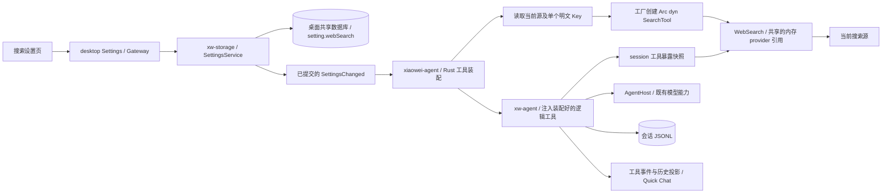

# 02i：WebFetch、WebSearch 与搜索设置

前置：第 5 批 TodoWrite 已交付。关联 [record](../../records/active/2026-09-28-agent-chat.md) 与[总实施顺序](00-implementation-order.md#工具接入批次)。

2026-10-27 用户要求两个工具一起实现，随后要求先出计划，并明确 Web 工具应放入独立 crate、可灵活装配；搜索配置／Token 跟 desktop settings 走；装配层按当前搜索源创建具体实现并返回 dyn SearchTool 对象，构造时只传该源的明文 Key，请求时不读取设置或解密。本文件为待审阅方案，本轮只更新计划，不实施代码。保留文件名，避免破坏已有引用。

本片作为第 6 批整体验收：模型能搜索资料、读取指定网页、获得工具结果并继续回答；搜索源设置可保存并即时生效；工具历史与重启恢复正确。验收后再进入后台工具批次。

## 范围与迁移依据

旧版源码位于 `/Users/changtang/Develop/XiaoWei/workspace/src/xiaowei-next`，本次已核对以下实现；编码时按这些行为逐项迁移：

- `crates/xw-agent-runtime/src/tools/web/fetch.rs`、`mod.rs`：网页请求、内容分类、HTML 转换与提取。
- `crates/xw-agent-tools/src/web_search.rs`、`backends/{mod,bing_html,tavily,brave,serper}.rs`：搜索声明、四个 provider、结果与错误映射。
- `xiaowei/studio/src/infra/web_search/service.rs`、`biz/web_search_settings/{mod,commands}.rs`：搜索源切换、缺 Key 回退与存储。
- `crates/xw-tauri/src/crypto.rs`、`xiaowei/src/components/chat/parts/tools/{WebFetch,WebSearch}.tsx`：Key 混淆及工具展示。

交付独立 `crates/xw-agent-tools-web/`，包含两个可分别装配的真实工具、四个搜索源、设置页接线及结果 UI。该新包已由用户明确要求，实施时直接按此边界创建；不重复询问建包授权。Wikipedia、后台工具、Skill、preset、压缩、大历史分页和单轮调用上限设置继续按各自事项推进。本批不导入旧设置数据库，不新增独立搜索 service 或持久化文件。

### WebFetch

| 项目 | 本批行为 |
| --- | --- |
| 输入 | 必填 `url`、`prompt`；URL 最多 2000 UTF-8 字节，仅 http/https，拒绝内嵌凭据；保留旧 host 含点规则，不新增 IP 白名单等规则 |
| 请求 | HTTP 自动升级 HTTPS；User-Agent 为 `XiaoWei/WebFetch`，Accept 为 `text/markdown, text/html, */*`；请求超时 60 秒，响应体最多 10 MiB |
| 重定向 | 最多 10 次；仅同 scheme、有效端口一致、去掉 `www.` 后 host 相同且无凭据时自动跟随。其他跳转返回目标 URL，提示模型显式再次调用 |
| 内容 | HTML 用旧版 `htmd 0.5` 转 Markdown；其他 `text/*`、JSON、XML、JS、YAML、表单文本直接作为提取输入。缺 Content-Type 或不支持的二进制返回说明，不调用模型；4xx/5xx 的可读正文保留旧处理方式 |
| 提取 | 所有支持的文本均经过辅助模型；最多传入 100000 个 Unicode 字符，并保留截断标记及原始字节数。使用当前 small_text 配置，温度 0.3、输出上限 2048 token、关闭 reasoning、超时 60 秒，同时遵守模型能力 |
| 结果 | 提取文本作为工具输出；保留 `webfetch` 中的 url、final_url、status、content_type、bytes、duration_ms、truncated、redirected、binary 元数据 |

旧版固定模型 `deepseek/v4-flash` 改为现有 `AgentHost.get_auxiliary_model_ref()`；未配置或不可用时返回明确工具错误。10 MiB 限制改为读取响应流时执行，避免先完整分配超限响应。其他技术方案沿用旧版，差异写入交付证据。

### WebSearch

输入为非空、trim 后的 `query` 及可选 `max_results`；默认 10，限制为 1–20。返回按序编号的 title、url、snippet，并保留 `webSearch: { query, provider, results }` 元数据；零结果为成功。搜索结果直接回传，不调用辅助模型。

| 搜索源 | 请求与解析 |
| --- | --- |
| Bing | 默认且免 Key；GET `https://www.bing.com/search?q=…`，保留浏览器 UA、HTML／语言头、20 秒超时和最多 5 次跳转。按旧版解析 `li.b_algo`、标题与摘要，解开 `ck/a` 的 `a1` URL-safe Base64 及 `url` 参数，保留实体解码和结果顺序 |
| Tavily | POST `https://api.tavily.com/search`，body 含 api_key、query、basic、max_results，关闭 answer／raw_content；映射 title、url、content |
| Brave | GET `https://api.search.brave.com/res/v1/web/search`，q／count，`X-Subscription-Token`；映射 `web.results` 的 title、url、description，清理高亮与实体 |
| Serper | POST `https://google.serper.dev/search`，`X-API-KEY`，body 为 q／num；映射 organic 的 title、link、snippet |

保留 provider 的旧超时、取消及错误分类：401/403 为 Key 无效，Brave 422 同类，429 为额度／频率限制。显示安全错误分类及状态码，不透传可能带凭据的上游正文。所选源缺 Key 时，由 desktop 装配流程选择 Bing 实例；具体搜索实例执行时不切换 provider，请求失败不自动换源或重试。提示词沿用聚焦查询、技术问题优先英文关键词、逐次改进、已知 URL 用 WebFetch、每任务通常 2–3 次搜索的规则，次数是指导，不新增强制额度。

## 责任与接口



- `xw-agent-tools-web` 提供对象安全的 SearchTool trait、BingSearch／TavilySearch／BraveSearch／SerperSearch，以及固定 AgentTool 入口 WebSearch。具体 provider 实例只持有自己的客户端和明文 Key；WebSearch 持有当前 provider 的共享 Arc。WebFetch 独立。该 crate 不选择 desktop 当前源，不读取设置／存储或还原 Key，只依赖 runtime 公开接口与领域类型。
- `xw-storage::SettingsService` 是 desktop 搜索配置的持久 owner，负责 Key 保存／还原、校验、脱敏快照和已提交变更通知；沿用 Settings.Get／Update／SettingsChanged。它不驱动 Agent 的工具创建或替换。
- `xiaowei-agent` 持有配置订阅与装配生命周期：取得当前源及其单个明文 Key，通过工厂得到 `Arc<dyn SearchTool>`，组装 WebSearch 后将逻辑工具对象交给 core。配置变化由本模块监听并重新创建 provider 实例；没有对外配置 Apply 接口。
- core 拥有通用工具集、session 暴露绑定、分派、辅助生成记录及恢复；不导入 Web crate，不按 Web 工具名写分支，不存储搜索设置／Token。runtime 提供通用 AgentTool／ToolContext，不包含工具配置存储接口。
- renderer 设置页使用 `services.getSettings()`；展示组件只接收数据和回调。AgentHost 仍只提供模型能力。main 只调整依赖接入顺序，不代管 Rust 的配置读取、订阅和工具装配。

### 工具暴露与 provider 实例的生命周期

2026-10-27 用户明确：工具集按 ID 更新，暴露集合的变化只影响后续 session；此限制仅在当前进程内，重启后可按当前配置重新装配。随后补充：搜索 provider 的变化只更新内存对象，对 session 透明。因此区分两种变化：

| 变化 | 生效范围与动作 |
| --- | --- |
| 逻辑工具声明／规则或集合变化 | 按稳定注册 ID 更新默认工具集；之后创建的 session 获取新快照，当前进程内已有 session 保留自己的暴露快照 |
| 当前搜索 provider 或其 Key 变化 | xiaowei-agent 创建新的 `Arc<dyn SearchTool>`，更新共享 WebSearch 对象内部的 provider 引用；已有和新 session 的后续搜索都使用新 provider，工具暴露／上下文不变 |
| 应用重启后恢复历史 session | 按当前配置重新装配工具；保留已提交历史，声明有差异时仍走现有系统上下文增量和 provider 能力校验，不保留旧凭据版本 |

现有 `execution.rs` 在每次 StartRun 调用 `tool_registry::synchronize`，后者重新计算声明；直接改服务默认集合会使旧 session 收到增量，违背进程内暴露快照规则。实施时必须让声明、规则和执行绑定共同来自 session 快照，不能只冻结 UI 展示或只冻结 schema。

- `AgentTool` 提供声明、具名规则、恢复策略及异步 execute；ToolContext 提供当前取消与受 core 提交保障的 extract_text。辅助生成写入失败由 core 冻结／失败结算，不能降为可继续的普通工具错误。
- core 的 `set_tools(Vec<ToolRegistration>)` 和 `update_tool(id, tool)` 只更新默认工具集。注册 ID 是稳定字符串，例如 `web.fetch`、`web.search`，与每次调用的领域 ToolId／provider_call_id 分开；同 ID 的更新替换默认槽位，重复模型工具名校验失败不改变原集合。
- CreateSession 在幂等已有会话检查之后捕获完整暴露快照，后续所有 Run 用该快照；创建后尚未首次发送也不会受到默认集合更新影响。同一创建请求重试仍返回原会话和原绑定。恢复历史会话时按当前进程的默认集合建立运行绑定。
- session 快照保存逻辑工具的 Arc、声明和规则。WebSearch 是多个 session 可共享的逻辑工具对象，其 provider 引用可在内存更新，因此 provider 切换不会改变工具名、参数、规则或 session 绑定，也不追加 SystemContext delta。
- `SearchTool` 只定义统一异步搜索接口（boxed future）、请求／结果及源标识。工厂位于 xiaowei-agent，返回 `Result<Arc<dyn SearchTool>, ToolAssemblyError>`；唯一选源 match 在装配层。构造器为 BingSearch::new()、TavilySearch::new(api_key)、BraveSearch::new(api_key)、SerperSearch::new(api_key)，没有多源 Key 配置结构。
- 装配为 `WebSearch::new(search: Arc<dyn SearchTool>)` 后再交给 core。配置更新调用本地 Rust 的 `WebSearch::set_provider(new_search)`；不经过 Settings 或 Agent 的 Apply RPC。每次搜索只克隆当前 provider Arc，再调用具体实现，锁不跨网络 await；在途调用完成于旧对象，之后调用取得新对象。
- 外部逻辑工具支持空集合、仅 Fetch、仅 Search、两者都有，独立于 cwd；声明、规则与执行器来自同一注册项。恢复依注册项的 CancelPending 策略处理未结算 Web 调用；未知工具保持原保护，不自动执行。

### desktop 搜索设置与装配

唯一持久 owner 为 desktop settings：复用共享数据库 meta 的 `setting.webSearch` 保存 provider 和各源 Key。Agent 的 sessions.sqlite、JSONL 和 Web crate 不保存配置，不新增工具设置 store。默认源为 bing，统一 ID 为 bing／tavily／brave／serper；旧 bing_html 仅作迁移核对。

Key 沿旧版 XOR xwwx + 标准 Base64 混淆存盘，由 Settings 层读取时还原；这是可逆混淆。装配方只取得当前有效源的单个明文 Key，再调用该 provider 的构造器。其他源 Key 留在 desktop Settings，工具请求不读取设置、不解密。公开 Settings.Get／Update 响应与 SettingsChanged 只含 selected_provider、effective_provider、configured_providers，Key 不进入模型上下文、工具参数、聊天记录或日志。

| 入口 | owner 与语义 |
| --- | --- |
| Settings.Get / SettingsSnapshot.web_search | SettingsService 的脱敏配置 |
| Settings.Update / web_search_provider | 保存选择；无 Key 的选择保留，但 effective_provider 为 Bing |
| Settings.Update / web_search_api_key | write-only 的 provider + 明文 api_key，空字符串删除；删除当前源 Key 在同次 setting.webSearch 更新内切回 Bing |
| Settings.GetWebSearchRuntimeConfig | SettingsService 提供原生装配读取，只返回当前有效 provider 及其单个明文 Key；可指定测试源，缺 Key 时严格报错，不回退 |
| Settings.TestWebSearchProvider | xiaowei-agent 为指定源读取单个 Key，用同一工厂构造临时 trait 对象并测试；不替换当前对象，不保存设置或历史 |

首次装配：Storage／Settings 先接入，Agent 的异步 activate 先订阅既有 SettingsChanged，再读取当前源，构造 provider 与 WebSearch 并交给 core，成功后才 ready／启动维护。可参考 xw-clipboard::start_services 的订阅先于初读模式。初读期间的新通知必须继续串行刷新，不能由旧初读覆盖新值；失败关闭订阅及 endpoint。未装 Search 时不读取搜索配置。

设置变化：SettingsService 校验、保存成功后发布既有脱敏 SettingsChanged；保存失败不发布，当前 provider 无需回滚。xiaowei-agent 的 Rust 订阅收到通知后串行读取当前源及 Key，与已装配值相同时保留实例，变化时创建新 provider 并调用本地 set_provider。读取由设置变化驱动，不放进搜索请求路径；Key 被替换而 configured 列表不变的通知也必须处理。复用完整 SettingsChanged，不新增容易随事件合并丢失的变化标志或凭据广播。

Settings.Update 成功表示配置已保存；运行实例由通知后刷新。刷新失败保持已装配对象并记录安全的阶段／源错误，不虚报已生效，也不回滚已保存配置；后续成功刷新更新对象。关闭／取消先停止订阅和装配任务，再释放服务／endpoint，避免迟到通知更新已关闭对象。

搜索执行只使用已装配对象：WebSearch 从共享槽位克隆 dyn SearchTool 的 Arc，具体实现直接使用构造时收到的 Key 请求。provider 切换不会写入会话系统增量，旧 ToolOutcome 中记录的实际 provider 保持原值。

### 辅助生成、提交与恢复

1. core 先提交 ToolIntent，再调用已注册执行器。WebFetch 在独立 crate 内请求网页，跨域跳转或二进制说明可直接形成结果；可提取文本调用 `ToolContext.extract_text`，由 core 解析当前辅助模型并构造独立 RunContext。
2. 提交 `GenStarted(purpose=ToolExtraction { tool_id })`；run_id 与 ToolIntent 相同，turn_id=null，独立 gen_id／message_id。runtime 的 `RunRequest.turn_id` 调整为可选，普通对话继续传 Some，不伪造辅助 Turn。
3. 复用 `execute_text` 收集模型流，同时持续消费有界事件 channel，避免堵塞。记录真实开始、首 SSE（若 provider 提供）和结束、原始回复元数据及 usage；先提交辅助 Message／GenEnded，再提交 ToolOutcome。辅助增量不发布为聊天正文或当前 Conversation Generate。
4. 投影及上下文按 GenPurpose 隔离：辅助 Assistant 不进入聊天 Item、final_gen_id、Conversation 尝试次数或下一轮模型历史；辅助输入不参与聊天 context_tokens 测量。usage 以 gen_id 为唯一身份保留一次，不复制进 ToolResult 再累计。
5. 抓取、转换或提取失败返回 Failed 工具结果，普通模型可继续说明；Stop 取消网络与辅助生成，先结束活动辅助 Gen，再结算 Cancelled 工具，并停止本 Run。持久化失败沿既有冻结／恢复路径处理，不吞写错误或继续下一次生成。
6. 重启时先结束尚未结束的辅助 Gen，再按已装配工具的 `CancelPending` 策略取消未结算调用。即使已有辅助 Message／GenEnded，也只保留已提交事实并返回中断说明，不补造抓取元数据、不重新抓取／生成；已完成 ToolOutcome 原样恢复。未装配时按上述未知结果边界处理。覆盖这些提交前缀与迟到事件，保证恢复后的 journal 合法。

日志复用现有工具 start／settled；增加实际 provider、回退原因、结果数／字节数、HTTP 状态及抓取／提取阶段耗时。错误保留安全分类，不记录 Key、原始 query／prompt、页面正文或完整含参数 URL。

## 文件与改动

以下为计划修改清单；每行多路径时，各文件的变化分别说明。生成文件只由 `just gen` 更新。

### 独立工具 crate、通用接口与 core

```text
crates/xw-agent-tools-web/                  # 新增独立 crate
├── Cargo.toml
├── README.md
└── src/
    ├── lib.rs
    ├── fetch.rs
    ├── tests.rs
    └── search/
        ├── mod.rs
        ├── bing.rs
        ├── tavily.rs
        ├── brave.rs
        └── serper.rs
crates/xw-agent-runtime/src/tools/
└── extension.rs                            # 新增通用工具接口
crates/xw-agent/src/                        # 新增通用能力
├── tool_execution.rs
└── tool_execution_tests.rs
crates/xw-storage/src/settings/
└── web_search.rs                           # 新增 desktop 搜索设置
crates/xiaowei-agent/src/
└── tools.rs                                # 新增工厂／装配／设置订阅与生命周期
```

| 类型 | 文件 | 具体改动 |
| --- | --- | --- |
| 新增 | `crates/xw-agent-tools-web/Cargo.toml` | 依赖 runtime／types、reqwest 0.12（JSON／stream／Rustls native roots）、htmd 0.5、base64 0.22（Bing URL 解包）、regex 及所需 serde／Tokio；TLS fixture 依赖仅用于测试 |
| 新增 | `crates/xw-agent-tools-web/README.md` | 用途、SearchTool 抽象与具体实现、四种装配组合、按源明文 Key 构造、提取能力与测试入口 |
| 新增 | `crates/xw-agent-tools-web/src/lib.rs` | 导出 WebFetch、固定 AgentTool 入口 WebSearch、SearchTool 抽象及四个 provider 实现，不自动注册 |
| 新增 | `…/src/fetch.rs` | WebFetch 的声明／规则、URL 校验、跳转、体积限制、内容分类、htmd 转换，通过 ToolContext 提取 |
| 新增 | `…/src/search/mod.rs` | 对象安全的 SearchTool、请求／结果与 future；固定 WebSearch 的声明／规则、provider Arc 槽位、本地 set_provider、参数校验和结果格式，无选源 match |
| 新增 | `…/src/search/bing.rs` | BingSearch 的构造与 SearchTool 实现、HTML 解析及 URL 解包，无 Key |
| 新增 | `…/src/search/tavily.rs` | TavilySearch 的构造与 SearchTool 实现，只持有 Tavily 明文 Key，完成请求／响应与错误映射 |
| 新增 | `…/src/search/brave.rs` | BraveSearch 的构造与 SearchTool 实现，只持有 Brave 明文 Key，完成请求／响应、清理与错误映射 |
| 新增 | `…/src/search/serper.rs` | SerperSearch 的构造与 SearchTool 实现，只持有 Serper 明文 Key，完成请求／响应与错误映射 |
| 新增 | `…/src/tests.rs` | 本地 TLS／HTTP fixture、四源具体实例请求映射、trait 对象调用、各源独立 Key、提取回调、取消／错误测试 |
| 新增 | `crates/xw-agent-runtime/src/tools/extension.rs` | AgentTool／ToolContext、取消／安全错误与恢复策略；不包含工具配置存储接口 |
| 修改 | `crates/xw-agent-runtime/src/tools/mod.rs` | 导出通用扩展接口，不导出 Web 工具模块 |
| 修改 | `crates/xw-agent-runtime/src/text.rs`、`tests/text.rs` | 允许单次生成无 Turn，验证计时、取消和背压，保持普通生成行为 |
| 新增 | `crates/xw-agent/src/tool_execution.rs` | 调用外部执行器，提供有提交保障的 extract_text：模型选择／RunContext／Gen 生命周期／安全错误 |
| 新增 | `crates/xw-agent/src/tool_execution_tests.rs` | 用 fixture 工具验证辅助归属、计时、usage、隔离、失败、Stop 与写入失败 |
| 修改 | `crates/xw-agent/src/lib.rs` | 注册通用执行模块，导出外部工具装配所需公开类型 |
| 修改 | `crates/xw-agent/src/service.rs`、`index.rs` | 维护默认注册集合并按 ID 更新；CreateSession 捕获暴露／执行快照，恢复按当前配置绑定，不存搜索设置 |
| 修改 | `crates/xw-agent/src/session.rs` | 保存本进程的完整逻辑工具 Arc／声明／规则快照；历史恢复重新绑定当前集合，不持久化实例或凭据 |
| 修改 | `crates/xw-agent/src/execution.rs` | 将工具与 ToolContext 接到执行路径，普通 RunRequest 显式带 Some(turn_id) |
| 修改 | `crates/xw-agent/src/tool_registry.rs`、`prompts/mod.rs` | 注册 ID／重名校验，默认工具集更新与 session 暴露快照；synchronize 只读取该 session 的绑定，不读取最新默认集合 |
| 修改 | `crates/xw-agent/src/run_loop.rs` | 在原顺序循环查找注册项并结算，不增加 Web 工具名分支 |
| 修改 | `crates/xw-agent/src/persistence.rs` | 辅助记录提交与按 purpose 过滤恢复投影／最终回复 |
| 修改 | `crates/xw-agent/src/recovery.rs` | 辅助 Gen 先结束，已注册工具按策略取消，未知工具保持原保护；公开恢复入口保留默认行为 |
| 新增 | `crates/xw-agent/tests/tool_assembly.rs` | 验证四种装配、稳定 ID 更新、已有 session 暴露不变／新 session 用新集合、创建幂等／首次 Run、无 cwd 与未知工具行为 |
| 修改 | `crates/xw-agent/tests/tool_loop.rs`、`prompts.rs`、`context_sync.rs` | 验证 session 绑定与系统暴露基线、默认工具更新不追加旧 session 增量、重启恢复按当前集合；不依赖具体 Web crate |
| 修改 | `crates/xw-agent/tests/generations.rs`、`recovery.rs` | 辅助 Gen 隔离，已装配／未装配及中断前缀恢复 |
| 新增 | `crates/xw-storage/src/settings/web_search.rs` | desktop 搜索配置、Key 存储转换、脱敏快照／单源运行配置、provider／Key 校验和保存 |
| 修改 | `crates/xw-storage/src/settings/mod.rs`、`gateway.rs` | 将搜索设置接入 Get／Update／SettingsChanged，保存单份 setting.webSearch，提交后发布通知，提供 RuntimeConfig 读取 |
| 修改 | `crates/xw-storage/src/tests/settings.rs` | 默认／校验／保留其他源 Key／脱敏／重开／保存失败不发布／替换 Key 仍发布通知 |
| 修改 | `crates/xw-storage/Cargo.toml` | 增加旧 Key 混淆所需 base64 0.22；不依赖 Web crate |
| 修改 | `crates/xiaowei-agent/Cargo.toml` | 增加 xw-agent-tools-web 与 proto-desktop-rs path 依赖；core/runtime 不依赖 Web crate |
| 新增 | `crates/xiaowei-agent/src/tools.rs` | create_search_tool 返回当前源 Arc<dyn SearchTool>；组装稳定 WebSearch 后注入 core，订阅 SettingsChanged 重建 provider，负责串行刷新／测试／取消／关闭 |
| 修改 | `crates/xiaowei-agent/src/lib.rs` | 异步 activate 准备工具后标记 ready，与清理／维护保持同一生命周期；持有工具装配生命周期和共享 WebSearch，关闭时先停止配置订阅，不保存设置 |
| 修改 | `crates/xiaowei-agent/src/gateway.rs` | 仅新增归本模块负责的 Settings.Test 路由，配置 Get／Update 由 xw-storage 持有，不注册 Apply |
| 修改 | `crates/xiaowei-agent/napi/src/gateway.rs` | endpoint activate 等待 Rust Agent 的初始化，失败沿现有清理退出；不新增业务 napi 方法 |
| 修改 | `Cargo.lock` | 由 Cargo 添加新包及依赖，core/runtime 不引入网页依赖 |

根 Cargo.toml 的 crates/xw-* 已覆盖新包，用 cargo metadata 验证成员与依赖方向。context.rs 已按 Conversation purpose 重建上下文，以回归测试守住。现有 GenPurpose、GenFirstSseReceived 和元数据字段足够，不修改 JSONL schema 或领域类型；Agent 的 catalog 不新增搜索配置键。

### 契约、正式链路与 UI

| 类型 | 文件 | 具体改动 |
| --- | --- | --- |
| 修改 | `contracts/proto/xiaowei/desktop/settings.proto` | 扩展脱敏快照、Update 的 provider／write-only Key 分支；RuntimeConfig 仅返回单源明文 Key，读取可指定测试源；Test 严格缺 Key，不新增 Apply 配置方法 |
| 修改 | `gateway/rust/business_binding_config.rs` | xiaowei-agent 增加 Settings service 依赖；xw-storage／xw-clipboard 已有该 service，不修改生成机制 |
| 生成 | `contracts/out/proto-desktop-rs/src/gen/xiaowei.desktop.settings.rs`、`descriptor.bin` | just gen 更新消息与 descriptor；proto-agent-rs 与 agent.proto 无搜索配置改动 |
| 生成 | `contracts/out/proto-desktop-ts/src/gen/xiaowei/desktop/settings_pb.ts` | 同步 Settings descriptor 与 typed client 方法 |
| 生成 | `crates/{xiaowei-agent,xw-storage,xw-clipboard}/src/gateway_binding.rs` | 同步各模块已声明的 Settings Method 常量 |
| 修改 | `desktop/src/main/app/gateway.ts` | Storage／Settings 先接入，再打开／激活 Agent；只调整生命周期依赖顺序，不读取或传递 Key，不新增 TS settings owner |
| 修改 | `desktop/tests/main/lifecycle.test.ts` | 验证设置先就绪、Agent 初始化失败清理与反向关闭顺序 |
| 新增 | `desktop/tests/rust-napi/agent-settings.test.ts` | 实际双 addons 验证设置保存／通知、当前 provider 内存替换、已有 session 透明、无系统增量、刷新失败、重启与脱敏 |
| 修改 | `crates/xiaowei-agent/napi/test/tool-loop.test.cjs` | 正式 worker 验证搜索→抓取→提取→继续、provider 内存更新、旧 session 后续搜索透明切源且无暴露增量、Stop／重启 |
| 修改 | `crates/xiaowei-agent/napi/test/runtime.test.cjs`、`sessions.test.cjs` | 启动 fixture 提供默认 desktop 搜索配置，补初始化依赖失败；原会话行为保持 |
| 新增 | `crates/xiaowei-agent/napi/test/fixtures/settings.cjs` | 正式 Agent 测试的 Settings RuntimeConfig fixture 与读取计数，不使用用户配置 |
| 新增 | `crates/xiaowei-agent/napi/test/fixtures/web.cjs` | 本地 HTTPS／CONNECT fixture，测试子进程专用代理／CA，不改系统信任或应用配置 |
| 新增 | `crates/xiaowei-agent/napi/test/fixtures/web/{ca.pem,server.pem,server-key.pem}` | 仅测试用 CA／证书／私钥，不使用用户凭据 |
| 新增 | `desktop/src/renderer/src/components/settings/AgentSettingsPage.tsx` | 用 services.getSettings() 读取／订阅／更新脱敏 web_search、保存 Key 与测试；处理忙碌／安全错误 |
| 修改 | `…/settings/AgentSettings.tsx` | 受控搜索源／Key 编辑 UI，保存失败可见；maxCalls 可选，生产不显示未接线控件 |
| 修改 | `…/settings/SettingsPage.tsx` | 启用 agent tab 并装配 AgentSettingsPage，沿用同一 Settings owner |
| 修改 | `…/settings/SettingsPreview.tsx` | 预览维护 Key 保存后的 values，保留已有 maxCalls 演示 |
| 新增 | `…/settings/AgentSettingsPage.test.tsx` | Settings 读写／订阅接线、替换 Key、失败反馈、删除当前 Key 回退与脱敏展示 |
| 修改 | `…/settings/Agent.test.tsx`、`SettingsPage.test.tsx` | Key 弹窗行为、生产页入口及不显示未接线调用上限 |
| 新增 | `desktop/src/renderer/src/components/agent-chat/AgentWebResult.tsx` | WebFetch URL／指令／结果与复制，WebSearch 标题链接／域名／摘要；无结果、失败或旧 metadata 回退文本 |
| 新增 | `…/agent-chat/AgentWebResult.test.tsx` | 结果顺序、链接／复制回调、空结果／非法 metadata 与 URL scheme 边界 |
| 修改 | `…/agent-chat/tool-presentation.ts`、`AgentToolIcon.tsx` | 两工具的图标、动词、URL／query 目标与分组标签 |
| 修改 | `…/agent-chat/AgentToolCall.tsx` | 按工具类型渲染 WebResult，保留参数／状态／失败展示 |
| 修改 | `…/agent-chat/AgentToolGroup.tsx`、`AgentMessage.tsx` | 传递现有 onCopy／onOpenUrl 回调，保持顺序，不在展示组件读取 service |
| 修改 | `…/agent-chat/AgentMessage.test.tsx`、`AgentToolGroup.test.tsx`、`AgentTodoList.test.tsx` | 回调接线、混合工具顺序、失败／Stop／最终回复及 Todo 回归 |
| 修改 | `desktop/src/renderer/src/components/quick-chat/quick-chat.css` | 网页工具内容、链接与摘要样式，沿用现有主题／折叠 |

链接只允许 http/https，沿既有 System 打开 URL 和复制回调；不新增 IPC 或 service getter。跨 addon 复用 SettingsChanged 与 RuntimeConfig typed 调用，由 xiaowei-agent 自主装配，不在工具请求路径读取配置。

### 文档与跟踪

| 类型 | 文件 | 具体改动 |
| --- | --- | --- |
| 修改（本轮） | 本 Plan、`00-implementation-order.md`、`02-runtime-tools.md`、`02h-bash-sandbox.md`、`04d-final-acceptance.md` | 第 6 批统一为两个工具及搜索设置，后续依赖顺序不变 |
| 修改（本轮） | `.agent/records/active/2026-09-28-agent-chat.md` | 记录用户扩大本批范围及先审计划，旧里程碑保留 |
| 修改（实现时） | `crates/README.md`、`crates/xw-agent-runtime/README.md`、`crates/xw-agent/README.md`、`crates/xiaowei-agent/README.md` | 分别更新独立工具 crate 索引、通用工具接口、注入／辅助生成职责，以及 desktop 明文配置装配边界 |
| 修改（实现时） | `crates/xw-storage/docs/database.md` | 补充私有 Key／脱敏快照／运行配置与提交后通知边界，不驱动工具重建 |
| 修改（实现时） | `desktop/docs/quick-chat.md` | 补充已接入网页工具、链接／复制与状态展示 |
| 修改（实现时） | record 的 `architecture.md`、`runtime-ui.md`、`control-api.md`、`implementation-results.md` | 分别记录独立工具装配边界、展示行为、配置所有权／接口边界、迁移差异和验收证据；不重复 proto 字段表 |

根 `docs/`、根 README 不在本批修改范围。完成后回填 record 的 Current work／Outcome，再删除本 Plan 并更新后继引用。

## 实施顺序与验证门槛

| 顺序 | 工作 | 通过标准 |
| --- | --- | --- |
| 1 | 通用工具接口与独立 Web crate，工厂返回所选源的 dyn SearchTool | 四种装配及依赖方向正确；URL／内容转换／四源协议／取消通过；工具无需存储接口或解密 |
| 2 | desktop Settings 存储、当前源实例创建／替换与契约，执行 just gen | Settings 保存后通知，集成层创建新 provider 并更新共享对象；旧 session 后续搜索用新源且暴露不变，重开／脱敏通过 |
| 3 | core 通用分派与辅助 Gen、投影／恢复 | core 不按 Web 名分支；结果能回传后继续，身份／首 SSE／usage／隔离／Stop／写入失败／恢复前缀通过 |
| 4 | 设置页与工具展示接线 | 实际 typed client 的装配、保存／删除／测试反馈、链接／复制和有序工具展示通过 renderer 测试 |
| 5 | 正式 addon／worker 与完整检查 | 通过正式 Agent／Settings API 验证工具与配置交付，生成无漂移，受影响原生 addon 重建成功 |
| 6 | 当前工作区产品窗口及真实模型验收 | 实际搜索→读取→回答、设置生效、停止和重启不重放有证据；补齐差异与文档后才结束本批 |

自动验证拆为确定性与真实服务两层，不用真实密钥或公网波动作为测试通过条件：

- Web crate 使用本地 HTTPS fixture（如 `https://127.0.0.1:<port>`），并独立验证 HTTP 升级；测试专用 CA／客户端不放宽生产 scheme、host 或证书规则。覆盖同源／www／跨域／端口／凭据跳转及循环、分块体积超限、HTML／文本／二进制／错误正文、超时与取消。
- 四源使用固定请求／响应 fixture，核对 URL／header／body、Bing 跳转解包和实体、结果数、零结果、401／403／422／429、错误 JSON、断流及取消。API Key 仅为 fixture 值。
- core 以确定性模型流覆盖辅助配置缺失、空提取、失败／Stop、首次 SSE 未提供／重复、usage 原样保留且不双计；逐个提交前缀恢复，特别是辅助 Message 后／GenEnded 前、GenEnded 后／ToolOutcome 前及 ToolOutcome 已提交后。
- 原生正式链路由测试子进程使用本地 CONNECT 代理及专用 CA（reqwest native roots 的标准信任入口），把固定 provider 域名导向 fixture；验证真实网络／Gateway／LLM worker 边界，不给生产增加 endpoint 开关。不修改系统 CA、用户代理或真实搜索设置。
- 配置验收：Settings 保存成功后通知，失败不通知；替换当前 Key 但 configured 列表不变也能刷新。工厂只创建选中源具体实例并返回 dyn 对象。初读／通知竞态、串行刷新、读取或构造失败、关闭后迟到通知均覆盖；普通搜索不读取 Settings／解密。
- provider 透明性：同一个已有 session 中从源 A 搜索，修改设置后再搜索使用 B；模型可见的 WebSearch 声明、规则、系统记录数量不变，旧结果仍标注 A。在途 A 请求正常完成，后续请求使用 B；Key 不进入日志或历史。
- 暴露隔离：session A 在默认集合 v1 下创建；按相同注册 ID 更新声明／规则／执行器后，A 后续 Run 仍用 v1，session B 用 v2；覆盖尚未首次发送和幂等创建。此规则适用于当前进程；重启恢复允许按当前配置重新装配，并继续遵守已有增量／provider 能力校验。
- 独立装配：空集合、仅 Fetch、仅 Search、两者都有；未装 Search 不读搜索运行配置。cargo tree 验证 core/runtime 无 Web crate／HTTP 依赖，历史已完成结果独立恢复，未知未完成调用不重发。
- 检查：独立 Web crate、runtime、core、xw-storage 与集成入口的受影响 `cargo test` 与严格 Clippy；`just gen`、`pnpm contracts:test`、`pnpm contracts:check`、`pnpm gateway:check`、`just check`、`pnpm --dir desktop test`；按 `crates/README.md` 构建受影响的 `xiaowei-agent` 与 `xiaowei-rust` 两个 napi 包。Gateway 核心未改，不额外扩大为通信层改造。
- 产品：先按 manage-dev-instances 确认当前工作区活实例，再允许重启；不冷启动。用默认 Bing 与当前配置的 small_text 验证完整真实模型链路，检查明暗主题、展开／复制／打开链接、搜索／抓取／提取各阶段 Stop、设置持久化与重启不重放。付费源有现成凭据时补真实请求，无凭据时明确记录仅完成确定性协议验证；不虚报其联网验收。

未启动实例、未配置辅助模型或缺外部源凭据时，说明具体待验行为与完成条件；必要产品验收未完成前保留本 Plan，不把编译／fixture 成功当作整批交付。
