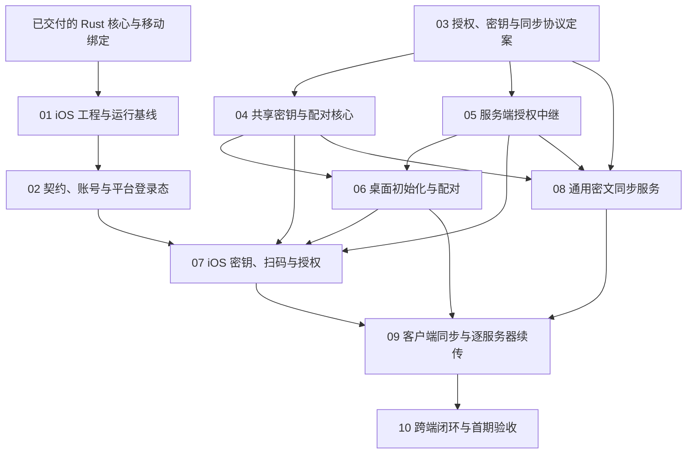

# iOS 客户端：实施顺序与任务拆分

关联 [iOS 客户端与设备授权](../../records/active/2026-10-25-ios-client.md)。本文件只索引尚未完成的工作、依赖和验收；已交付行为与证据保留在 record 及包内文档。编号属于完整 iOS 事项，不沿用前置 Rust 迁移的编号。

## 当前基线

共享 xw-api 网络与 account 会话核心、桌面接入、xiaowei-mobile 功能模块和 Swift／Kotlin 绑定已完成。现有入口和资源语义见[移动模块](../../../crates/xiaowei-mobile/README.md)与[绑定说明](../../../crates/xiaowei-mobile/ffi/README.md)，本轮直接复用。

当前没有 iOS App 工程。两个 iOS 目标只完成库交叉编译、Swift SDK 编译及链接；Swift／Kotlin 运行测试发生在 macOS 命令行程序中。模拟器 App 运行与 iPhone 真机运行均未验收。

## 剩余任务

| 切片 | 交付与代码位置 | 前置 | 完成验收 |
| --- | --- | --- | --- |
| [01 iOS 工程与运行基线](01-ios-app-baseline.md) | 新增根 `ios/` SwiftUI 工程；在既有 FFI 下补 iOS 打包入口，接入同次生成的绑定与 Rust 原生库 | 已完成的移动模块；先明确系统／工具链与开发签名基线 | 实际 App 在模拟器和真机分别安装、启动并完成隔离 HTTP／WS、取消及资源清理；库构建不能代替运行证据 |
| 02 Swift 契约、账号与平台登录态 | 扩展 `contracts/scripts/` 的 Swift 生成与漂移检查，产物放 `contracts/out/proto-server-swift/`；`ios/` 增加账号层、Keychain 和登录／连接 UI | 01；先确定移动端服务器入口、Keychain 中会话凭据的访问条件及 SwiftProtobuf 版本 | 从 App 完成密码登录、重启恢复、刷新检查点保存、退出和失效；保存失败、取消后收取新凭据、断网保留凭据及前后台恢复均有验证 |
| 03 授权、密钥与通用同步协议定案 | 在 record 下承载协议设计，明确消息、状态、信任来源、同步库归属和存储职责；据此确定后续 Rust 模块与业务 proto 布局 | 已确认的首期目标；可与 01／02 的工程工作独立对齐 | 用户确认关键产品／安全选择；成熟协议与库有明确依据；字段、状态转换、失败路径及跨端测试向量足以指导实现 |
| 04 共享密钥与配对核心 | 在 03 确定的 `xw-*` 业务模块实现密钥包、认证绑定、加解密及配对状态；由 xiaowei-mobile 与桌面组合入口接入，FFI 只适配公开对象 | 03；新增 crate 或依赖按仓库规则确认 | 固定测试向量、跨端互解、篡改／错误身份／错库／错版本／重放拒绝；私钥、配对秘密和内容密钥不进入日志或服务器 |
| 05 服务端设备授权与密钥包中继 | 在 `contracts/proto/xiaowei/server/` 定义业务契约；扩展 `server/internal/httpapi/`、业务模块和 `server/internal/db/` 迁移，复用现有账号与会话 | 03；与 04 按同一协议协作 | 真实 PostgreSQL／HTTP／WS 验证申请、批准、拒绝、取消、过期、单次领取及并发领取；身份／公钥替换与跨账号访问被拒绝；服务端只处理密钥包密文 |
| 06 桌面初始化与配对接入 | 扩展 `crates/xiaowei-rust/napi/`、desktop main 的宿主存储／编排与 renderer 授权入口；复用既有 Gateway | 04、05；初始化发起端与桌面密钥保管策略已在 03 确定 | 通过实际桌面入口完成首台初始化、手机入库所需配对及新电脑申请；取消、切服和迟到响应不修改新上下文；已有账号行为保持 |
| 07 iOS 密钥保管、扫码与授权 | 扩展 xiaowei-mobile 组合能力；`ios/` 接入系统相机、独立密钥 Keychain 记录及授权 UI，不在 Swift 重写共享协议 | 02、04、05；完整链路依赖 06；密钥访问／备份／恢复／退出策略先定案 | 真机相机权限与取消通过；手机从首台电脑取得密钥，并在旧电脑不参与时授权另一台电脑；锁定、重启与前台恢复遵守已确认策略 |
| 08 通用密文同步服务 | 按 03 的通用协议扩展服务器契约、`server/internal/httpapi/` 与数据库，处理密文、游标、幂等和删除记录；不引入收藏字段 | 03、05 的授权边界；使用 04 的密文测试向量 | 隔离真实服务验证访问权限、重复提交、分页／续拉、删除及事务失败；数据库与接口不依赖明文业务内容 |
| 09 客户端通用同步与逐服务器续传 | 在 03 确定的共享 Rust 模块实现同步推进；桌面与 iOS 分别接入本地事务、待上传队列及游标，保持平台持久化所有权 | 06、07、08；两个宿主按同一协议接入 | 无业务含义的数据跨端加解密；A→B→A 按规范化服务器地址与 user_id 隔离进度；断线、重启、重复消息和切服取消不丢进度、不跨上下文提交 |
| 10 跨端闭环与首期验收 | 从 iOS／桌面产品入口完成验收矩阵；结果回填主 record、包内说明及相关切片结果 | 01–09 的对应功能完成 | 真机完成“首台客户端→手机→新电脑”授权和密文互通，原电脑不参与第二次授权；失败矩阵及平台恢复通过，剩余边界明确后再提议归档 |

02–10 是待实施任务，尚未创建对应包、业务 proto 或完整实施 Plan。其文件清单在各片开工前按已确认协议与实际代码展开，避免为未确定的方案预建模块。10 汇总跨端验收；各片自己的必要验收在交付该片时完成，不集中拖到最后。

## 依赖顺序

建议从 01 开始；03 的方案讨论可以提前进行，不等待 App 全部完成。配对或同步实现开始前必须完成 03 的对应决策。收藏业务后于本索引中的通用同步机制，不在这里扩成完整剪贴板项目。

## 决策归属与开工条件

| 决策 | 最迟在哪片之前确定 | 约束 |
| --- | --- | --- |
| 最低 iOS、Swift／Xcode、Bundle ID、开发签名与验收设备 | 01 创建工程前 | 当前库测试 iOS 15.0 不是 App 产品决定；签名配置按本机设置，不提交私钥或 provisioning 数据 |
| 移动端服务器入口、会话 Keychain 访问条件 | 02 | 首期不强制多服务器 UI；隔离测试地址不自动成为产品入口；会话凭据与同步密钥分开管理 |
| 初始化端、手机入库的扫码方向、认证握手和可信密码库 | 04、05、06 实现前，在 03 对齐 | 不以扫码、设备名称或登录成功直接授予内容密钥；不自行拼装未经验证的密钥交换协议 |
| 设备／内容密钥层级、锁定／备份／换机／遗失／退出／撤销 | 04 及对应宿主存储实现前，在 03 对齐 | 恢复码、生物识别和密钥轮换不是已确认必选功能；不承诺撤回设备已经获得的明文密钥 |
| 同步库在不同服务器的归属、是否转发或合并、异服配对路径 | 08／09 前，在 03 对齐 | 已确认的只有逐服务器续传，不据此推定 A 端数据自动上传 B；协议必须有目标隔离 |
| 通用同步的游标、幂等、删除及事务语义 | 08／09 前，在 03 对齐 | 协议与业务内容无关；普通剪贴板历史留在本机，收藏模型另行接入 |

## 验收证据与实施约束

- 分开记录 Rust／macOS 宿主测试、iOS 库编译链接、模拟器 App 运行、真机 App 运行四层证据。记录源码版本／改动基线、Xcode／SDK、目标设备与系统、实际命令和结果；只收集安全状态，不保存凭据或密钥。
- 自动网络失败测试优先复用现有隔离 HTTP／Go WS fixture；真机通过明确的可达地址连接 fixture，不把 Mac 的 localhost 当作手机 localhost，不为测试关闭生产 TLS 校验。
- 手机进入后台时取消并结算当前工作，回前台重新恢复；授权和同步的正确性不依赖后台长连接。持久化检查点先保存再继续，取消后也要收取已经轮换的凭据。
- 契约仍以 proto 为唯一来源。修改契约、typed service、Gateway 或依赖前，读取对应仓库技能和模块规则；Swift 契约加入现有生成／漂移入口，不维护另一套手写协议。
- 新包、根 docs、桌面实例冷启动和生产部署分别遵守仓库授权边界；本任务拆分不授予 App Store 发布或生产部署权限。不重启其他工作区的服务，不为验收操作真实账号退出。
- 只有即将执行且前置已清楚的切片展开详细 Plan；完成后立即回填持久决策和验证证据、删除该 Plan，并更新本索引。整体范围完成后删除索引与空目录，再按 record 流程提议归档。
