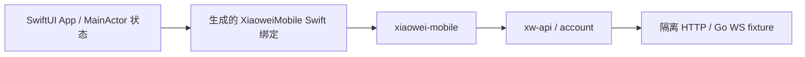

# 01：iOS 工程与运行基线

关联 [主 record](../../records/active/2026-10-25-ios-client.md)及[任务索引](00-implementation-order.md)。当前处于准备阶段：本轮只建立计划，尚未创建 App、安装或运行模拟器／真机程序。

## 范围与完成标准

在根 `ios/` 建立 Swift + SwiftUI 原生 App，直接接入现有 xiaowei-mobile 及其 UniFFI 绑定。先用最小界面和独立测试入口验证原生库加载、HTTP／WS、状态订阅、取消、暂停及关闭，在模拟器与真机分别取得运行证据。

本片不实现产品登录态持久化、完整登录界面、Swift 业务消息包、相机、内容密钥、配对或同步。测试所需账号消息复用 Rust fixture 生成的合成 PB；产品业务消息的 Swift 类型化消费留到 02，不手写消息或 codec。

## 实施前输入

1. 确定 App 最低 iOS、Bundle ID 和开发签名基线。现有库脚本的 iOS 15.0 仅为测试配置，不擅自设为产品最低版本；当前机器可用 Xcode 26.3／Swift 6.2.4，实际选定版本写入包内开发说明。
2. 确定模拟器型号／系统与可用真机。没有连接、信任或签名条件时仍可完成无签名构建与可执行的模拟器验证，但真机验收继续待办，不把构建结果记为运行通过。需要真实 Apple 开发身份或设备信息时再读取用户登记资料。
3. 工程目录拟采用 `ios/`，App 与测试使用原生 Xcode targets；本片不引入工程生成器、新 Rust crate 或 npm 包。共享实现、绑定生成器与 Cargo 锁定版本继续复用。
4. 明确隔离 fixture 的运行地址与真机可达方式。开发网络例外只作用于测试配置，生产配置保持证书校验；不改全局网络或真实用户会话。

上述输入在创建工程前完成对齐；任务状态进入 active 不表示这些产品或安全配置已被决定。

## 拟新增与修改的文件

以下为本片计划位置，均尚未创建或修改；系统版本和签名值由上述输入决定。

```text
ios/
  README.md
  docs/development.md
  Config/{Base,Debug,Release}.xcconfig
  XiaoWei.xcodeproj/
    project.pbxproj
    xcshareddata/xcschemes/XiaoWei.xcscheme
  XiaoWei/
    App/{XiaoWeiApp,AppModel}.swift
    Features/Connection/ConnectionView.swift
  XiaoWeiTests/MobileRuntimeTests.swift
  XiaoWeiUITests/AppLaunchTests.swift
  scripts/verify-runtime.mjs
crates/xiaowei-mobile/ffi/
  scripts/build-ios.mjs
  scripts/binding-fixture.mjs
  README.md
.gitignore
```

| 类型 | 文件 | 计划内容 |
| --- | --- | --- |
| 新增 | `ios/README.md` | 说明 App 用途、准备与构建入口，链接开发说明；不在根 README 新增链接 |
| 新增 | `ios/docs/development.md` | 维护选定工具链／系统基线、开发签名设置、隔离 fixture 使用与模拟器／真机运行命令；运行结论回填 record |
| 新增 | `ios/Config/Base.xcconfig` | 声明选定的最低系统版本、Swift 并发模式和产品标识；个人 Team 等值由本机配置或命令参数提供 |
| 新增 | `ios/Config/Debug.xcconfig` | 配置本片测试入口及必要的开发网络设置，只允许隔离测试使用 |
| 新增 | `ios/Config/Release.xcconfig` | 关闭测试入口，保证正式构建不包含测试凭据或 fixture 配置 |
| 新增 | `ios/XiaoWei.xcodeproj/project.pbxproj` | 建立 App、XiaoweiMobile Swift 绑定、单元／UI 测试 targets 及依赖；引用同次生成的 Swift／C 绑定与 Rust XCFramework |
| 新增 | `ios/XiaoWei.xcodeproj/xcshareddata/xcschemes/XiaoWei.xcscheme` | 提供命令行可用的共享构建／测试 scheme，不依赖 Xcode 用户状态 |
| 新增 | `ios/XiaoWei/App/XiaoWeiApp.swift` | 建立 SwiftUI 入口与平台 scene 生命周期，将状态交给 AppModel |
| 新增 | `ios/XiaoWei/App/AppModel.swift` | 以 MainActor 持有展示状态，管理一个 MobileClient、订阅任务和可等待的清理；调用现有异步 API，不在主线程阻塞或重写网络 |
| 新增 | `ios/XiaoWei/Features/Connection/ConnectionView.swift` | 最小连接／错误状态展示与本片所需操作；只呈现安全状态，不展示 PB、token 或内部调试说明 |
| 新增 | `ios/XiaoWeiTests/MobileRuntimeTests.swift` | 通过实际 iOS 加载的绑定与隔离服务验证 HTTP／WS、取消、订阅及 pause／shutdown；使用 fixture 计数和连接关闭信号确认结果 |
| 新增 | `ios/XiaoWeiUITests/AppLaunchTests.swift` | 从安装后的 App 入口验证启动、界面状态与前后台恢复入口，确认真正运行本片产物 |
| 新增 | `ios/scripts/verify-runtime.mjs` | 接收明确的 destination／fixture 参数，协调构建、安装／测试与证据保存；区分模拟器与真机，对缺失设备、签名和网络条件给出明确结果 |
| 新增 | `crates/xiaowei-mobile/ffi/scripts/build-ios.mjs` | 复用现有生成器、SDK 和 Cargo 目标构建规则，输出 arm64 真机／模拟器静态库及 XCFramework、匹配的 Swift／C 绑定到 target；不手改生成代码 |
| 修改 | `crates/xiaowei-mobile/ffi/scripts/binding-fixture.mjs` | 增加显式测试监听／对外地址和设备测试驱动，复用请求计数、断开信号与结束断言；保留默认回环监听和既有命令行调用方式 |
| 修改 | `crates/xiaowei-mobile/ffi/README.md` | 增加实际 App 打包与接入入口，继续区分库层脚本和 App 运行验收 |
| 修改 | `.gitignore` | 仅补实际新增的本机签名设置、Xcode 用户状态或未被 target 规则覆盖的派生产物，不忽略共享 scheme 或工程源码 |

XCFramework、生成绑定、DerivedData 和测试报告保存在仓库 `target/`，工程源码与共享 scheme 入库。Swift 绑定与 Rust 二进制来自相同源码／UniFFI 版本，不复制入另一套手工维护源码。

现有 Node fixture 固定监听 Mac 回环地址，并通过子进程 stdin 驱动命令行测试，不能直接用于真机。设备测试需显式选择可达监听／对外地址，并提供不依赖 App 读取 Mac 子进程 stdin 的场景驱动；默认调用保持现状。Go WS fixture 已支持 `XIAOWEI_WS_FIXTURE_LISTEN`，Node 代理仍可经回环地址访问它，本片无需修改 Go 监听实现或生产协议。

## 接口与依赖方向



App 通过 `setSession`、操作句柄、`subscribeConnection`、`pause` 与 `shutdown` 接入。异步等待取消必须显式取消实际操作；账号测试取消后仍在独立清理任务中等待 `settledResult` 并关闭句柄。AppModel 的关闭与恢复串行化，状态更新切回 MainActor，旧任务结果按上下文丢弃。

本片只持有测试用的内存会话。进入后台时停止本片网络工作，回前台重新提交内存上下文；系统杀进程后的持久会话恢复留给 02。复用 Rust 的状态与错误分类，不另建 Swift HTTP／WS 状态机。

## 实施顺序

1. 对齐实施前输入，记录实际系统与工具链基线；核对 SDK、Rust target 和现有库脚本结果。
2. 新增 iOS 原生打包入口，分别构建两种平台，使用 `xcodebuild -create-xcframework` 组合；检查架构、平台、头文件和绑定版本。
3. 建立可重复构建的 Xcode 工程、配置及共享 scheme，使用无签名模拟器构建确认 native target 依赖和 Swift 严格并发通过。
4. 接入 AppModel、最小 SwiftUI 界面与受控测试入口，处理 fixture 的设备可达性。通过应用日志记录初始化、状态转移、取消和清理结果，不记录认证 payload；网络效果由 fixture 计数与 socket 信号补证。
5. 增加运行测试与命令入口，先在实际模拟器 App／测试宿主中跑通，再使用明确设备和开发签名完成真机安装与运行。
6. 回填平台运行结果、实际限制及稳定接入说明，更新任务索引；本片全部必要验收完成后删除本 Plan。

## 验证与证据

| 层次 | 执行与判定 |
| --- | --- |
| 库层回归 | 运行既有 `verify-ios.mjs`、Rust 移动集成测试；fixture 增加设备驱动后运行 `verify-bindings.mjs`，确认原 Swift／Kotlin 命令行验证仍通过，不把这些结果当作 iOS App 运行结果 |
| 工程构建 | 使用选定 scheme，分别对 iphonesimulator／iphoneos 构建；检查实际链接产物与 Swift 严格并发结果；未签名的 device build 只登记构建通过 |
| 模拟器运行 | 使用明确 simulator destination 执行真实安装／启动与 XCTest；HTTP／WS、请求取消、订阅结束和 pause／shutdown 有 fixture 的请求数／关闭信号及 App 结果证据 |
| 真机运行 | 使用已连接并信任的 iPhone 和本机开发签名执行安装／启动；核对实际设备系统、fixture 可达性与 TLS、同组网络／清理测试；实际前后台切换后恢复，避免仅有 Xcode Build Succeeded |
| 失败路径 | 取消前／发送后、断网／超时、订阅停止、重复清理和迟到状态；确认旧任务不修改新上下文，关闭后没有残留连接或请求重放 |

运行证据写入 target 下的报告，record 只记安全摘要和命令入口。构建、模拟器与真机分别登记通过／失败／待验收，不以一种结果代替另一种；缺少真机、签名或网络条件时继续保留相应必要验收，不删除本片计划或宣称本片完成。
