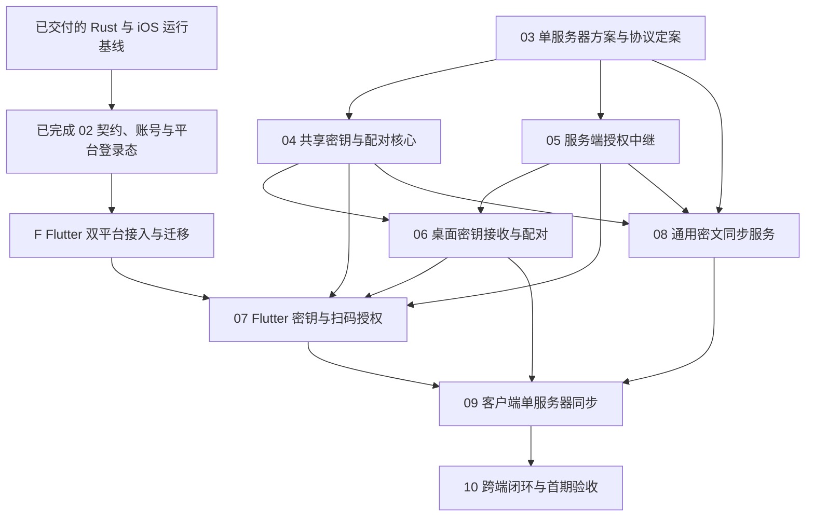

# Flutter 移动客户端：实施顺序与任务拆分

关联 [Flutter 移动客户端与设备授权](../../records/active/2026-10-25-mobile-development.md)。本文件索引尚未完成的工作、依赖和验收；已交付行为与证据保留在 record 及包内文档。保留原切片编号，F 表示 2026-11-16 确认 Flutter 后的双平台接入与基线迁移。

## 当前基线

共享 xw-api 网络与 account 会话核心、桌面接入、xiaowei-mobile 功能模块和 Swift／Kotlin 绑定已完成。现有入口和资源语义见[移动模块](../../../crates/xiaowei-mobile/README.md)与[绑定说明](../../../crates/xiaowei-mobile/ffi/README.md)。Rust 核心直接复用；已有 UniFFI 绑定不是 Dart 绑定，Flutter 接入须单独验证。

01 已交付根 `ios/` SwiftUI App、静态绑定 framework、共享 scheme、原生打包和 XCTest／UI 测试入口；按默认 iOS 17 实施。模拟器 26.3.1／18.3.1 的隔离 HTTP／WS、取消、账号检查点和资源清理均通过，真机 iPhone 15 Plus／iOS 26.5 的公开 HTTPS 与生命周期通过。真机局域网 fixture 按用户要求跳过，不将其计为通过；完整证据见 [record Outcome](../../records/active/2026-10-25-mobile-development.md#outcome)，接入说明见 [iOS](../../../ios/README.md)。

02 已完成 Swift 契约、账号 UI、Keychain 与约定验收，包含真机真实密码登录、认证 WSS 和结束进程后的自动恢复；证据见 [record Outcome](../../records/active/2026-10-25-mobile-development.md#outcome)，当前行为见 [iOS 开发说明](../../../ios/docs/development.md#账号与平台持久化)。

F 的 Flutter 双平台登录与会话基线已通过验收，覆盖共享登录界面、认证连接、平台安全存储、取消、重启与前后台恢复。[验收结果](../../records/active/2026-10-25-mobile-development.md#f-flutter-工程与登录)

## 总体路线

按用户 2026-10-27 的最新要求，只推进单服务器：同一服务器、同一账号、一个同步库、多台可信设备。多服务器不在首期实施或验收范围，不预建跨服务器密钥、转发或续传机制。手机创建密钥只是待评估的想法；手机初始化与电脑初始化的完整路径统一在[总体方案](../../records/active/2026-10-25-mobile-development/pairing-and-sync-protocol.md#初始化端评估)比较。

2026-11-16 用户确认 iOS／Android 使用 Flutter 共享 UI。先完成 Dart／Rust 账号迁移与平台验收，再恢复授权与同步实施。绑定使用同一 Rust FFI crate 中的 flutter_rust_bridge 2.13.0。

| 里程碑 | 包含原切片 | 可观察结果 |
| --- | --- | --- |
| F Flutter 双平台接入与基线迁移 | 新增 F | 同一 Flutter UI 经 Rust 在两个平台完成登录、真实安全存储、取消、重启及前后台恢复 |
| A 手机授权闭环 | 03–07 | 完成选定的初始化流程，手机持有密钥；手机在旧电脑不参与时授权新电脑，保存成功后双方显示完成 |
| B 单服务器加密同步闭环 | 08–10 | 获授权设备通过同一服务器互通通用测试对象；密文、去重、删除和断线／重启／前台恢复实际验证 |

顺序为 F → A → B；收藏业务在本事项之后。初始化端未定不阻塞 F 的现有账号／网络迁移。以下编号用于定位实现和验证，不把每个编号展开成新的产品问题。

## 剩余任务

| 切片 | 交付与代码位置 | 前置 | 完成验收 |
| --- | --- | --- | --- |
| 03 单服务器总体方案与协议定案（进行中） | 统一[总体方案](../../records/active/2026-10-25-mobile-development/pairing-and-sync-protocol.md)；评估初始化入口，集中完成成员签名、状态表、字节格式及向量 | 已确认的单服务器目标及现有工程 | 手机创建与电脑创建的完整首用路径经过评估；产品流程明确；协议字段、状态、失败路径和向量足以指导实现 |
| 04 共享密钥与配对核心 | 在 03 确定的 `xw-*` 业务模块实现密钥包、认证绑定、加解密及配对状态；由 xiaowei-mobile 与桌面组合入口接入，FFI 只适配公开对象 | 03；新增 crate 或依赖按仓库规则确认 | 固定测试向量、跨端互解、篡改／错误身份／错库／错版本／重放拒绝；私钥、配对秘密和内容密钥不进入日志或服务器 |
| 05 服务端设备授权与密钥包中继 | 在 `contracts/proto/xiaowei/server/` 定义业务契约；扩展 `server/internal/httpapi/`、业务模块和 `server/internal/db/` 迁移，复用现有账号与会话 | 03；与 04 按同一协议协作 | 真实 PostgreSQL／HTTP／WS 验证申请、批准、拒绝、取消、过期、单次领取及并发领取；身份／公钥替换与跨账号访问被拒绝；服务端只处理密钥包密文 |
| 06 桌面配对与密钥保管 | 扩展 `crates/xiaowei-rust/napi/`、平台存储及 renderer 授权入口；如选电脑初始化，在同一流程接入创建入口；业务运行归 Rust | 04、05；初始化入口在 03 评估定案 | 实际桌面入口显示二维码并保管密钥；初始化与加入按选定流程完成；取消、上下文变化和迟到响应不修改新状态；已有账号行为保持 |
| 07 Flutter 密钥保管与扫码授权 | 扩展 xiaowei-mobile 与 Dart 薄绑定；共享授权 UI，分别接入平台安全存储与相机；如选手机初始化，在同一流程接入创建入口 | F、04、05；完整闭环依赖 06；不预定手机一定是初始化端 | 两个平台按选定流程创建或取得密钥；相机权限与取消通过；旧电脑不参与时授权新电脑；可信设备恢复新手机和生命周期遵守总体方案 |
| 08 通用密文同步服务 | 按 03 的通用协议扩展服务器契约、`server/internal/httpapi/` 与数据库，处理密文、游标、幂等和删除记录；不引入收藏字段 | 03、05 的授权边界；使用 04 的密文测试向量 | 隔离真实服务验证访问权限、重复提交、分页／续拉、删除及事务失败；数据库与接口不依赖明文业务内容 |
| 09 客户端单服务器通用同步 | 在共享 Rust 核心实现同步推进；桌面与 Flutter 宿主接入本地事务、待上传队列及一个同步库的游标，持久化归宿主 | 06、07、08；两个宿主按同一协议接入 | 无业务含义的数据跨端加解密；断线、重启、重复消息和后台取消不丢进度；iOS／Android 的账号与库上下文不串写 |
| 10 跨端闭环与首期验收 | 从 Flutter iOS／Android 和桌面产品入口完成单服务器矩阵；回填 record、包内说明及切片结果 | F、A 与 B 的对应功能完成 | 完成选定的首用流程、手机独立授权新电脑和密文互通；旧电脑不参与后一次授权；分别记录两个移动平台的失败矩阵与恢复证据后再提议归档 |

03–10 的新包或业务 proto 尚未创建。各片随实施验证。初始化入口定案后再开发对应的创建入口。

## 预计代码文件与接口

以下为已创建的骨架及预计新增／修改位置。测试名称与迁移时间戳在对应切片开工时落定；生成文件始终通过现有流程更新。新 crate 的用途、边界和位置已在总体方案说明，仍遵循仓库的创建前确认规则。

| 类型 | 文件或生成范围 | 具体改动 |
| --- | --- | --- |
| 已创建 | `mobile/.fvmrc`、`pubspec.yaml`、`pubspec.lock`、`analysis_options.yaml`、`README.md`、`lib/main.dart`、`lib/app.dart`、`ios/`、`android/` | 已固定 Flutter 工具链和依赖，建立共享页面根组件与两端宿主 |
| 已接入 | `mobile/lib/app.dart`、`lib/src/account/` 与两端宿主 | 共享登录与账号页、会话存储、凭据检查点、生命周期和原生库打包 |
| 已接入 | `crates/xiaowei-mobile/ffi/src/flutter.rs`、`src/frb_generated.rs` 与 `mobile/lib/src/rust/` | 通过既有 FFI crate 的 `flutter` feature 适配共享 Rust 的会话操作和连接订阅 |
| 已验收 | `mobile/test/account_flow_test.dart`、`mobile/tool/verify-account.mjs` 与实际设备 | 隔离 fixture、实际平台存储、App 重启与前后台验收已通过 |
| 新增 | `crates/xw-sync/Cargo.toml`、`README.md`、`src/lib.rs` | 建立共享同步业务核心，公开密钥、配对操作及同步检查点；不依赖 UI、Gateway 或 FFI |
| 新增 | `crates/xw-sync/src/keys.rs`、`crypto.rs`、`pairing.rs`、`engine.rs` | 分别实现密钥与成员身份、内容加解密、认证配对、单服务器推拉推进；engine 在 B 接入 |
| 新增 | `crates/xw-sync/tests/crypto.rs`、`pairing.rs`、`sync.rs` | 固定向量、篡改／身份拒绝、配对状态、幂等与恢复回归 |
| 修改 | `Cargo.lock`、`crates/README.md` | Flutter 适配已登记在既有 FFI crate；xw-sync 计划由现有 `crates/xw-*` 纳入 |
| 新增 | `contracts/proto/xiaowei/server/vault.proto`、`pairing.proto`、`sync.proto` | 定义库与成员、申请与密钥包中继、通用密文操作；统一 `xiaowei.server`，不定义收藏字段 |
| 新增 | `contracts/proto/xiaowei/desktop/sync.proto` | 定义桌面同步状态、授权操作与事件；不向 renderer 暴露密钥或凭据 |
| 修改／生成 | `contracts/generate.config.json`、`contracts/README.md`、`contracts/proto/xiaowei/server/README.md`、`contracts/tests/codec.mjs`、`contracts/out/` 对应产物；按需要新增 Dart 生成入口与 `proto-server-dart` 输出 | Flutter 消费 PB 时将 Dart 纳入唯一生成与漂移流程；保留既有语言验证，登记错误码并补往返测试，不手抄 Dart 消息 |
| 新增 | `server/internal/sync/service.go`、`pairing.go`、`changes.go` 及相邻 `*_test.go` | 库与成员权限、申请状态与中继、事务提交和分页拉取；用真实数据库和网络覆盖失败路径 |
| 新增／修改 | `server/internal/db/sync.go`、`sync_test.go`、`migrations/<UTC>_sync.sql`；修改 `migrate.go` | 保存库、成员、公钥、申请、密文、操作去重和提交游标；登记 UTC 迁移，验证提交顺序和回滚 |
| 新增／修改 | `server/internal/httpapi/sync.go`、`sync_test.go`；修改 `api.go`、`server/cmd/xiaowei-server/main.go` | 通过现有共享注册接入 HTTP／WS，传递已验证账号身份并装配业务服务 |
| 修改 | `crates/xiaowei-mobile/Cargo.toml`、`src/lib.rs`；新增 `src/sync.rs`、`tests/sync.rs` | 组合共享核心与现有 api，管理操作、取消、暂停、恢复和存储检查点；复用单个 MobileClient |
| 修改 | `crates/xiaowei-mobile/ffi/src/flutter.rs`、Dart 生成绑定与对应测试 | 在 F 的薄绑定上接入共享配对与同步操作；旧 UniFFI 接口继续作为兼容基线 |
| 新增／修改 | `crates/xiaowei-rust/napi/src/sync/mod.rs`、`gateway.rs`；修改 `Cargo.toml`、`src/lib.rs`、`src/account/mod.rs` | 注册 typed Sync 业务入口，复用既有账号客户端与上下文；由 Rust 持有业务状态和后台任务 |
| 新增／修改 | `crates/xw-platform/src/secure_store.rs`、`src/macos/secure_store.rs`；修改该 crate 的 `Cargo.toml`、`src/lib.rs` | 提供 macOS Keychain 原语，业务密钥归同步核心；平台能力不持有账号或配对策略 |
| 新增／修改 | `crates/xw-storage/src/sync_dao.rs`、`tests/sync.rs`；修改 `src/lib.rs` | 本地对象、outbox 与游标事务；不使用普通设置 KV 存放明文密钥 |
| 修改 | `desktop/src/main/app/gateway.ts`、`services/account/session.ts` | 仅装配、交付现有账号上下文并关闭 Rust owner；不新建 TS 同步状态机 |
| 新增／修改 | `desktop/src/renderer/src/components/settings/SyncSection.tsx`、`SyncSection.test.tsx`；修改 `AccountSettingsSection.tsx`、`src/services.ts` | 显示授权二维码、状态和重试；经 typed Gateway 调用，不接触密钥或直接联网 |
| 新增 | `desktop/tests/rust-napi/sync.test.ts` | 从真实 napi／Gateway 入口验证存储、账号隔离、授权、关闭及取消 |
| 新增 | `mobile/lib/features/sync/sync_controller.dart`、`sync_section.dart`、`scanner_page.dart`、`mobile/lib/platform/vault_store.dart`、`local_sync_store.dart` | Flutter 共享授权页面与状态编排，接入平台相机、密钥保管和本地事务；local_sync_store 在 B 接入 |
| 新增／修改 | `mobile/test/sync_controller_test.dart`、`mobile/integration_test/pairing_test.dart`、`sync_recovery_test.dart`；扩展 `mobile/tool/verify_runtime.dart` 与双平台权限配置 | 验证授权、存储失败、实际扫码权限、同步事务与前后台恢复；报告区分 iOS／Android、模拟器／真机 |
| 修改 | 各受影响包已有 README／开发说明、本 record 与本计划 | 同步实际职责、入口、结果和未验证边界；根 `docs/` 与根 README 不在本次修改范围 |

依赖方向：Flutter／Dart → Dart／Rust 薄绑定 → xiaowei-mobile → xw-api／xw-sync；桌面 UI → Gateway → xiaowei-rust → xw-sync。Flutter 经平台插件或必要的 Swift／Kotlin 适配访问安全存储和相机；现有 UniFFI 不作为默认 Dart 中间层。服务端沿现有 API 注册 → 业务模块 → PostgreSQL；宿主负责持久化，网络核心不引入平台存储或 UI。

## 依赖顺序

当前下一步为 03，评估初始化入口并确定单服务器配对与同步协议。

## 决策归属与开工条件

| 决策 | 最迟在哪片之前确定 | 约束 |
| --- | --- | --- |
| 初始化端、认证握手和可信密码库 | 04、05、06 实现前，在 03 对齐 | 初始化端需评估，手机创建不是已确认决定；扫码方向已确认，不重复提问；使用成熟协议 |
| 设备／内容密钥层级、锁定／备份／换机／遗失／退出／撤销 | 04 及对应宿主存储实现前，在 03 对齐 | 恢复码、生物识别和密钥轮换不是已确认必选功能；不承诺撤回设备已经获得的明文密钥 |
| 多服务器库归属、密钥、转发与续传 | 已移出本事项 | 不阻塞单服务器实施，不预建跨服务器层；未来是否重新开启由用户决定 |
| 通用同步的游标、幂等、删除及事务语义 | 08／09 前，在 03 对齐 | 协议与业务内容无关；普通剪贴板历史留在本机，收藏模型另行接入 |

## 验收证据与实施约束

- 分开记录 Rust／绑定宿主测试、iOS／Android 构建链接、各平台模拟器运行及真机运行证据。记录源码版本、Flutter／Dart／Rust／Xcode／Android 工具链、设备／系统／ABI、实际 scope 和结果；旧 SwiftUI 与 macOS/JVM 测试不能替代 Flutter／Android 验收。
- 自动网络失败测试优先复用现有隔离 HTTP／Go WS fixture；真机通过明确的可达地址连接 fixture，不把 Mac 的 localhost 当作手机 localhost，不为测试关闭生产 TLS 校验。
- 手机进入后台时取消并结算当前工作，回前台重新恢复；授权和同步的正确性不依赖后台长连接。持久化检查点先保存再继续，取消后也要收取已经轮换的凭据。
- 契约仍以 proto 为唯一来源。修改契约、typed service、Gateway 或依赖前，读取对应仓库技能和模块规则；Dart 如需消费业务 PB，加入现有生成／漂移入口，不维护另一套手写协议。
- 新包、根 docs、桌面实例冷启动和生产部署分别遵守仓库授权边界；本任务拆分不授予 App Store 发布或生产部署权限。不重启其他工作区的服务，不为验收操作真实账号退出。
- 只有即将执行且前置已清楚的切片展开详细 Plan；完成后立即回填持久决策和验证证据、删除该 Plan，并更新本索引。整体范围完成后删除索引与空目录，再按 record 流程提议归档。
