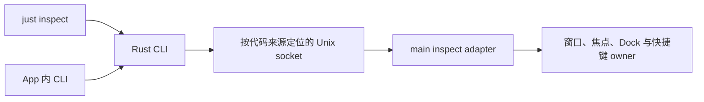

# 配套 CLI 与运行实例检查

## Why

原生 Computer Use 在窗口隐藏时多次出现取窗超时；合成快捷键发送成功也不能证明 Launcher 已显示。窗口、焦点、Dock 与快捷键排障需要直接读取运行实例的实际状态，并调用已有窗口入口。

用户提出参考 cmux 的配套 CLI 和本地 socket，允许重新设计，不要求复用 xiaowei-next 架构。多个开发工作区与普通正式版共用全部应用数据，运行代码来源可能不同。用户要求尽量不改 App 的运行和数据，因此以代码来源配对 CLI 和 App，保留现有数据、启动与单实例规则。

用户于 2026-10-25 授权建立 record、确认首版范围、crate／二进制名称与位置，随后明确要求开始实施。事项采用 record + Plans 跟踪。

## What

- crate 与二进制均为 `xiaowei-inspect`，源码位于 `desktop/inspect/`，加入根 Cargo workspace。
- 开发入口为 `just inspect …`；macOS 正式 App 携带配套 CLI。
- 首版提供身份、能力发现、窗口、焦点、Dock、有效快捷键查询，以及 Launcher 的搜索／剪贴板／Quick Chat 显示与收起。隐藏窗口仍可查询，读取不激活窗口，重复显示保持可见。
- CLI 按代码来源配对，执行前校验完整来源，目标不存在或不匹配时明确失败。
- 用户数据目录、数据共享关系、Agent／模型配置、单实例锁、开发启动／重启与接管方式保持现状，不迁移、复制或删除数据。
- 首版不增加聊天、Agent、数据库或通用业务 RPC。release CLI 内嵌技能与 Quick Chat／其他 Agent 使用记录为后续，不纳入首版。

完成标准：通过配套 CLI 读取真实运行状态并执行既有窗口入口；错配、协议、参数、失败和超时可诊断；验证开发及正式 CLI 入口，完成当前工作区的隐藏查询、重复显示、模式切换、焦点和 Dock 运行验收。

## How

### 已实现的职责与接口

当前说明分别维护在：

- [CLI README](../../../desktop/inspect/README.md)：准备、开发／正式二进制位置和调用方式。
- [本地协议](../../../desktop/inspect/docs/protocol.md)：唯一的来源哈希规则、请求／响应、方法、状态和错误契约。
- [App 接入](../../../desktop/docs/inspect.md)：宿主生命周期及各 owner 的边界。
- [仓库 inspect 技能](../../skills/inspect-running-app/SKILL.md)：实例校验、能力发现、任务内操作和结果复核。

App 在现有窗口和快捷键初始化后挂载 listener。检查入口启动或关闭失败记录错误，不阻断主应用启动或已有 owner 清理。`services/inspect/` 管理本地协议与白名单适配，状态与动作仍归原 owner；查询不捕获焦点，也不维护另一份业务状态。

来源为规范化工作区或 App bundle 路径，与共享数据目录无关。runtime 目录私有，socket 权限为 `0600`；保留活 socket，明确识别后才恢复陈旧 owned socket。完整来源与协议在 dispatch 前校验，读查询不排在窗口操作后面，过期的排队动作不执行。TS 与 Rust 使用共用样例校验哈希。

显示等待既有焦点交接，并检查实际显隐、焦点与模式；隐藏分别返回实际状态和焦点归还结果。Dock 区分实际可见、预期、延后隐藏及重试；快捷键区分配置、实际系统注册、菜单暂停与不可用，注册行为和默认绑定保持原样。

### CLI 与打包

`just inspect` 通过 Cargo 增量编译和定位客户端，显式传入当前工作区。正式 CLI 位于 `XiaoWei.app/Contents/Resources/bin/xiaowei-inspect`，从真实可执行路径找到所属 App，符号链接不改变配对。两种入口使用同一份实现，不自动启动 App 或回退到其他实例。

macOS App 构建阶段从 Cargo 输出取得 release CLI，随包复制并显式加入签名；后续 dmg／zip 阶段复用该产物。验收检查 CLI 文件、执行权限、arm64、代码签名、系统库依赖以及离线帮助和版本。Cargo 缓存涵盖 `desktop/inspect/`，原 Node 草稿 CLI 和工作区 `.dev.sock` 入口已替换。

### 参考与取舍

已核对本地 `~/Develop/Projects/cmux` 的 `CLI/cmux.swift`、`CLISocketPathResolver.swift`、socket control 包、`TerminalController.swift` 和 CLI contract。借鉴配套定位、结构化请求、能力发现和 owner 调用，不迁移历史协议、终端业务或完整发现系统。

- 原 Gateway 承担业务通信；新增 socket 只处理外部宿主检查及窗口操作，业务能力仍走 typed Gateway。
- 独立 Rust CLI 随正式包携带，用户无需额外安装 Node 或 Rust；开发态仍使用已有 Rust 工具链。
- socket 按代码来源定位。数据共享不影响配对，也不因该入口新增或限制 App 多开能力。

### 后续扩展：内嵌技能与 Agent 使用

用户提出 release CLI 内置一份配套技能，供 Quick Chat 或其他 Agent 使用，并明确留待后续实施。

用户补充约定：Quick Chat 后续通过 skill 使用 inspect 时，让 Agent 阅读配套 README 获取使用说明；skill 负责定位当前 App 对应的 CLI 与说明入口，不重复维护完整命令文档。具体命令可通过二进制的离线 `--help` 查阅，运行实例支持的方法与参数通过 `capabilities --json` 查询。

当前 README 位于 `desktop/inspect/README.md`，尚未作为独立说明文件随 App 分发；现有二进制已内置 `--help`。后续接入需保证 Agent 能读取与配套 CLI 同版本的 README，随包提供或其他读取方式在该阶段确定。

候选方案是将 `desktop/inspect/skills/xiaowei-inspect/SKILL.md` 编译进二进制，以离线 `xiaowei-inspect skill` 输出；开发入口对应 `just inspect skill`。技能随 CLI 更新，引导读取配套 README，并说明同一 CLI 路径、身份核对、能力发现、任务内窗口操作和结果复核。

Agent 的发现、加载、工具调用和权限接入在后续实施前另行对齐。本期不创建这个 release 技能文件或 `skill` 命令，也不改动 Agent／LLM／Quick Chat；仓库开发技能直接调用现有 CLI。

## Alternatives considered

- 仅依赖 Computer Use 或技能文档：隐藏窗口缺少稳定观察和外部动作入口，保留 UI 工具用于视觉验收。
- 照搬 xiaowei-next：用户允许重新设计，仅保留目标归属、能力发现和操作后复核等经验。
- 使用通用 `xiaowei` 命令名：独立目录不会直接覆盖 App 主程序，但名称过于宽泛；已统一为 `xiaowei-inspect`。
- CLI 放根 `inspect/` 或 `crates/`：当前只配套桌面应用，协议和发布随 desktop，已选择 `desktop/inspect/`。
- 任意 socket 发现或固定 dev／prod 两个 socket：不能充分表达代码来源，当前以来源路径自动计算 endpoint。
- 将数据隔离一起实施：会扩大到存储、登录、Agent／模型和运行兼容，按用户约束移出本次范围；本地更新测试包的既有隔离也保持原样。

## Outcome

首版范围已实现并完成自动验证、打包验证与 oracle 真实实例验收。当前实现与用法已沉淀到上述包内文档及仓库技能；实施 Plan 已清理。事项保留在 active，归档另行确认。release 内嵌技能和 Agent 接入保留为独立后续扩展，实施前另行对齐。

验证结果：

- `cargo test -p xiaowei-inspect --locked`：4 项通过，覆盖跨语言哈希样例、离线帮助／版本、参数错误与不存在实例。
- 首轮完整 `pnpm --dir desktop test`：429 项通过、1 项原有跳过，含真实 Rust↔TS socket 集成和窗口／bootstrap 回归。窗口验收修复后，重跑全部 main 测试 99 项及 inspect／焦点／Dock／Launcher 快捷键回归 50 项，均通过。
- 打包／发布／Cargo 缓存回归：53 项通过；覆盖 CLI 缺失／链接／权限拒绝、签名与产物缺失阻断、ZIP 复用及缓存失效。
- `just check`、两份仓库技能校验及 `git diff --check` 通过；窗口验收修复后再次运行总检查通过。首次与原生构建并行的总检查误扫到 napi 事务临时文件，构建完成后完整重跑通过，未修改或排除这些生成文件。
- 实际 macOS ad-hoc App 阶段通过：包内 CLI、架构、签名、动态依赖、离线帮助／版本和既有 native 模块加载均验证成功。实际包内 release CLI 另经真实 socket 与 TS fixture 完成身份、状态、显示和收起调用；该 fixture 未创建 Electron 实例。
- 首次 `directoryOnly + build:false` 验收在 App 与 CLI 已通过后，因当前 debug napi 缺少既有调试符号归档所需的 dSYM 停止；改用独立 App 阶段完成所需验收，未修改调试归档规则。未执行正式 Developer ID 签名、公证或发布。
- `app/paths.ts`、模型配置、开发 controller／session 等文件没有改动。原有数据与运行策略保持。
- TS 协议声明收拢至 `main/services/inspect/protocol.ts`，只由 inspect 服务和测试引用；不放入 main／renderer 共用的 `src/shared/`。移动后 20 项 socket／CLI 集成测试、desktop 类型检查和相关格式检查通过。

运行验收与修复：

- 用户启动 oracle 后，核对 Electron／controller 的绝对路径、cwd、父子关系和 cmux console；全程只操作当前工作区已有实例，通过 console 的 `r` 重载修复，未自行冷启动或操作其他工作区。
- 首次显示时发现 macOS 在 Electron 调用返回后异步完成原生显示与聚焦，入口过早检查而返回 `HANDLER_ERROR`，窗口随后实际可见且聚焦。先用异步显隐／焦点回归复现，再在显式显示入口补充最多一秒的确认等待；收起、模式变更、销毁或退出会结束等待，不重复激活窗口。新增回归覆盖首次显示、可见但失焦时重复显示及等待期间收起。
- 隐藏状态下的身份、能力、窗口、状态和快捷键查询通过，前台进程、Launcher generation 与隐藏状态保持不变。当前三项配置快捷键的系统实际注册均为 `registered`。
- Quick Chat 显示与重复显示均返回成功，窗口实际可见、聚焦且不置顶，Dock 可见；重复显示保留原焦点来源与 generation。原生 UI 也确认快速对话输入框获得焦点。
- Quick Chat 分别切回搜索和剪贴板后，窗口实际置顶、聚焦且保持可见；等待超过一秒后仍未隐藏。Dock 返回 `hideDeferred: true`、`visible: true`、`desiredVisible: false`，pending／retry 已结束，符合弹层期间延后隐藏的既有策略。原生 UI 与截图确认搜索框显示并获得焦点。
- 收起返回 `focusRestored: true`，前台进程回到原来的 cmux；窗口实际隐藏，Dock 最终隐藏且 deferred／pending／retry 全部清零。重复收起返回 null，不改变窗口或 generation。

本次原始 CLI 响应保存在 `/tmp/xiaowei-inspect-runtime-acceptance.json`，末次检查日志为 `/tmp/xiaowei-inspect-runtime-check.log`，新增窗口回归日志为 `/tmp/xiaowei-inspect-launcher-runtime-tests.log`。未执行正式 Developer ID 签名、公证、发布或 packaged GUI 实例验收；包内 release CLI 已通过前述真实 socket fixture 验证。
