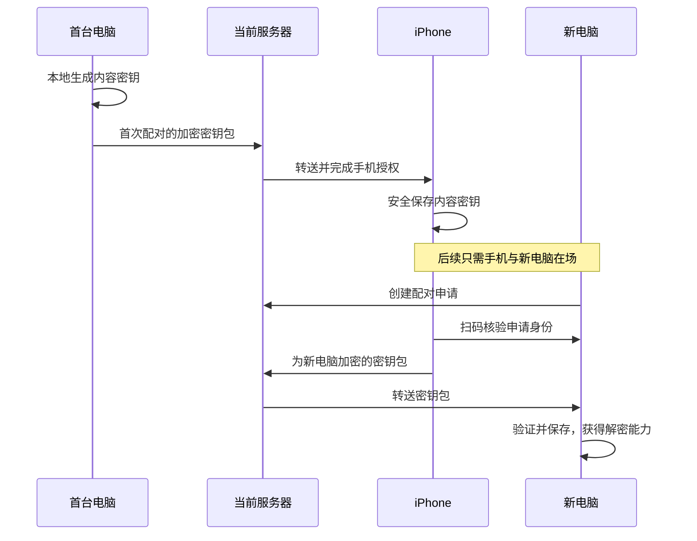

# iOS 客户端与设备授权

## Why

剪贴板收藏同步需要端到端加密，服务器无法直接读取同步内容。首台客户端需要生成内容密钥，后续客户端需要通过可信授权获得密钥；登录服务器与取得解密能力是两个独立步骤。

用户无法让两台桌面设备同时在场，但可以携带手机。因此引入 iOS 客户端作为随身授权设备：手机先从首台已初始化客户端获得授权，以后由手机授权新电脑，不要求旧电脑同时参与。设备配对不能只按“两台桌面同时在线”设计。

用户于 2026-10-25 明确要求启动本 record，随后确认采用 SwiftUI，并要求评估将 TS 的 xwapi 和 WebSocket 迁往 Rust，以便桌面与 iOS 共用。共享核心与移动 Rust 模块已按独立前置任务实施；2026-10-26 用户明确要求本事项进入 active 并拆分任务，开始按 record + Plans 推进完整 iOS 接入。iOS 工程与运行基线的结果见 Outcome。

## What

首期目标是一个能够参与密钥授权的最小 iOS 客户端，覆盖账号登录与恢复、密钥保管、首次配对和手机授权新电脑。移动端首期可只连接线上单服务器，地址入口尚待确定，不要求复制桌面多服务器管理。通用加密同步与设备授权先于剪贴板业务接入；首期不要求手机提供收藏列表。

已确认的整体顺序与边界：

1. 先建立与业务内容无关的客户端／服务端同步机制，以及客户端切换服务器后继续各自进度的机制，并补齐密钥初始化和设备授权。
2. 再在该机制之上实现剪贴板收藏同步；普通剪贴板历史留在本机。
3. 对于支持多服务器的客户端，同一时刻只与当前服务器同步；切服后读取各自独立进度，切回时继续，不要求同时连接多台服务器，也不将服务器列表作为移动端首期必需功能。
4. 同步内容在客户端加密和解密，服务器不持有明文内容密钥；手机是可信客户端，不是服务端解密代理。

本事项承载 iOS 工程与授权接入，以及完成该链路所必需的桌面／服务端集成。通用同步协议保持跨平台、与业务无关；收藏数据模型和完整收藏同步实现属于后续范围，不因引入 iOS 而并入本事项。

首期完成标准：

- iOS 工程可重复构建，完成真机安装与运行；登录、重启恢复与会话失效行为通过真实接口验证。桌面切服行为在共享核心接入后保持，移动端是否提供切服入口另行决定。
- 手机可安全获得首台客户端的同步库密钥，并在旧电脑不参与时授权另一台电脑；不同电脑可先后与手机完成该流程。
- 使用无业务含义的测试数据验证获授权客户端的加密与解密互通，服务端只保存和转送密文及必要协议元数据。
- 申请过期、拒绝、取消、重复领取、配对身份或公钥被替换、断线及切服的失败路径有明确结果，旧请求不污染新上下文。
- 手机挂起、退出或网络中断后可在前台恢复；不以 iOS 后台长连接常驻作为授权或同步正确性的前提。

首期不包括 Android App、完整剪贴板界面、系统剪贴板后台采集、分享扩展、远程桌面控制、微信登录、App Store 上架或生产部署。后续按实际需求分别决定，不预建无消费者的跨平台层。

## How

共享 Rust 核心及桌面接入已完成，验证结果见下述迁移方案。移动 Rust 功能模块与 Swift／Kotlin 绑定也已作为独立前置切片实现，当前行为见[模块文档](../../../crates/xiaowei-mobile/README.md)，决策与验证见[移动接入结果](2026-10-25-ios-client/mobile-module-interface.md)。[iOS App](../../../ios/README.md) 已接入最小连接与生命周期；产品账号、平台存储、设备配对及加密同步尚未实施。

### 现有基础与 React Native 的实际状态

- [服务器建设事项](2026-10-11-server-development.md) 已交付统一 HTTP／WS API、设备会话、桌面服务器切换和连接恢复；收藏上传与同步不在该事项范围。
- [xwapi](../../../docs/xwapi.md)、[服务端契约](../../../contracts/proto/xiaowei/server/README.md) 和 [WebSocket 接入](../../../server/docs/websocket.md) 是客户端接入的现有依据。
- [契约工程](../../../contracts/README.md) 当前只生成 TS、Rust 和 Go；尚无 Swift 业务消息产物，现有移动函数绑定由 UniFFI 生成。移动端调用 xwapi 不要求先接入 Gateway。
- [source-log](../../../packages/source-log/README.md#react-native--metro) 已提供 Babel 日志源码定位入口，但没有 RN／Expo 工程，也未完成 Metro 或移动真机验收。这不构成已经确定移动端采用 RN 的决定。
- [工作区初始化记录](../archived/2026-09-14-setup-workspace.md) 明确将移动端技术栈留待后续设计；其中的 `mobile/` 是历史候选，当前未创建该目录或移动工程。

### 原生 iOS 技术栈（已确认）

用户已确认 SwiftUI，采用 Swift + SwiftUI 原生客户端。Swift 负责 UI 和系统接入；客户端网络和单服务器会话维护已按独立前置迁移下沉 Rust；移动 Rust 模块与 UniFFI 绑定已交付，后续 App 直接接入，不另写一套 Swift 网络协议栈。

| 能力 | 建议方向 | 边界 |
| --- | --- | --- |
| UI 与状态展示 | SwiftUI | 首期围绕账号、配对和授权，不迁移桌面整套界面 |
| HTTPS 与认证 WS | 移动功能模块组合已迁移的 Rust xw-api | 遵循客户端／服务端契约和网络协议；Swift 经绑定调用移动模块，xwapi 自身不依赖 Gateway |
| 消息与 API | 复用现有 proto 与 Rust 生成类型 | Swift 边界按需要生成类型和绑定，保持契约唯一来源，不手抄业务消息或维护独立 API 清单 |
| 密钥持久化 | Keychain | 可访问条件、设备迁移和备份策略待定，不在普通配置或日志中保存明文密钥 |
| 扫码与确认 | iOS 原生相机能力 | 处理相机权限、取消与返回前台，具体 API 随最低系统版本决定 |
| 加密与配对 | 成熟协议与库，系统密码能力按协议适配 | CryptoKit 不等于完整配对协议；不自行拼装认证和密钥交换流程 |

原生客户端无法直接复用 Electron main、Node WS 实现、React DOM 组件或 napi 入口。可共用的业务实现位于不依赖宿主的 xw-* 核心；桌面由现有 xiaowei-rust 接入，移动端由 xiaowei-mobile 组合能力并管理运行资源，其 ffi 子层生成 Swift／Kotlin 绑定。模块职责、统一 API 与验证入口维护在[包内文档](../../../crates/xiaowei-mobile/README.md)，iOS 宿主接入见 [iOS 开发与验证](../../../ios/docs/development.md)。

移动 App 位于仓库根 `ios/`，与 `desktop/`、`server/` 按宿主分开；共享功能继续放 `crates/xiaowei-mobile/`。01 按建议默认采用 iOS 17，并建立 Swift 6 严格并发、静态绑定 framework 与 Rust XCFramework 接入。打包、签名、系统生命周期及运行方式统一维护在 [iOS 开发说明](../../../ios/docs/development.md)，库检查的 iOS 15.0 不改变 App 基线；App Store 发布不在首期范围。

### xwapi 与 Account 的 Rust 迁移

已明确的职责是：Gateway 负责同一个 App 内的跨进程和跨模块代理，xwapi 负责客户端／服务端契约与 HTTP／WS 通道，Account 负责账号与会话生命周期。桌面 UI／TS 业务通过 Gateway 使用 Rust 提供方；共享 Rust 内部的 account 直接调用 api，无需绕行桌面 Gateway，也不需要认证调用接口注入。

用户明确要求梳理 AccountService：多端共同需要的认证操作与会话维护下沉 Rust，桌面继续自行维护登录态，要求与迁移前行为 100% 兼容。共享 account 只处理当前账号的登录、退出、传入会话的校验与连接维护，不提供存储或存储接口；各端自行加载、保存和提交登录态。桌面的服务器集合、选择、退出全部、UI 聚合快照与 Gateway 注册不进入共享核心，既有 AccountService／AccountStore 保留上述职责。移动端仍可按自身需要接入本地 Gateway，但 xwapi 和共享会话核心均不依赖它。

共享实现放在 `xw-api` crate，网络客户端与 `account` 会话模块在内部按职责组织。桌面现有 `xiaowei-rust/napi` 依赖该 crate 并提供 Gateway handlers 与 endpoint，由 main 通过既有 napi 接入 Gateway；移动端由独立功能模块组合网络与会话能力，再经 FFI 适配两种语言。职责拆分与桌面验证维护在 [客户端 Rust 迁移方案](2026-10-25-ios-client/client-rust-migration.md)，移动模块当前说明维护在包内文档，不在本主文档重复维护文件清单。网络迁移、会话提取及移动模块的前置成果直接复用；完整 iOS 工程、配对及通用同步按本事项的剩余切片推进。

### Swift 与后续 Android 的 Rust 绑定评估

Rust 业务核心可由 Swift 和 Android 共用，但需要显式的外部接口和各平台构建产物。现有 napi 只服务桌面 Node，不能用于移动端；Protobuf 解决消息编码，也不会自动提供 Swift／JVM 到 Rust 的函数调用绑定。

独立前置切片已采用 UniFFI 0.32.2，从同一移动模块接口生成 Swift 和 Kotlin 绑定，并完成 macOS 上的双语言真实链路验证。其[官方支持范围](https://mozilla.github.io/uniffi-rs/latest/#supported-languages)包含两种语言；实际接入和验证边界见[绑定说明](../../../crates/xiaowei-mobile/ffi/README.md)。Android App 与实际 ABI 接入仍属于后续平台，不因 Kotlin/JVM 验证而增加首期 Android 工程或宣称平台验收完成。

| 调用端 | 候选接入方式 | 需要承担的接入工作 |
| --- | --- | --- |
| Swift | UniFFI 生成 Swift／C FFI 绑定，链接 Rust 静态库 | 已接入 iOS App 的静态 framework／XCFramework、最小 UI 与生命周期；运行范围及未验证边界见 Outcome |
| Kotlin | UniFFI 生成 Kotlin 绑定，加载 Android Rust `.so` | 当前官方后端依赖 JNA；集成 NDK、目标 ABI、Gradle、协程和资源关闭 |
| Java | 优先通过薄 Kotlin facade 调用相同绑定 | 对外提供 Java 易用的 callback／future，避免直接暴露 suspend；若要求纯 Java 则另外评估 JNI，不把 Java 视为官方 Kotlin 后端的同等直接支持 |
| 桌面 TS | 既有 napi 薄适配 | 继续调用同一纯 Rust 核心，不为统一绑定而替换桌面本地通信 |

移动功能模块组合 xw-api 网络与 account 会话模块的操作、结果和必要通知，管理自己的运行时与资源；FFI 仅适配该模块的公开 API。Rust 的泛型、借用、锁和内部 Tokio future 不原样暴露给 Swift／JVM；边界转换为受支持的数据类型和拥有明确生命周期的句柄。移动绑定不暴露 App 内部 Gateway 的 registry、owner 或调用上下文，业务消息仍以 proto 为唯一声明来源；具体接口与资源语义见[统一接口](../../../crates/xiaowei-mobile/docs/interfaces.md)，未来移动端自身的 Gateway 接入另按内部通信需求设计。

绑定前置已验证下列库层语义，App 的平台验证结果与边界另见 Outcome：

- **异步与取消**：[UniFFI async 文档](https://mozilla.github.io/uniffi-rs/latest/futures.html)支持 Rust async 到 Swift async／Kotlin suspend 的映射，但明确要求库自行提供取消通道。将 Swift Task／Kotlin coroutine 取消桥接到 xwapi 自己的请求生命周期，并区分取消等待与已提交的远端副作用；网络核心所需 Tokio runtime 要独立管理，不能依赖 napi、桌面 Gateway 或仅依靠生成的异步语法。
- **线程与事件流**：Rust 后台通知不直接更新 UI，由 Swift actor／Kotlin dispatcher 切回正确上下文；明确订阅关闭、队列上限及迟到回调处理。事件接口不会因使用绑定生成器就自动具有 AsyncStream／Flow 的完整语义。
- **内存与资源所有权**：Swift ARC、JVM GC 和 Rust Arc 不共享同一种回收机制。请求、订阅、核心实例都提供显式关闭和幂等清理，避免跨端互相持有回调造成资源遗留；[Kotlin 生命周期说明](https://mozilla.github.io/uniffi-rs/latest/kotlin/lifetimes.html)要求显式 close 以保证 Rust 资源及时释放。
- **Swift 并发兼容**：[Swift 绑定说明](https://mozilla.github.io/uniffi-rs/latest/swift/overview.html)仍标注 Swift 6 支持存在边界，尤其涉及 Sendable 与 async；选定版本后用实际 Xcode／Swift 语言模式验证，不能仅凭支持 Swift 就认定已通过当前严格并发检查。
- **错误与拷贝成本**：预期错误使用结构化结果，panic 不作为业务错误跨语言传播；区分业务非零 code、传输失败与取消。字符串和字节缓冲可能经过复制，优先在 Rust 内完成网络收发与协议处理，外部传操作及批量结果，附件使用有界分块，避免每个 WS 帧跨 FFI 往返。
- **交付与升级**：UniFFI 不代替跨平台编译和打包。固定生成器与运行库版本，绑定和 Rust 二进制同步交付；分别验证 iOS 架构／平台与 Android ABI 的加载、TLS、取消和关闭行为，不能以桌面构建通过推定移动端可用。

最小跨端验证已按独立前置执行，Swift／Kotlin 均通过真实 fixture 请求、取消、状态与关闭，并覆盖账号检查点和凭据收取。UniFFI 已是本模块的实际绑定方案；iOS 的前后台与网络基线另做实际平台验证，系统存储和 Android 平台加载仍待各自工程接入，不能用 macOS 宿主验证替代。

### 手机授权的目标流程

以下以首台电脑初始化为例，说明手机如何衔接两次独立配对；初始化的发起端仍待确认。

图示仅表达角色和目标。首次手机入库的扫码方向、完整握手、消息顺序、密钥确认及接收回执均待协议设计；不能仅因扫码或账号登录成功就释放密钥。

设备身份、服务器登录会话和同步库身份分别管理。首台客户端在本地生成内容密钥；各设备持有自己的设备私钥，授权只向目标设备分发所需内容密钥。服务器转送申请和密钥包，不生成或接收明文内容密钥。

配对应绑定申请、目标设备公钥、同步库、协议版本和有效期，并使用成熟的认证密钥交换或密钥封装方案。二维码可用于建立带外信任，但不能只依赖服务端自报设备名称或替换后的公钥；日志不记录配对秘密或明文密钥。手工配对码、PAKE 和具体算法仍是候选，未确定为首期必选实现。

手机只在初始化及设备授权等交互时参与。电脑获授权后独立执行加密同步，不要求手机持续在线或逐条审批收藏变化。服务器仍可见账号、必要路由标识、密文大小与时序；“无法查看内容”不表示隐藏全部元数据。

### 多服务器与同步机制的接口

各同步目标按规范化服务器地址与公开 user_id 保存独立状态，至少区分远端拉取游标和本地待上传进度；登录 token 轮换不重置同步进度。切服取消旧任务及配对上下文，目标服务器恢复后继续其进度，迟到响应不得越界写入。

内容同步、幂等操作、删除记录和本地事务由通用同步机制设计，iOS 接入该机制，不为手机另建一套收藏同步协议。业务数据应在进入服务端存储前完成加密；服务端不依赖明文正文、备注或分类来执行通用同步。

不同服务器是否承载同一同步库、是否共用内容密钥，以及从 A 拉取的收藏切换到 B 后是否上传，仍待用户确认。已经确认的是逐服务器续传，不据此推定跨服务器合并或转发；手机与电脑当前连接不同服务器时的配对路径同样待明确。

### 待对齐的安全与生命周期决策

- 首次初始化由电脑还是手机发起；首台电脑如何授权手机，避免初始化循环依赖。
- 内容密钥、设备密钥和授权记录的层级与版本；扫码绑定与加密密钥包的具体协议及可信库。
- 手机锁定后的密钥访问条件，是否要求设备解锁或生物识别；手机备份、换机与重装时的密钥行为。
- 手机遗失、全部设备不可用时的恢复路径；恢复码或独立同步密码仅为讨论候选，尚未确认必须提供。
- 撤销设备、退出账号和移除服务器对本地密钥及远端权限的影响；已交付给设备的密钥不能通过删除服务器记录收回，后续数据的密钥轮换策略待定。

## Alternatives considered

- **React Native**：此前已有日志工具适配准备，可以复用部分 TS 生态；但目前没有移动端工程，桌面 UI 使用 React DOM，现有 xwapi 装配及 WS 依赖 Node，不能视为可直接运行在 RN。首期仍需接入相机、Keychain 与 iOS 生命周期；在 Android 尚未进入范围时，跨平台收益不足以直接决定采用 RN，保留为比较方案。
- **Swift + SwiftUI**：用户已确认。SwiftUI 承载原生交互，所需网络与消息接入通过共享核心和薄绑定完成，不要求所有客户端逻辑都使用 Swift。
- **各端分别实现 HTTP／WS 与账号规则**：Swift 可使用 URLSession，但会重复维护路由、鉴权、重连和恢复状态机。当前更推荐 Rust 共享核心；其代价是新增网络依赖、Swift FFI、iOS 构建和跨语言生命周期验证。
- **仅桌面配对**：不能覆盖用户无法同时拿到两台桌面的使用场景，不作为主要授权入口。
- **仅恢复码／同步密码**：可以独立解锁，但用户本轮明确希望通过手机授权电脑，不以此替代手机；是否作为手机遗失后的恢复方式另行决定。

## Current work

2026-10-26 用户明确要求本 record 从 proposed 进入 active。整体方向与首期完成标准沿用上述约定；未决的 App 配置、安全策略和跨服务器归属分别作为相关切片的前置决策，不因状态迁移而视为已经确定。

剩余任务、依赖及各片验收统一维护在[实施顺序与任务拆分](../../plans/2026-10-25-ios-client/00-implementation-order.md)。01、02 已完成约定实现与验收，结果见下述 Outcome。下一片为 03 授权、密钥与通用同步协议定案。服务器沿用现有单服务器入口，用户已选择首次系统解锁后可读写且仅限本设备的会话 Keychain；不增加 App 锁或 Face ID。SwiftProtobuf 生成器与运行库固定为 1.39.0。

02 的实现、模拟器及真机平台自动验证已完成；用户已在 App 内确认真实密码登录、认证 WSS，以及结束进程后无需密码的自动恢复，对应 Plan 已删除。用户重新连接 iPhone 15 Plus 后，本轮 Keychain／公开 HTTPS／生命周期的 3 项测试均通过；结果独立于 01 记录。后续协议决策、密钥与配对、桌面和服务端接入、通用密文同步及整体验收依次按依赖推进；不重新实施已完成的 Rust 迁移与绑定。协议设计可以先行对齐，但在算法、密钥生命周期和同步库边界明确前不实现配对或加密协议。

## Outcome

已交付的前置成果为纯 Rust xw-api 及 account 会话模块、桌面既有 Gateway／napi 接入、xiaowei-mobile 功能模块与 Swift／Kotlin 绑定。迁移与验证证据分别见[客户端 Rust 迁移](2026-10-25-ios-client/client-rust-migration.md#outcome)和[移动接入结果](2026-10-25-ios-client/mobile-module-interface.md#outcome)。

2026-10-26 按用户要求执行 br-merge：前置模块、record 状态迁移与初始任务计划提交为 `c0f3363`，合入含 WebSocket／账号修复的 develop，合并结果为 `1ea785d`；atlas 保留并恢复至该结果。01 随后基于该版本实施，提交与再次合并结果见下段。

随后用户要求 br-merge 并继续 02：01 提交为 `a2d45e2`，合并至包含两项桌面修复的 develop，结果为 `1a7674a`；atlas 保留并恢复至合并结果，合并后 just check 通过。02 实施期间的新增改动未提交。

### 01 iOS 工程与运行基线

已交付原生 SwiftUI App、共享 scheme、静态 Swift 绑定 framework、Rust XCFramework 打包与统一准备／运行验证入口。AppModel 按同一串行任务链交接前台、后台及 shutdown，取消请求、停止订阅、等待 Rust 清理并隔离迟到结果；关闭后的客户端可以重建。当前说明见 [iOS 开发与验证](../../../ios/docs/development.md)，本片 Plan 已删除。

用户于本轮明确允许跳过真机到 Mac 的局域网 fixture。因此本片真机范围收窄为签名／安装／启动、公开 HTTPS、前后台与停止后重建；隔离 HTTP／WS、取消、账号检查点和连接关闭仍由模拟器实际验证。真机局域网权限允许／拒绝、认证 WS 和实际请求取消没有通过验收，不能由模拟器结果替代。

| 层次 | 实际结果与证据 |
| --- | --- |
| 构建与配置 | Xcode 26.3（17C529）、Swift 6.2.4、SDK 26.2；arm64 真机／模拟器 Debug 与 Release 构建通过，Release 产物不含 fixture-control、调试加载方法或本地网络测试 plist |
| iOS 26.3.1 模拟器 | iPhone 16 Plus 实际安装／启动，1 个 UI 测试及 2 个宿主测试通过；UI 完成 3 次健康请求、3 次 WS 建连、前后台断开／重连及停止后重建，最终 0 个 WS；报告 `target/ios/runs/2026-10-26T04-25-23.824Z/` |
| iOS 18.3.1 模拟器 | 同组 3 个测试与 fixture 断言通过；报告 `target/ios/runs/2026-10-26T04-26-51.275Z/` |
| iOS 26.5 真机 | iPhone 15 Plus 经个人开发签名安装并运行；`--public-only` 的 UI 与宿主测试各 1 个通过，覆盖真实 Rust HTTPS、前后台、停止和重建；报告 `target/ios/runs/2026-10-26T04-24-56.197Z/` |
| 原入口与仓库检查 | xiaowei-mobile Rust 测试、macOS Swift／Kotlin fixture、两个 iOS 15.0 库层编译／链接和完整 `just check` 通过；fixture 启动失败能传播错误并退出，无服务残留 |

各运行报告包含源码基线与未提交内容哈希、实际工具链／destination、范围和安全断言，不保存凭据。模拟器与真机截图均已从实际 UI 测试核对。最低 iOS 17 当前没有安装 runtime，仅完成 deployment 编译基线，不宣称 17 已运行验证。

上述 01 结束时，Keychain、产品账号与重启恢复、设备授权及通用加密同步仍属后续；02 的当前进展见下节。Android App、收藏业务同步、上架与生产部署继续留在首期范围之外。

### 02 Swift 契约、账号与平台登录态

已实现唯一 Swift 服务器契约输出及 descriptor 方法常量、精确 SwiftProtobuf 1.39.0 依赖与解析锁、密码登录表单、真实 Keychain store 和 AccountSession 平台编排。产品仍用单个 MobileClient。会话采用用户确认的 AfterFirstUnlockThisDeviceOnly，不增加 App 锁或 Face ID；当前行为和持久化／取消／重连边界统一维护在 [iOS 开发说明](../../../ios/docs/development.md#账号与平台持久化)。验收完成后按用户要求进入 br-merge 提交与合并流程。

实际 UI 验收复现并修复了账号句柄关闭误断已提交连接：Rust 回归测试先证实 generation 从 1 错误重置为 2，再验证关闭只结算隔离操作、连接继续由 MobileClient 管理。Swift 侧也验证同一 generation 的断线重连会再次校验账号。另修复库验收与 App 打包共用 Cargo 产物导致 15.0 链接误用 17.0 增量对象，SDK 缓存现按 deployment 版本隔离；不改共享业务或 App 最低版本。

| 层次 | 实际结果与证据 |
| --- | --- |
| Swift 契约 | 生成／漂移、唯一提供方、manifest／解析锁缓存失效与消息／方法常量缺失、多余、陈旧产物检查通过；服务器登录／健康消息在 TS／Rust／Go／Swift 双向遍历通过，原 Envelope 三语言检查保留；日志 `/tmp/xiaowei-ios02-codec-final.log`、`/tmp/xiaowei-ios02-contracts-cache.log` |
| iOS 26.3.1 模拟器 | 6 个 XCTest 及 fixture 断言通过：真实 Keychain、10 项账号保存／取消／失效／离线／补偿场景、账号表单与进程重启、同会话重连、原生命周期 UI 与 Rust 网络宿主；账号 UI 3 次登录请求、3 次用户校验、3 次连接、1 次退出，最终 0 个 WS；最终打包入口复验报告 `target/ios/runs/2026-10-26T05-24-35.206Z/`；初轮完整报告 `target/ios/runs/2026-10-26T05-19-20.691Z/` |
| iOS 18.3.1 模拟器 | 同组 6 个测试、10 项账号场景及 fixture 断言通过；报告 `target/ios/runs/2026-10-26T05-21-38.853Z/` |
| 构建与原入口 | 两个 SDK 的 Debug／Release 构建通过，Release 不含 fixture／account-fixture／verification-public 入口或测试网络 plist；Rust 移动测试、Swift／Kotlin 原绑定验证、iOS 15.0 库编译／链接及 just check 通过；最终库日志 `/tmp/xiaowei-ios02-ios-library-final.log`，仓库检查日志 `/tmp/xiaowei-ios02-just-check-final.log`，其余日志前缀 `/tmp/xiaowei-ios02-` |
| Keychain 补充验收 | 两版模拟器以禁止认证 UI 的新 LAContext 实际读回字节；报告 `target/ios/runs/2026-10-26T05-28-52.274Z/`、`target/ios/runs/2026-10-26T05-29-05.008Z/` |
| iOS 26.5 真机 | 用户重新连接并解锁 iPhone 15 Plus 后，个人开发签名安装／运行，`--public-only` 的 3 项 XCTest 全部通过：真实 Keychain 读写、访问属性、禁止认证 UI 的实际读回，Rust 公开 HTTPS，以及 App 前后台／停止重建；报告 `target/ios/runs/2026-10-26T06-11-53.656Z/`，实际 UI 截图已核对 |
| 真实产品账号 | 已打开无测试参数的正常 App，用户自行输入账号并明确确认“已登录且已连接”；按 Rust 的连接状态语义，此状态对应认证 WSS 成功。已结束原进程并启动新进程，用户再次明确确认“已自动恢复，无需密码”，页面恢复为“已登录”“已连接”。该链路为真机产品入口的人工验收，独立于合成 fixture 与公开 HTTPS 自动测试。凭据未进入对话、参数或报告。真机到 Mac 的局域网 fixture 沿用用户已授权的跳过决定 |

02 的实现与约定验收已完成，结果回填后删除对应 Plan。正常 App 留在真机继续使用，真实凭据由 App 自行保存在设备 Keychain，不进入对话、命令参数或报告。真机局域网 fixture 的允许／拒绝、隔离账号失败与取消仍未执行，沿用已授权的跳过边界；对应失败路径已由模拟器验证。下一片为 03 的协议与安全决策；本 record 因仍有后续配对和同步事项保持 active。
