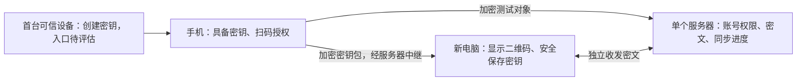
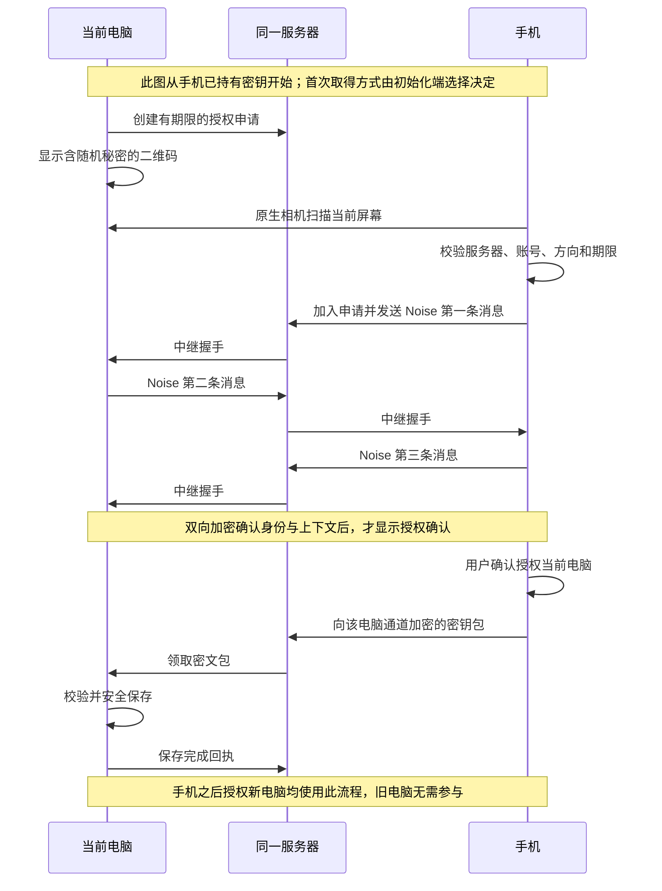

# 单服务器：手机授权与加密同步总体方案

关联 [Flutter 移动客户端与设备授权](../2026-10-25-mobile-development.md) 的 03。本文先确定完整的单服务器产品流程，再指导契约和共享实现；不将实现细节拆成逐项产品提问。2026-11-16 用户已确认 Flutter 共享 iOS／Android UI，分工与迁移边界见 [Flutter 技术栈](../2026-10-25-mobile-development.md#flutter-移动技术栈2026-11-16-已确认)。设备授权、内容密钥保管和密文同步尚未实现，已完成的登录与网络行为仍以对应包文档为准。

## 首期目标与边界

2026-10-27 用户要求先把单个服务器的事情弄明白，多服务器可以不做。Flutter 双平台继续沿用当前服务器地址：同一服务器、同一账号、一个同步库、多台可信设备。不设计多服务器库归属、跨服务器授权、数据转发、密钥共用或逐服务器续传，也不为这些能力预建抽象。

需要完成的闭环是：首台可信设备创建同步库密钥，手机具备日常授权能力，以后独立授权其他电脑；已授权设备直接与同一个服务器交换密文，手机不必持续在线。初始化端按下节评估，尚未决定。先用无业务含义的测试对象验证同步，随后再做收藏接入。普通剪贴板历史继续留在本机。

现有桌面账号模块的服务器选择行为沿用；本次同步能力仅在与手机相同的首期服务器下启用。选择其他服务器时停止本次同步任务，不将旧任务或库密钥交给新账号上下文。这是现有上下文隔离要求，不扩展为多服务器同步功能。

## 初始化端评估

“由谁创建第一份内容密钥”和“谁日常授权新设备”是两件事。用户提出手机创建密钥作为候选想法，并明确要求评估，不能将其记为已决定的需求。

| 候选 | 首次完整流程 | 优点 | 代价 |
| --- | --- | --- | --- |
| 手机初始化 | 手机启用同步 → 首台电脑显示二维码 → 手机扫码授权 | 首台和后续电脑使用同一流程；手机直接成为日常授权设备 | 首台电脑启用同步前必须准备手机；初始化入口在 iOS |
| 电脑初始化 | 首台电脑启用同步并显示二维码 → 手机扫码获得密钥 → 手机授权后续电脑 | 首台电脑可先启用同步；延续原有桌面优先路径 | 手机首次加入与后续授权电脑的密钥传递方向相反，需要两种明确的 UI 状态 |

两种方案都使用相同的共享 Rust 随机数、密码协议和平台安全存储；创建发生在手机上本身不意味着更强的加密。手机遗失后的恢复取决于其他可信设备是否保留密钥，与最初由谁生成无关。

从操作步骤看，手机初始化更统一；从首台电脑可独立开始看，电脑初始化更合适。总体方案先保留这一个明确的产品分支，结合完整首用流程评估后再选入口。不同时实现两种初始化入口，也不因此新增“手机永久独占签发权”的权限层。

## 完整用户流程

1. **首台设备启用同步。** 在选定的初始化端点击“启用同步”，本机生成并安全保存内容密钥，再注册同步库。若由电脑初始化，手机先扫码取得密钥；若由手机初始化，直接进入电脑申请授权流程。服务器只收到库标识和设备公开信息，已有库不会被缺少密钥的新设备覆盖。
2. **电脑申请授权。** 电脑登录同一账号后，点击“申请授权”，创建短时申请并显示二维码。二维码不包含内容密钥。
3. **手机扫码确认。** 手机扫描当前电脑二维码，校验账号与申请身份，完成认证加密握手；用户确认后，将密钥通过该通道加密给电脑。电脑保存成功后回执，双方才显示授权完成。首台与后续电脑走同一流程。
4. **设备独立同步。** 获授权设备加密上传、拉取后本地解密；服务器保存密文与必要元信息。断线、重启和手机回前台后，从已经提交的本地进度继续，不依赖后台长连接。

## 密钥与生命周期默认方案

电脑展示二维码而手机扫码，以及首期不做恢复码或云端密钥备份，沿用本轮用户选择。密钥初始化端仍是候选评估；锁屏、退出和撤销按下表作为统一方案提出，不单独逐项询问。

| 事项 | 方案 | 结果 |
| --- | --- | --- |
| 密钥归属 | 选定的首台设备创建内容密钥，每台设备自行生成设备私钥 | 日常由手机分发加密后的库密钥包，不替电脑生成或保存电脑私钥 |
| 保管 | iOS 密钥采用 WhenUnlockedThisDeviceOnly，macOS 使用系统 Keychain；Android 使用 Keystore 支撑的加密存储；不启用云同步或额外生物识别 | 访问条件、备份与恢复按平台实际验证；现有 iOS 登录会话的 AfterFirstUnlockThisDeviceOnly 作为迁移基线保留 |
| 退出 | 停止同步并清理内存密钥，保留按账号隔离的本机持久密钥 | 再次登录同账号可恢复；认证临时失效不销毁唯一密钥副本；显式清除本机同步数据时才删除 |
| 换手机 | 由仍持有密钥的已授权电脑展示恢复授权二维码，新手机扫码取得密钥 | 不要求找回旧手机；全部可信设备的密钥都遗失时，旧密文不可恢复 |
| 移除设备 | 撤销服务器端成员权限，拒绝后续正常上传、下载与授权操作 | 不承诺收回已交付的明文或密钥；首期不做密钥轮换 |

不同服务器或账号的二维码直接拒绝，不自动切服或转发登录凭据。设备名称只作展示，不能充当可信身份。

## 交付顺序与完成标准

| 里程碑 | 交付 | 验收 |
| --- | --- | --- |
| F Flutter 接入与既有能力迁移 | 共用 Dart UI、薄 Rust 绑定、两平台存储与生命周期；以现有 SwiftUI 行为作对照 | Flutter 在 iOS／Android 实际验证登录、凭据保存与轮换、取消、重启和前后台恢复；不直接继承旧平台测试结论 |
| A 手机授权闭环 | 选定首用流程、电脑申请、手机扫码、密钥保存与回执；共享核心、服务器及两个 UI 按同一流程接入 | 完成初始化及手机取得密钥，再在旧电脑不参与时由手机授权新电脑；错误账号、公钥替换、拒绝、取消、过期与保存失败有明确结果 |
| B 单服务器加密同步闭环 | 通用对象、幂等推送、分页拉取、本地待上传队列与游标、删除记录和前台恢复 | 两端通过真实接口互解测试对象；重复提交不重复生效；断线／重启后继续；服务器存储与日志无明文内容或密钥 |

先完成 F，再打通 A、接入 B。F 复用已有账号与网络能力，不依赖初始化端选择；A 内按“契约与核心 → 服务器和平台存储 → 两端交互 → 真机闭环”的顺序推进。具体文件、原切片编号和检查入口见[实施计划](../../../plans/2026-10-25-mobile-development/00-implementation-order.md)。收藏列表、真实收藏数据接入、上架和生产部署均不纳入本轮闭环。

## 实际代码约束

- [xwapi](../../../../docs/xwapi.md) 已提供 HTTP／WS、取消和连接代次，不增加专用配对连接或另一套网络栈。
- [认证契约](../../../../contracts/proto/xiaowei/server/auth.proto) 的 device_id 是公开 UUID，不是认证凭据。账号登录只取得服务器身份，不能由此推定持有设备私钥或内容密钥。
- [地址规范化](../../../../crates/xw-api/src/context.rs) 复用 `normalize_server`，包括基础路径；用服务器、公开 user_id 和 vault_id 校验当前库归属，token 轮换不重置进度。
- [HTTP](../../../../server/docs/http.md) 请求上限为 16 KiB，Rust HTTP 响应上限为 64 KiB；[WS](../../../../server/docs/websocket.md) payload 上限为 8 MiB。首期业务消息按更小的 HTTP 边界设计，避免正确性依赖 WS 常驻。
- Flutter 接入现有 MobileClient 的生命周期与资源语义；原 SwiftUI AppModel 是迁移对照。Dart Future、订阅或页面销毁不自动取消 Rust 工作，后台清理需显式结算；断线或取消不等于远端事务没有提交。

## 密钥与信任来源

建议区分以下对象，不使用登录密码派生内容密钥，不复用 access／refresh token 作为加密材料。

| 对象 | 用途与生命周期 | 持久化 |
| --- | --- | --- |
| 设备密钥 | 每台设备独立生成：X25519 用于 Noise，Ed25519 用于成员操作签名 | 私钥仅在平台安全存储；两种公钥一起绑定到成员身份，不复用同一私钥 |
| 一次性配对秘密 | 操作系统 CSPRNG 生成的 32 字节 PSK，二维码带外传递 | 仅配对双方内存；不上传服务器、不写日志或普通文件 |
| Noise 临时密钥与通道状态 | 每次配对重新生成，保护本次密钥包及确认消息 | 仅内存；挂起、终止或失败后废弃，不能重置 nonce 继续旧通道 |
| 内容密钥 | 每个同步库的随机 32 字节密钥；v1 单一 key_version | 手机与电脑分别由平台安全存储保管，不进入 renderer 或服务器 |
| 同步元信息 | vault_id、成员公钥、版本、游标、操作 ID 与密文 | 服务器和宿主数据库分别保存自己的状态，不含明文密钥 |

选定的初始化端在本机创建内容密钥。后续配对的初始信任来自用户扫描当前电脑屏幕中的随机秘密与公钥，再由已持有内容密钥的一方明确确认授权。仅有二维码编号、服务器返回的设备公钥或账号密码均不足以获得内容密钥。二维码属于短时授权秘密，不能作为普通链接打开或进入遥测。

### 密码协议与库候选

建议配对采用标准 `Noise_XXpsk3_25519_ChaChaPoly_SHA256`，由 `snow 0.10.0` 实现。使用规范已有的 XXpsk3，不修改握手 token，也不以短数字码替代 256 位 PSK。二维码中的电脑静态公钥必须与握手实际取得的远端公钥相同。

Noise 握手结束后，双方还需各发送并验证一条加密的上下文确认，证明双方已进入包含 PSK 的通道。确认前不发送内容密钥，不把握手第二条消息中的身份当作已认证身份。设备 Noise 静态密钥只用于该 Noise 协议，不挪作其他加密或签名用途。

建议内容加密使用 RustCrypto 的 `chacha20poly1305 0.10.1` 所提供的 XChaCha20-Poly1305：32 字节密钥、每次新操作独立生成的 24 字节 nonce、16 字节认证 tag。此版本与 snow 的依赖范围一致。密钥清理可复用锁文件已有的 `zeroize 1.9.1`；具体 feature 和目标平台可用性仍须在 04 验证。

XChaCha20-Poly1305 有成熟实现与互通资料，但不是已发布的 IETF RFC；不能把它描述成 RFC 8439 本身。库的历史审计也不等于小微的完整协议或新集成已经审计。上述只是依赖候选，本轮不创建 crate、不修改 Cargo 依赖或锁文件。

依据（2026-10-27 已查阅）：

- [Noise 规范](https://noiseprotocol.org/noise.html)：§6 prologue、§9 PSK／XXpsk3、§14 静态密钥与 PSK 使用限制。
- [snow 0.10.0](https://docs.rs/snow/0.10.0/snow/) 及其 [Builder](https://docs.rs/snow/0.10.0/snow/struct.Builder.html)、[HandshakeState](https://docs.rs/snow/0.10.0/snow/struct.HandshakeState.html)：标准算法组合、PSK、prologue、远端静态公钥和通道状态入口。
- [RustCrypto 0.10.1](https://docs.rs/chacha20poly1305/0.10.1/chacha20poly1305/)：XChaCha 构造、API、安全说明与历史 NCC Group 审计说明。
- [libsodium 的 XChaCha20-Poly1305 说明](https://doc.libsodium.org/secret-key_cryptography/aead/chacha20-poly1305/xchacha20-poly1305_construction)：随机 192 位 nonce、AAD 和跨实现互通入口。

## 配对流程建议

初始化端先登录服务器，创建内容密钥并安全保存成功，再提交同步库初始化。其他设备登录同一服务器的同一账号后申请授权。服务器已有库而本机缺少密钥时进入加入或恢复授权流程，不覆盖旧库。初始化采用单账号唯一约束和幂等操作 ID，处理响应丢失与两台设备同时初始化。

二维码包含协议版本、配对 ID、方向、规范化服务器地址、公开 user_id、vault_id、电脑 device_id／Noise 公钥、过期时间和随机 PSK。PSK 不出现在服务器的 Create／Get 结果中。建议有效期 5 分钟；客户端和服务器均限制有效期，未知版本明确失败。

协议版本、方向、服务器、用户、同步库、申请、有效期与展示方公钥共同绑定到 Noise prologue；双方完整身份和握手公钥绑定到加密上下文确认。不能仅对这些字段做普通哈希后就视为认证成功。最终字节编码与测试向量须在 03 定案后冻结，不直接使用各语言 JSON 重编码或默认 PB 序列化字节作为密码学规范化格式。

密钥包须绑定完整上下文、双方实际公钥、handshake hash、key_version 和内容密钥。接收方先验证再持久化；存储失败时不显示“已授权”，也不发送“已保存”回执。扫码结束与服务端收到密文都不是接收方已经保管密钥的证据。

### 状态与恢复

服务器建议维护 `waiting → handshaking → approved → claimed → completed`，同时允许进入 `rejected`、`cancelled`、`expired`。批准与取消按数据库事务顺序裁决；已交付密钥不能通过后续取消收回。UI 必须区分已中止操作、已发送密钥和接收方已保存。

- 申请只绑定一对参与者；对方身份、公钥、方向或同步库变化需要重新创建申请。设备名称变化不允许改写密钥身份。
- 中继帧包含发送方、方向与序号。相同序号和相同字节可以查询／重发，不能再次消耗 Noise 状态；相同序号但不同字节拒绝。
- 单次领取是“一份包绑定一个接收方和一个 claim_id”。相同 claim_id 的重试返回相同结果，不允许另一个接收方或 claim_id 消费；不能在第一次写 socket 前就永久删除包，否则响应丢失无法恢复。
- 密钥保存之前进程终止、进入后台或切服时，废弃本次内存握手并重新扫码；不持久化可恢复的 Noise nonce 状态。服务器上的旧申请最终取消或过期。
- 密钥已经保存但回执未送达时，保留最少的待确认标记；重进前台核对原目标后补交确认，不重复导入或覆盖其他库密钥。回执的认证、保留期限和清理顺序仍须在 03 冻结。
- 不重放连接断开前的业务调用；根据固定操作 ID 查询结果，再决定继续。WS 通知只提示状态可能变化，Get 的持久状态才用于恢复。

### 服务端成员身份

账号 device_id 可公开且可由登录请求传入，因此“已登录且 device_id 相同”不能作为持有原设备私钥的证明。方案采用独立 Ed25519 设备签名；服务器验证当前账号会话、成员公钥和操作签名。配对、同步与成员变更都使用同一校验规则，不复用 Noise X25519 密钥设计签名。

首次注册只能在该账号无同步库时执行，并验证初始化设备对所提交公钥的持有证明。其他设备加入时，双方 Noise 通道确认同时绑定设备的签名公钥；现有可信成员签名批准具体申请、公钥和密钥包。接收方保存成功后签名回执，服务器才将待激活成员标为可同步。已有成员公钥不能由普通登录覆盖；移除设备后，旧成员签名不再允许业务操作。

精确签名输入、密码学字节编码与固定向量属于下一步契约工作，须作为 04／05 的前置测试完成，不要求用户逐字段选择算法或编码方式。

## 通用密文同步建议

单服务器下维护当前账号同步库的一份待上传队列和拉取游标，本地任务带宿主 generation。网络连接 generation、session_id 与 token 均不是进度主键。服务器、用户或库归属不匹配时停止旧任务，不建立跨服务器数据转发机制。

建议使用不含业务语义的对象操作与服务器提交游标：

| 候选字段 | 语义 |
| --- | --- |
| protocol_version、vault_id、key_version | 选择协议与内容密钥；未知版本拒绝，不静默降级 |
| object_id | 客户端生成的随机对象标识；不是正文哈希或本机数据库行号 |
| operation_id | 一次逻辑提交的随机 ID；创建后连同 nonce、密文和 base_revision 一起持久化，重试不重新生成 |
| base_revision | 修改所依据的远端对象版本；创建为 0，用于条件写入与冲突检测 |
| kind | upsert 或 tombstone；不包含收藏类型、备注或分类 |
| nonce、ciphertext | 客户端产生的认证密文；删除也要有认证的空负载，不能接受裸删除标记 |
| revision | 服务器成功事务分配的单调提交位置；客户端不能指定 |

AAD 应绑定域分隔标识、协议版本、规范化服务器、用户、库、密钥版本、对象、操作、base_revision 和 kind。服务端分配的 revision 在加密时尚不存在，不能作为需要预先知道的 AAD。服务器不可见明文，但仍可见账号、对象标识、操作类型、密文大小和时序；不宣称隐藏全部元数据。

### 提交、拉取与本地事务

1. 本地修改与 outbox 同事务提交，先保存重试所需的精确密文字节，再发网络请求。宿主负责数据库和事务，不把持久化搬入 FFI。
2. 服务器在同一事务中验证成员权限、检查 operation_id、比较 base_revision、更新对象当前版本并追加变更。相同操作和相同内容返回原 revision；同一操作 ID 携带不同内容明确拒绝。
3. revision 的分配必须与同一库内提交顺序一致，例如锁住库计数行后递增。单独调用 PostgreSQL sequence 不能保证较大游标返回时较小事务已经提交。
4. 条件不满足时返回冲突及可拉取的远端版本，不静默覆盖。上层业务决定是否合并；通用机制保留本地未提交值，并可继续处理其他对象。
5. Pull 返回 `revision > cursor` 的有序变更、next_cursor 和 has_more，以实际 Proto JSON 字节限制页面。应用这一页、记录已处理操作及推进游标必须在同一个本地事务中完成。
6. 推送响应先于本地确认丢失时，以同一 operation_id 查询或重试；拉取到自己的操作时可完成去重，但只有匹配的 outbox 版本才能被确认，不能误删随后产生的修改。
7. tombstone 和去重信息首期保留，不在未定义离线设备安全边界前压缩或清理。首次接入与旧游标都从同一日志语义恢复。
8. 退出账号、挂起或切换当前上下文时先取消旧任务，提交本地事务前再比较账号、库与 generation。迟到结果不能修改新上下文；回到原账号后以已持久化的操作和游标恢复。

建议 v1 先限制单个密文负载不超过 4 KiB，一次 Push 一个操作，Pull 返回的完整 JSON 不超过 48 KiB，并对元信息字段设限；04／08 用实际生成的 Proto JSON 验证极值。大附件、分块协议及收藏数据映射后续再设计，不依赖 WS 的较大帧绕过 HTTP 限制，也不将此上限描述为完整收藏同步已经可用。

本轮安全目标是内容保密、篡改检测、申请身份绑定与成员访问控制；不扩展为服务器历史完整性审计系统。

## 模块分工与开工边界

建议新增 `crates/xw-sync/` 承载配对、内容加密与通用同步规则，由 xiaowei-mobile 和 xiaowei-rust/napi 组合；不把这些业务放入 xw-api 的网络／账号模块。Flutter／Dart 与桌面 TS 承担对应 UI 和宿主编排；Swift／Kotlin 只接入必要的平台能力，Dart／Rust 绑定只适配公开 API。新增 crate 需按[包管理规则](../../../../docs/package-management.md#新增包)说明并获得确认，本草案不创建包。

业务 proto 后续分别在 `contracts/proto/xiaowei/server/` 下按同步库、配对和通用同步职责组织，统一使用当前 `xiaowei.server` package；具体 service／消息与字段编号在授权条件定案后建立。保留 TS／Rust／Go／Swift 生成与校验；Flutter 如需消费 PB，新增 Dart 输出并纳入同一流程，不在本文维护第二份可执行接口清单。

总体方案明确后，03 收尾和 04 的前置工作集中为一份技术交付：

- 将以上单服务器流程映射为 proto 消息与端点身份／状态表，覆盖成员签名、回执与响应丢失恢复。
- 冻结二维码、prologue、密钥包和 AAD 的精确字节格式、字段边界与版本规则，提供固定向量；不能仅以双方都使用同一实现作为正确性证据。
- 按包管理约定完成新共享 crate 的创建前确认，再实施共享核心；不把技术细节或多服务器设计作为新的零散产品问题。

## 验证门槛

| 层次 | 后续实施必须取得的证据 |
| --- | --- |
| 密码协议 | 标准 Noise 向量；独立实现的 XChaCha 固定向量；错误 PSK／公钥／身份／库／方向／版本、密文与 AAD 篡改均拒绝 |
| 配对与真实数据库 | 初始化竞争、到期、拒绝、取消与批准竞争、重发帧、身份替换、领取响应丢失、并发领取、存储失败与回执重试；服务端日志和数据不含秘密 |
| 通用同步 | 相同操作重试与不同内容冲突、并发提交的游标顺序、条件写冲突、删除后离线恢复、页面字节边界、事务失败和账号上下文迟到结果 |
| 平台宿主 | Dart／Rust 绑定、iOS／Android 构建和实际平台存储与生命周期；真机扫码权限和手机独立授权新电脑；桌面经实际 Gateway 入口验证。旧 SwiftUI／Kotlin/JVM 结果只作基线 |

目前已核对原有代码边界及公开协议／库资料。Flutter 已接入 Rust 账号与连接，平台验收进度见 [record Outcome](../2026-10-25-mobile-development.md#f-flutter-工程与登录)。配对与同步仍处于方案阶段。
