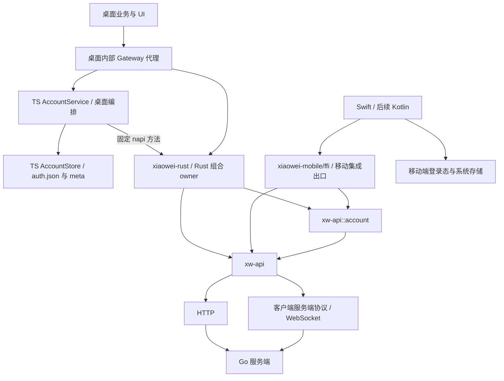

# 客户端 Rust 迁移方案

本方案承载 [iOS 客户端与设备授权](../2026-10-25-ios-client.md) 的独立前置迁移任务，覆盖 xwapi 迁移与 AccountService 的共享逻辑提取。01、02 的共享核心与桌面接入已完成，后续契约重组和迁移遗留清理也已完成自动回归及 Hermes 现场验收；移动 FFI 和移动端工程尚未实施。当前契约边界与验证结果见下文。

## 范围与边界

- Gateway 负责同一个 App 内的跨进程或跨模块代理通信，各平台按需接入；不承载手机调用桌面逻辑。
- xwapi 依据 server/*.proto 定义的通信契约执行 HTTP／WS 调用，通过稳定的普通 Rust API 供各端复用，核心不依赖 Gateway。桌面 UI／TS 业务通过 Gateway 使用 Rust 提供方；共享 Rust 内部的 account 直接调用 api。
- Account 提供当前账号的登录、退出、会话校验与连接维护，独立于 xwapi 请求执行。共享模块不提供存储，也不接管平台的产品登录态；桌面继续自行维护现有登录态与持久化流程。
- 本轮不实施内容加密、设备配对、收藏同步、iOS 完整 App 或 Android 工程。Swift 绑定验证在客户端核心稳定后接续。
- 移动端首期可以只连接线上单服务器；用户尚未最终确定移动端地址入口，不把多服务器管理列为移动端必需功能。通用客户端仍能接受调用方选定的服务器。

## 模块结构



共享实现采用一个纯 Rust crate：`crates/xw-api/` 承载网络客户端，其 `account` 模块承载当前单服务器会话的认证操作与运行维护。现有 `xiaowei-rust-napi` 依赖该 crate 并组合客户端和会话核心提供桌面接入。共享实现不依赖 Electron、napi、AppKit、Swift、JVM 或 Gateway。

| 代码位置 | 包／模块名称 | 职责 |
| --- | --- | --- |
| `crates/xw-api/` | Cargo 包 `xw-api`，Rust 导入名 `xw_api` | Rust HTTP／WS 实现；内部创建网络 client |
| `crates/xw-api/src/account/` | Rust 模块 `xw_api::account` | 直接使用同一 crate 的认证与连接能力，管理当前会话运行 |
| `crates/xiaowei-rust/napi/` | 现有 Cargo 包 `xiaowei-rust-napi`、npm 包 `xiaowei-rust` | 桌面 Gateway 与 napi 适配，继续只生成现有聚合 `.node` |
| `crates/xiaowei-mobile/ffi/`（后续移动切片） | 移动端 FFI 集成出口 | 组合 xw-api 的网络客户端与 account 模块，提供 Swift／后续 Kotlin 可调用接口及移动生命周期接入 |
| `desktop/src/main/services/account/` | 现有 TS AccountService／AccountStore | 桌面登录态、存储、多服务器选择和 UI 状态提交 |

各端按需设置自己的集成出口：桌面复用 `xiaowei-rust/napi`，移动端后续使用 `xiaowei-mobile/ffi`。`napi` 专用于 Node 绑定，移动端通过 FFI 暴露同一组 Rust 核心；具体绑定库仍按 iOS record 的评估验证。各端独立管理产品登录态与存储，移动端按自身内部通信需要决定是否接入 Gateway。本轮不创建移动集成包或绑定工程。

xw-api::account 直接调用同一 crate 的网络能力，桌面与移动端使用相同的调用路径，不注入认证接口或 client 创建工厂。xiaowei-rust 在 Rust 内部创建并组合 account 与 api，共用同一个具体客户端和 Gateway endpoint；TS 不创建或传递 Xwapi 原生实例，也不保留 desktop/services/xwapi 模块。HTTP／WS 由 xw-api 内部创建和维护。宿主只提供目标服务器、设备与恢复会话等数据，接收操作结果和凭据变化。xw-api::account 不提供存储接口，也不读取、保存或清除持久化凭据。

桌面调用的权限、取消和目标隔离由 `xiaowei-rust` 的 Gateway 适配接入。原有认证方法与受限 caller 的权限行为仍须保持；直调 api 不能直接删掉原来嵌套调用承担的校验。共享核心不接收 Gateway 对象，后台恢复仍使用明确的宿主身份。

### 桌面 Gateway 挂载

桌面 Gateway 接入放在 `crates/xiaowei-rust/napi/`，沿用现有 Storage、Clipboard 和 Search 的 endpoint 接入方式。以下为当前接入结构；契约重组后的完整回归与实例验收均已完成。

```text
crates/
  xw-api/
    Cargo.toml
    src/
      lib.rs               # 网络客户端公开入口
      http.rs              # HTTP 执行
      connection.rs        # WS 连接、心跳与重连
      websocket.rs         # 请求、通知、流与取消
      account/
        mod.rs             # 当前会话操作入口
        session.rs         # 登录、校验与退出
        refresh.rs         # 凭据刷新与并发合并
        types.rs           # 会话操作、结果及内部阶段
  xiaowei-rust/napi/src/
    xwapi/
      gateway.rs           # Auth / Health handlers 与连接事件
    account/
      mod.rs               # Rust 内部创建 api / account 与宿主会话接入
      operation.rs         # 固定 napi 会话方法、取消与保留结果适配
    gateway.rs             # 复用现有 GatewayEndpoint 类型
    gateway_binding.rs     # 通过生成流程产生 typed Method 常量
desktop/src/main/
  app/gateway.ts           # attachRustNapi 挂载与整体关闭
  services/account/        # 现有登录态、AccountStore 与 Account UI service
```

具体挂载链路：

1. `xiaowei-rust` 创建并持有共享模块实例，各自的 `gateway.rs` 提供正式 PB handlers，由组合入口注册到同一个 Rust `XwInvokeRegistry` owner；接口复用已有业务实例，不额外创建状态。
2. napi 层用现有 `GatewayEndpoint` 类型导出组合 endpoint，在 Rust 内注册 Auth／Health 与连接观察；会话操作使用 XwAccount 的固定 napi 方法。
3. 原生接入先创建 api 客户端，再创建复用它的 account 运行实例，整个组合在 Rust 内完成。main 沿用通用 `attachRustNapi` 接入桌面 GatewayHost，不单独装配 xwapi；关闭组合 owner 时先清理 account，再释放 api 网络资源。
4. 现有 TS `Account` owner 继续维护桌面登录态、持久化、服务器选择与快照，在 main 内部通过固定 napi 方法调用会话核心。进入 Rust account 后直接调用 api；普通服务器 API 的桌面消费者通过同一组合 endpoint 的 Auth／Health handlers 使用该 api。

Gateway handler 注册、caller 权限与取消适配均属于 `xiaowei-rust`，不进入 `xw-api`。TS 不重复注册 Rust 已提供的服务器路由；会话固定 napi 接口不暴露给 renderer 或 preload。

## AccountService 逐项拆分

以下记录迁移前 `desktop/src/main/services/account/service.ts` 和 `store.ts` 的职责拆分，当前行为以 [桌面账号说明](../../../../desktop/docs/account.md) 及 xw-api 的 README 为准。

| 当前逻辑 | 去向 | 拆分说明 |
| --- | --- | --- |
| 单个服务器的密码登录、响应检查与设备／会话核对 | Rust 会话核心 | 只接受目标服务器和设备上下文，不要求目标存在于桌面地址列表 |
| 启动／重新回到前台后的会话恢复 | 桌面加载与提交；Rust 执行校验 | 桌面读取现有凭据并传入，Rust 检查有效性、必要时刷新并返回结果；核心不自行读取存储 |
| access 提前刷新、refresh 轮换、并发刷新合并 | Rust 会话核心 | 一个会话只保留一个刷新流程，避免重复消费 refresh token |
| WS 鉴权与用户校验的恢复顺序、拒绝后的有限刷新 | Rust 会话核心 | 直接调用 api 执行；已发出的请求不跨传输重放 |
| 临时网络失败与明确凭据失效的区分 | Rust 返回结构化结果；桌面处理登录态 | 区分原因不依赖文案；桌面沿用暂时失败保留凭据、明确失效才清理的现有行为 |
| 新凭据保存后才发布、轮换保存失败保留新 token | 桌面登录态与提交编排 | Rust 交出最新凭据及版本，不回用已消费 token；桌面保持现有保存、失败重试和状态发布顺序 |
| 单会话退出与撤销 | Rust 执行认证与撤销；桌面清理登录态 | 已失效视为已撤销，失败保留以便重试；Rust 不自行删除保存记录或清除其他会话 |
| 登录取消、迟到响应隔离 | Rust 操作生命周期与桌面提交共同约束 | 核心隔离过期操作；桌面继续决定是否接受结果，保存或选择失败时调用 Rust 撤销未提交会话 |
| 单会话操作串行化、连接状态、关闭清理 | Rust 会话运行核心 | 不携带桌面 AccountStatus、服务器列表或 UI 布局，不形成第二套桌面产品状态机 |
| 刷新时机规则与并发合并 | Rust 会话维护能力 | 桌面保留现有调度入口，由宿主驱动维护与暂停／恢复；不在 Rust 另启动一套竞争的桌面刷新任务 |
| 服务器列表、添加地址检查与去重、默认地址补入 | 桌面编排 | 地址规范化和无凭据健康检查能力可复用，列表策略保留桌面 |
| 当前服务器选择、登录异服后切换、各服务器登录态列表 | 桌面编排 | 选择哪个单会话核心处于活动状态，切换不撤销原会话 |
| 多服务器退出全部与失败汇总 | 桌面编排 | 组合单会话退出；逐项保留失败结果，不在核心内遍历服务器列表 |
| AccountSnapshot 的服务器集合、全局 revision、AccountChanged | 桌面接入 | 从活动会话和本地列表聚合，保持现有 renderer 契约；不要求移动端采用同一通知协议 |
| 登录浮层、loading、错误文案、管理弹窗 | 桌面 UI | 页面通过既有 Account Gateway 使用能力，不移动到 Rust |
| auth.json v1／v2、Storage meta、文件权限与原子替换 | 现有 TS AccountStore | 保持现有格式、路径和行为，不迁入 Rust account 或新增原生存储实现；移动端自行接入系统存储 |
| 设备名称、系统存储、前后台／锁定通知 | 各平台适配 | UUID 与设备 ID 的合法性规则可共用，具体取得与保存由宿主负责 |
| Gateway 注册、权限、窗口来源和嵌套上下文 | 桌面提供方适配 | 不把 Gateway client／owner／registry 暴露到共享会话核心 |

“有状态”不等于“UI 功能”。移动端仍需要知道会话可用、正在恢复或需要登录；这些是会话结果。桌面的聚合快照、修订号与通知形式是独立产品接入，不作为共享核心的固定接口。

Rust 核心只操作宿主指定的单服务器会话，在内存中保留执行所需上下文。桌面保存多份会话记录，只活动化当前一份；切换时暂停旧任务及连接，读取并传入目标会话。未活动会话的退出可以在隔离上下文中执行，不临时改变当前选择。移动端可只使用一个当前会话。

“连接维护”在两模块之间区分职责：account 处理当前账号的凭据有效性、刷新与连接鉴权恢复；api 持有 HTTP／WS 的实际连接、帧、心跳及退避重连。桌面决定当前选择、会话结果何时提交、何时发布已有 Account 状态。

## xwapi 迁移边界

迁入 Rust：

- proto 方法元信息、短网络标识、默认登录要求、标准 Proto JSON／PB 编解码与响应校验。
- HTTP 发送、认证头、取消、超时、响应限额和安全日志。
- WS 认证握手、帧、请求关联、通知、响应流、取消、连接代次与资源限制。
- 当前会话的连接、心跳、退避重连，以及凭据替换后的旧连接清理。
- 默认优先可用 WS、发送前可选 HTTP、显式传输选择，以及已发出请求不自动重放的语义。

桌面保留：

- xwapi 的 Gateway 代理提供方位于 `xiaowei-rust`，创建、组合和 handler 注册均在 Rust 内完成；主进程只接入组合 endpoint，调用方仍使用现有 typed service。
- 请求上下文和原 caller 的权限继承；未提交登录与异服操作的隔离上下文不能丢失。
- 选择服务器和提交会话的产品决策；xwapi 不自行保存、刷新或删除登录态。

`peer.ts` 中的 `exports.host.invoke/subscribe/stream` 与本机 caller 清理不进入共享 xwapi。产品继续不导出客户端本地路由；已有线协议版本、认证、响应、通知及流行为保持兼容。代码位置与命名整理不等于更换网络协议。

客户端调用、通知与响应流所需测试迁往 xwapi；旧 fixture 中用于远端调用本机 Gateway 的用例单独登记为移除的越界扩展，不伪装成已迁移覆盖。当前产品的空导出约束必须有回归证明。

## 接口和所有权

- `xw_api` 持有网络请求和连接资源，读取宿主提交的不可变目标上下文；业务请求与普通 Rust RequestOptions 不接受任意覆盖服务器或 token。
- `xw_api::account` 持有当前会话执行所需的内存上下文、操作代次及刷新并发控制，不持有平台文档，也不定义持久化提交规则。它不提供存储或 SessionStore 接口。
- 桌面 `AccountService` 继续维护产品登录态并决定结果是否提交，`AccountStore` 仍是 auth.json 的唯一写入者。Rust 不自行切换桌面账号或发布桌面 AccountStatus，不新增一套独立的桌面登录态。
- 启动时由桌面读取保存会话，通过受信任的内部接入传给 Rust；登录、刷新、退出及失效结果交回桌面，沿用既有保存、删除、失败重试与状态发布流程。刷新后即使后续校验失败，最新凭据也必须交给宿主，不能丢失已轮换的 token。
- 桌面凭据保存失败时保留最新内存凭据，由现有编排先重试保存，再继续后续轮换；登录保存失败或取消时，沿用现有回滚与未提交会话撤销。Rust 会话操作与桌面提交使用相同的目标及操作代次隔离迟到结果。
- 凭据注入和变化交付只用于受信任宿主，不进入普通 UI AccountSnapshot 或事件载荷；普通业务复用 Gateway，Account 内部使用固定 napi，不新增跨语言副作用回调或内部存储 service。iOS 在自己的登录态层接入 Keychain。
- 核心通知只携带安全会话状态，不向 renderer、UI 快照或日志暴露 token。移动端的 Keychain／Android 系统存储不修改桌面既有存储政策。
- 当前设备 UUID、服务器账号身份、同步库身份和内容密钥授权彼此区分；本轮不将配对密钥并入账号 token 管理。

## 实施顺序与验收

| 切片 | 交付 | 验收入口 |
| --- | --- | --- |
| 01 xwapi 网络迁移 | Rust HTTP／WS、Gateway 提供方透明替换、网络代码归位；整理旧实现类型与装配引用 | 原有 typed 调用与断言经真实 napi／Go 链路回归、现有账号回归、Gateway 本地链路回归 |
| 02 共享会话核心 | 提取认证操作与会话维护，桌面 AccountService／AccountStore 继续维护原有登录态 | 单服务器核心失败路径、桌面全部账号行为、持久化兼容、权限和取消回归 |
| 后续移动接入 | Swift 最小绑定及 iOS 平台适配 | 真机／模拟器加载、实际请求、取消、状态与前后台恢复；进入实施时单独编写切片计划 |

01、02 的独立前置迁移已完成并验证，实施 Plan 已删除，结果见下述 Outcome。当前 iOS record 保持 proposed；移动工程、FFI 与配对设计进入实施时再建立所属切片 Plan。

01 替换 xwapi 提供方、原生接入、主进程装配和相应测试准备，保持既有 Gateway service、消息、options、业务调用方式与行为。迁移前 Account 从 connection.ts 实现文件引用鉴权结果类型不合理；01 将其提取到公开接入类型，调整相应 import，不保留旧实现文件来维持路径。Account 中等待鉴权和选择传输的行为在 01 保留，02 已将认证／维护执行提取到共享会话核心，后续合并为 xw-api::account。

桌面验收以迁移前的完整账号行为为基线，要求 100% 兼容；保存格式兼容、构建通过或单个成功登录不能代替该要求。现有成功与失败路径均需通过正式 Gateway／napi 入口回归，不以共享化为由改变桌面产品行为。

共享库为 `crates/xw-api/`，账号实现位于其 `account` 模块；桌面接入继续使用现有 `xiaowei-rust/napi/`，直接依赖该 crate。2026-10-25 用户已授权按 01、02 顺序实施，iOS 工程仍未开始；创建遵循 [包和依赖管理](../../../../docs/package-management.md)。根 docs 的 xwapi、Gateway、workspace 三份说明已获用户单独授权并同步；根 README 和归档记录未改。

## 契约边界

用户已确认并恢复本轮契约重组。三个调用入口保持清楚：renderer → AccountService 使用桌面 Account Gateway；AccountService → Rust 会话核心使用固定 napi；renderer → 服务器 API 使用 Gateway，Rust 代理再调用 xw-api。共享 Rust 模块本身不定义 proto 或依赖桌面契约，认证消息和业务错误码统一来自服务器产物。

桌面 Account 使用自身的用户展示与密码输入消息，AccountService 显式适配服务器类型；不 import Auth，保存格式和 UI 字段保持。删除原 xwapi.proto、account-session.proto 和无实际用途的 server_call；普通 Rust RequestOptions／Transport 保留传输选择与超时，桌面连接通知独立归入 desktop/session.proto。

契约源按业务 package 组织，产物固定于 `contracts/out/`。输出包之间无直接依赖，同语言同一项目类型只生成一次；目录规则统一使用 `**`，target 名推导语言和目录。桌面 TS／Rust、服务器 Go／Rust、Agent、LLM 与 testing 在同次迁移中完成。完整映射和生成规则见 [contracts](../../../../contracts/README.md)，当前调用边界见 [xwapi](../../../../docs/xwapi.md)；实施结果见下述 Outcome，已完成的 Plan 已删除。

本轮仅是已有 Rust 迁移的后续契约整理，不启动 iOS proposed 事项；移动 FFI、工程与配对仍未实施。历史验证不能代替本轮回归与现场验收。

## Outcome

2026-10-25：01、02 的独立前置迁移完成。网络执行与单服务器会话规则分别进入纯 Rust xw-api／xw-account，由既有 xiaowei-rust 组合并挂载桌面 Gateway。未增加 xw-client、认证 API 注入或 client 创建工厂；桌面 AccountService／AccountStore 继续维护产品登录态、多服务器、保存与回滚、调度及 UI 快照。Go WebSocket 协议最终归 `server/internal/httpapi/ws/`，TS 网络执行器与 Gateway 的网络 WebSocket 出口已移除；原有客户端反向导出本机 Gateway 的越界 fixture 明确登记为删除覆盖。

恢复／退出在凭据轮换后通过检查点交回宿主，桌面先保留内存并保存，再继续网络验证；取消或失败时等待同一操作结束并收取核心已经保留的新凭据。现有文件格式、原子写入和保存失败重试保持在 TS，Rust 核心不提供存储接口。当前行为和接入说明已同步到 [桌面账号](../../../../desktop/docs/account.md)、两个共享 crate 的 README，以及获授权的三份根 docs。

自动验证通过：`just gen`、`just check`、`pnpm contracts:test`、`pnpm gateway:test`、`pnpm --dir desktop test`、两个核心的 18 项测试、正式原生 addon 构建和真实 PostgreSQL 的 `go test -race ./...`。桌面完整回归包括 75 项 main 测试、147 项 renderer 测试及原生业务等链路；权限、取消、异服隔离、旧凭据格式、刷新保存失败与补偿通过正式 Gateway／napi 和隔离 fixture 验证。首轮 Go race 在并行构建期间出现既有认证 HTTP 测试关闭超时，后续两次完整复验通过，未放宽断言。一个既有外部 live provider 测试按设计跳过。

随后按用户要求 rebase 到 develop 的 `ef0b499`，全部未提交改动保留，README 自动合并。rebase 后桌面类型检查、41 项账号／连接／Launcher 定向测试和 13 项普通窗口测试通过。用户已重启 Hermes，已核对新 Electron 的 cwd、父子关系及 cmux console；16:27:25 的正式日志确认加载 Rust 核心，设置界面显示原本地服务器的账号和“云连接：已连接”，完成重启恢复验收。

16:28:55 通过正式账号管理界面切到已保存的线上服务器，自动刷新返回 HTTP 200／业务 code 0，桌面接收并保存轮换结果，随后建立 generation 3 的 WS 并完成当前用户校验；界面展示线上账号和“已连接”，公开账号配置中的选择同步更新。16:29:19 切回原本地服务器，generation 4 的 WS 和用户校验成功，原 UID 恢复；两个服务器的账号均保留，最终界面和公开配置的选择均为 `http://127.0.0.1:10001`。现场未退出真实账号，登录失败、取消、撤销及退出失败等路径由隔离测试覆盖。

本地现场验收连接的是此前已运行的 prometheus 服务端：工作目录为 `worktrees/prometheus/server`，启动于 2026-10-18 12:54，验收时监听进程 PID 为 38962，父级 `go run` PID 为 38955、PPID 为 1。该进程与 Hermes Electron 在 10001 端口保持真实连接，Health.Ready 返回 code 0；现场结果同时证明新客户端兼容旧服务端协议。本次没有启动或重启该其他工作区的服务；迁移后服务端源码的编译与行为由真实 Go fixture、集成测试及完整 Go race 回归验证。

本轮范围内无剩余验收，实施 Plan 已清理，按用户要求发送了 Telegram 完成通知并核对消息送达，代码保持未提交。移动 FFI、iOS／Android 工程、设备授权、内容加密与收藏同步仍未实施，继续按 iOS proposed record 对齐后续边界；桌面验证不代替移动端构建和生命周期验收。

随后按用户确认的边界继续剥离桌面 TS xwapi 接入：删除 `desktop/src/main/services/xwapi/` 及独立原生 `Xwapi` 类，`XwAccount` 在 Rust 内创建并组合 api／account，由同一 endpoint 注册 AccountSession、Auth、Health 和连接事件。`app/gateway.ts` 不再单独创建、传递或关闭 xwapi；普通 Health 调用继续使用既有 Gateway，桌面账号只交付会话数据、接收运行结果并维护原有产品登录态。生产 TS 与正式 napi 导出均已核对无旧 Xwapi 接入引用。

本次剥离的自动验证通过：正式 debug addon 构建、`cargo check -p xiaowei-rust-napi --locked`、桌面类型检查、46 项定向测试、完整 `pnpm --dir desktop test`、`pnpm gateway:test` 和最终 `just check`。完整回归包括两个共享核心的 18 项测试、93 项 main 测试和 147 项 renderer 测试，既有外部 live provider 测试仍按设计跳过。正式组合 endpoint 的测试覆盖普通 Gateway API 使用当前 Rust 上下文，以及异服 Health 检查阻塞时当前服务器的认证请求仍正常、目标和凭据保持隔离。

已重载原有 Hermes 实例，16:56:53 的启动日志确认加载本次原生构建、建立 generation 1 的 WebSocket 并完成当前用户请求。17:17:44 用户手动切到线上服务器，日志确认 `savedSession: true`，Rust 建立 generation 2 的 WebSocket，随后经该连接执行 `auth.Auth/GetCurrentUser`，38 ms 收到响应；17:17:48 切回本地服务器，同样读取到保存会话，建立 generation 3 的 WebSocket，并在 2 ms 收到当前用户响应。对应 console 未见账号失效、校验不可用或重连错误。只读核对 `account.config`，原有两个服务器均保留，最终选择仍为 `http://127.0.0.1:10001`。本次界面切换由用户执行，Agent 核对实际运行日志与公开配置，不将此前 Computer Use 未恢复时的尝试记作现场操作。

TS 接入剥离的实现、自动验证与上述切服日志验收已完成，对应独立 Plan 已删除。iOS record 保持 proposed，移动 FFI、移动工程及后续同步能力仍未实施；代码保持未提交。

用户随后要求复查迁移遗留。已移除无生产调用的本地 `Connection.Authenticate`、专用返回消息和 Rust handler／绑定选择，以及未使用的桌面 `AccountSession.Maintain` 和 napi／TS `suspend` 包装。连接状态事件及其代次过滤仍保留；Rust 单会话核心的刷新维护、并发合并和暂停能力具有独立职责，继续由核心测试覆盖。同步删除了无引用的 `current_user_route`、已不需要的目标／会话 JSON 派生、单次调用的取消包装和 fixture 未使用的配置分支。桌面连接测试直接使用正式 account 接入与连接事件，服务器 API fixture 只保留隔离目标与测试时钟准备。

清理后已执行 `just gen`、契约编解码测试、正式 addon 构建、12 项定向测试、完整 desktop 回归和最终 `just check`；18 项共享核心、93 项 main、147 项 renderer 及其他原生／worker 回归通过，既有外部 live provider 测试仍按设计跳过。测试重接线中的目标初始化顺序和旧 Promise 身份断言已修正后全量复验通过。另用正式生产 addon 直接核对导出与 Gateway manifest，确认旧 Xwapi 类、桌面 suspend、Connection.Authenticate 和 AccountSession.Maintain 均未导出，普通 Auth 路由和 ConnectionChanged 事件仍存在。

随后按用户确认的客户端／服务端边界，取消“服务端也有 xwapi 模块”的划分。Go WebSocket 协议收回 HTTP 接入层的 `ws/` 子目录，服务端仅实现接口及网络规范；App 内 caller／trusted 不充当网络账号身份。反向调用／订阅客户端的实现、开关及专用 fixture 已删除，已发布帧与正常服务端接口保持兼容。真实 PostgreSQL 的完整 Go race、18 项 Rust 核心、完整 desktop 回归及最终 `just check` 通过，新增实际握手测试覆盖拒绝客户端方法和事件声明。当前说明、旧路径及 fixture 构建入口已同步。

清理时原 Hermes 实例已退出，桌面重载验证延后到用户重新启动之后；未自行冷启动，也未操作其他工作区实例。该项现场验收已于 2026-10-26 完成，结果见下文，清理 Plan 随之删除。iOS record 继续保持 proposed，代码未提交。

用户随后明确要求将 xw-account 合入 xw-api。现已将原账号实现和专属 HTTP 测试完整迁至 `crates/xw-api/src/account/` 与 `tests/account/`，公开路径为 `xw_api::account`；旧 Cargo 包、目录和原生依赖已删除，锁文件由 Cargo 更新，桌面测试入口统一运行 xw-api。迁移前后源码比较确认仅调整模块引用、内部可见范围和格式，六项账号测试及 fixture 保留。当前说明与依赖图已同步；本次合并不修改任何 proto、生成契约、Gateway 路由、napi 公开接口或桌面业务行为。

合并验证通过：迁移前后均为 18 项核心测试；完整 desktop 回归包含 93 项 main、147 项 renderer 和其他原生／worker 测试，既有外部 live provider 测试仍按设计跳过。修正模块迁移后的内部可见性告警后，正式 xiaowei-rust addon 再次构建，32 项账号／连接／API 正式原生入口回归与核心测试通过；`just check`、契约与 napi 产物内容比对、旧包清理及排版检查通过。合并切片已完成，代码未提交；此前清理切片的现场重载验收随后与契约重组一并完成。


2026-10-26 契约重组的源码与自动验证已完成：17 份 proto 按业务 package 归位，产物固定为五个独立 Rust 包、桌面 TS 包和服务器 Go 包；每种语言的同一项目类型只有一个生成来源，输出包之间没有直接依赖。`sources` 使用递归目录规则与精确文件规则，target 名推导语言和目录。旧 `contracts/{ts,rust,go}` 总包及中间 xwapi 产物已删除；消费者、锁文件、CI、Docker、生成缓存与当前文档均已切换。Settings 独立 package，Agent、LLM、testing 同次迁移，标准 Empty 使用语言运行库。

共享 xw-api 不再依赖 xwapi 或会话 RPC proto，普通 Rust 选项保留超时与传输选择。服务器 Auth／Health Gateway 代理继续由 Rust 注册；AccountService 内部改为固定 napi 登录、恢复、退出、撤销、继续、取消和保留结果方法。取消令牌在返回 JS Promise 前登记；同步建连初始化进入 napi 的 Tokio runtime，已由真实连接测试覆盖。权限投影、检查点先保存后继续、错误／取消后收取新凭据、目标隔离及生命周期保留。桌面 Account 自定义用户展示与密码输入，删除 Auth import，由 AccountService 显式转换；UI 字段、密码原值与原登录态存储格式保持。

本轮自动验证通过：`just gen`、契约和 Gateway 漂移检查、三语言 codec、156 项工具测试、`cargo test --locked --workspace`、`pnpm gateway:test`、完整 `pnpm --dir desktop test`、两个正式 debug addon 构建、正式 napi 产物检查、13 项常规 napi 包测试、真实 PostgreSQL 的 `go test -count=1 -race ./...` 及最终 `just check`。完整桌面回归包含 147 项 renderer 测试，既有外部 live provider 测试按设计跳过；最后补充的固定 napi 自主建连与立即取消等三项边界测试，以及 34 项账号／连接／API 定向回归通过。Go race 首轮发现测试路由中的错误 Empty 全名，修正为标准全名；随后一次认证 HTTP 测试关闭超时，单独全量复验通过，未调整关闭时限或断言。

Empty 的 PB／JSON 兼容已通过 codec；其 WS manifest 输入类型全名由自定义 Empty 变为 google.protobuf.Empty，旧服务端声明不匹配时自动策略会在发送前选择 HTTP。通过这些方法使用 WS 需要服务端更新到相同契约，该边界已写入 xwapi 当前说明。

常规 napi 包补充回归发现 Empty 的机械替换误改了两处空剪贴板错误文本，已恢复原 `Empty clipboard content`；同次复核撤回了与协议无关的书签 fixture 和 rollout 注释改动。常规 addon 重新构建后，13 项包测试与最终 `just check` 通过。

2026-10-26 按用户要求 rebase 到本地 develop 的 `efccd63`，全部未提交改动恢复，未创建提交。保留 develop 新增的 Agent 交互／Generate 状态、剪贴板修改时间与 inspect CLI，并同步迁移后的契约产物及消费者。合并回归复现了异服 Health 检查目标错误：新版 Gateway 区分逻辑 caller 与每次调用的 transport token，原生 xwapi 适配仍用 caller 查临时上下文。现改用 transport token 关联宿主 metadata，逻辑调用方身份、权限和并发目标隔离保持。

Rebase 后重新生成并构建两个正式 debug addon，受影响的 Storage／Clipboard／Agent Rust 测试、160 项工具测试、三语言 codec、28 项账号／API 定向回归、完整 Gateway 和 desktop 回归以及 `just check` 均通过。完整桌面回归含 99 项 main、207 项 renderer 测试及其他原生／worker 链路；既有外部 live provider 测试按设计跳过。Git 无未解决冲突或暂存改动。

用户已冷启动 Hermes。08:12:44 经 cmux 重载后，核对新 Electron 的绝对路径、cwd、父子关系及 inspect 来源均属于本工作区，两个原生模块加载成功。保存的本地会话建立 generation 1 的 WS，当前用户 HTTP 校验返回 200／code 0；设置界面显示原账号与“云连接：已连接”。08:13:10 由实际账号管理界面切到已保存的线上服务器，刷新成功并保存轮换结果，随后建立 generation 3 的 WS，当前用户 HTTP 校验成功，界面显示线上账号与已连接。08:13:15 切回原本地服务器，generation 4 建连和用户校验成功；两个已保存账号保持，最终选择为 `http://127.0.0.1:10001`。

现场服务端仍使用旧契约，因此 Empty 方法在发送前按 manifest 兼容规则回退 HTTP；现场证明了会话恢复、WS 建连、HTTP 回退及双服务器往返，不将其记作新版契约的 WS 方法验收。新版 WS 方法已由隔离真实服务端回归验证。本轮未读取真实凭据、未退出真实账号、未冷启动应用或重启其他工作区服务。契约重组与此前清理事项无剩余必要验收，对应两个 Plan 已删除；iOS record 保持 proposed，移动能力未实施，代码保持未提交。

用户随后纠正产物目录，七个输出包已统一迁入 `contracts/out/`。固定路径推导、workspace 与锁文件、Rust path 依赖、Go module／import／replace、CI 缓存、格式化入口、Docker 构建上下文及当前文档均同步；旧输出目录已移除。重新生成后的 60 个产物文件逐一比对，内容变化仅为 Go module 路径。源码日志工具原先按目录名排除 out，已复现其误伤契约包源码的问题并修正；契约包内的依赖与构建目录继续排除，相关回归通过。

目录修正验证通过：`just gen`、三语言 codec、10 项源码日志测试、160 项工具测试、完整 desktop 回归、两个正式 debug addon 构建、真实 PostgreSQL 的完整 Go race、linux/amd64 Docker 镜像构建及 `just check`。工具测试的临时仓库使用测试作者，运行时仅通过进程级 Git 配置关闭 fixture 提交签名，以避免全局 GPG 设置导致的无密钥错误，用户与仓库配置保持原状。08:18:34 通过当前 Hermes 控制 console 重载完整开发会话，新原生模块、renderer 与 worker 正常加载，保存的本地会话恢复、WS 建连和用户 HTTP 校验成功；inspect 确认新实例属于本工作区且 renderer 已就绪。代码保持未提交。
