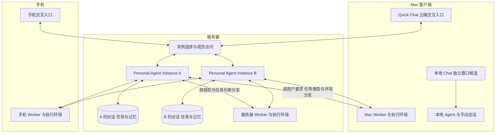

# Personal Agent：多实例、共享使用与多环境 Worker

## Why

用户于 2026-11-02 要求阅读 DeepSeek Harness 团队的[《Super-agent 设计探索：迈向更自主的 Agent 系统》](https://mp.weixin.qq.com/s/zoS7GlReWPhfCjENGxXCdg)（2026-10-31），据此起草推进 XiaoWei Personal Agent 的 record。

现有 [Agent Chat](../active/2026-09-28-agent-chat.md) 已建立持久会话、模型与工具循环、权限交互及 Quick Chat 入口。下一步需要让用户围绕事情持续协作，由系统接管任务关联、执行分发和结果汇总，降低手动管理多个 Session 的负担。

文章中的连续交互、Router／Worker 分工、事件驱动和计算与执行环境分离，为本事项提供总体参考。本文结合用户明确的运行位置和角色要求确定结构，不直接照搬文章的完整机制或原型实现。

总体实体命名为 **Personal Agent Instance**，下文简称“实例”。实例代表可持续协作的助手实体，协调、路由、任务管理和记忆是其内部能力。

用户要求先梳理整体结构，具体实现细节后续再定。本 record 保持 proposed，当前不固定服务端运行时、通信协议、数据结构或首期各 Worker 的具体能力。

## What

### 已明确的整体方向

- **实例运行在服务器**：每个 Personal Agent Instance 持有自己的云端对话、任务状态、记忆和协调能力，生命周期独立于客户端。
- **支持多实例与共享使用**：一个用户可使用多个实例，同一个实例也可由多个用户共同使用；用户与实例通过成员关系关联。
- **手机和 Quick Chat 是交互入口**：用户可以从任一入口访问有权使用的目标实例，发起任务、继续讨论、查看进展和结果，以及作出必要决定。
- **Worker 可运行在服务器、Mac 和手机上**：Worker 是执行角色，各运行环境提供实际可用的能力；同一设备可以同时承担交互与执行角色。
- **按用户要求、任务类型和所需环境动态分发**：实例在其获准使用的 Worker 范围内选择满足任务约束的执行方，执行位置随任务确定。
- **Quick Chat 拟迁移到云端实例**：原有本地 Chat 继续保留，单独对话窗口是当前候选承载方式，具体入口和实施范围后续确定。

### 逻辑角色

| 角色 | 职责 | 运行位置 |
| --- | --- | --- |
| 交互入口 | 接收用户要求，展示对话、任务、结果和待决定事项 | 手机 App、Mac Quick Chat；后续可扩展其他渠道 |
| Personal Agent Instance | 维护实例身份、成员与协作上下文，理解意图、管理任务与记忆、选择 Worker、跟进执行和汇总交付 | 服务器 |
| Worker | 接受任务，在独立执行上下文中调用实际能力，回报进展、阻塞和结果 | 服务器、Mac 客户端、手机 |
| 执行环境 | 提供工具、文件、数据、系统能力和运行资源 | Worker 所在或其明确获准访问的环境 |

实例内部的协调与 Router 能力负责理解意图和高层协调，任务分发同时使用明确的用户约束和可确定的环境信息。耗时执行交给 Worker，交互入口可继续接纳其他要求。Worker 和实例即使部署在同一台服务器，仍保持各自的执行上下文与职责。

### 用户与实例的关系

用户与实例是多对多关系，支持个人独用和多人共用。例如：

| 用户 | 可使用的实例 |
| --- | --- |
| 用户甲 | 个人实例 A、共享实例 B |
| 用户乙 | 共享实例 B |

每个实例拥有独立身份、成员范围、对话、任务和记忆。甲可以在 A 中处理自己的事项，也可以和乙在 B 中共同推进任务；甲在 A 中的上下文不会因其同时参与 B 而自动合并到 B。

共享实例中的用户输入、决定和操作保留实际发起人。具体成员权限、内容可见范围与管理方式后续设计。实例成员关系与 Worker／执行环境的使用授权分别管理，共用实例不自动开放成员的全部设备、个人数据或本地会话。

一个服务器部署可承载多个实例，每个实例可关联多个任务及执行会话。实例的身份、成员和上下文独立于底层进程与 Session 的组织方式。

### 同一设备上的角色组合

| 位置 | 可以承担的角色 |
| --- | --- |
| 服务器 | 多个 Personal Agent Instance，以及服务器 Worker |
| Mac 客户端 | Quick Chat 交互入口、Mac Worker，以及用户直接使用的本地 Chat |
| 手机 | 手机交互入口，以及提供手机端能力的 Worker |

Worker 的角色与设备类型分开定义。不同位置的 Worker 可以具备相同的通用能力，也可以提供只有该环境才有的能力；具体能力和可运行条件在后续设计中明确。

## How

以下是目标结构，尚未实现。

### 整体结构

一条典型链路是：用户从手机或 Quick Chat 向有权使用的目标实例提出要求，实例建立或关联任务，选择合适且获准使用的 Worker，Worker 执行后回报，实例统一交付。后续补充要求或决定保持原实例和任务归属，不要求用户指定底层 Session。图中的 Worker 连线表示按授权使用的可能关系，具体接入范围后续确定。

服务器 Worker 可以在 Mac 和手机离线时继续完成适合服务器环境的任务。需要特定 Mac 或手机能力的任务，在对应环境可用时执行；环境不可用时保留明确的等待状态。

### 任务如何分发

实例在其可用且获准使用的 Worker 范围内，综合以下三个方面确定执行位置：

1. **用户要求**：是否指定设备、位置、数据范围或其他执行约束。
2. **任务类型**：需要哪些模型、工具、系统能力或运行条件。
3. **所需环境**：相关文件、数据、应用、工具链或其他资源实际位于哪里，哪些 Worker 有权访问且当前可用。

明确的用户约束和环境限制是分发条件，语义判断用于理解任务需求和处理归属不明确的情况。满足条件的 Worker 不可用时，任务等待或向用户说明原因；具体选择策略后续确定。

例如，公开资料收集可以交给具备网页能力的可用 Worker；依赖某台 Mac 工作目录的任务交给该环境中的 Worker；需要手机端数据或原生能力的任务交给手机 Worker。上述是分发示例，实际选择仍服从用户要求和已具备的能力。

任务与执行会话通过稳定关联连接，保留所属实例和发起用户。一个任务可以包含不同环境中的执行工作，具体拆分粒度和协作方式后续设计；当前不预设完整工作流引擎或复杂调度平台。

### 任务与上下文的归属

- **Personal Agent Instance**维护本实例的成员关系、云端对话、任务目标、最新要求、任务状态、执行关联、重要决定和汇总结果，是该实例跨入口、跨用户协作的权威来源。
- **Worker**维护所承担工作的执行上下文、工具调用与实际执行结果，向所属任务的实例回报必要信息。执行保留实例与任务关联，不因 Worker 所在设备相同而混合不同实例的上下文。
- **交互入口**围绕用户有权使用的实例组织对话与任务。用户在手机和 Quick Chat 间继续同一实例中的事项，也可以切换到另一个实例；切换保持各实例的上下文归属。
- **本地 Chat**保留独立的手动会话与历史，可与 Mac Worker 复用执行核心；云端受管任务与用户手动本地聊天保持明确关联和数据归属。

每个实例的跨任务记忆先围绕可追溯的任务、决定和结果组织，通过摘要与关联按需读取。共享实例的协作记忆属于该实例，个人数据接入范围单独明确；跨实例共享、长期个人事实、偏好、检索方式和保留策略留待后续设计。

### 交互入口与本地 Chat

Quick Chat 拟成为云端实例的快捷入口，与手机访问用户有权使用的实例及其对话、任务。入口需要明确当前目标实例和切换关系，具体 UI 后续确定。现有 Launcher 唤起、焦点和键盘交互可按适用范围复用。

本地 Chat 继续提供直接使用本地 Agent 的能力。独立对话窗口是当前候选方案，后续确定打开方式、会话列表和快捷键归属。Quick Chat 的入口迁移与原有本地历史的云端导入是两个事项，不默认上传或删除旧会话。

手机同时拥有交互端和 Worker 两种角色，其执行能力应按 iOS 的实际运行条件设计。首期不预设手机可以持续后台运行完整 Agent；前后台、挂起和系统能力的具体处理后续确定。

### 现有基础与模块关系

| 现有部分 | 在整体结构中的位置 |
| --- | --- |
| [Go 服务端](../../../server/README.md) | 提供账号、设备会话、网络与持久化基础；增加实例、成员关系、协调与任务业务 |
| [Agent Core](../../../crates/xw-agent/README.md) 与 [Agent Chat](../active/2026-09-28-agent-chat.md) | 复用有效的会话、工具循环、历史与交互机制，作为 Worker 和本地 Chat 的执行基础；不同宿主的接入仍需设计 |
| [Quick Chat](../../../desktop/docs/quick-chat.md) | 从现有本地聊天入口调整为云端实例入口，支持明确目标实例；本地聊天另有承载位置 |
| [iOS App](../../../ios/README.md) 与 [移动接入](../../../ios/docs/development.md) | 复用现有 SwiftUI、登录及共享网络基础，增加 Personal Agent 交互和所选手机 Worker 能力 |
| [xwapi](../../../docs/xwapi.md) | 提供客户端访问服务器的现有基础，后续扩展所需业务接入 |

现有本地 Agent、账号和网络连接不等于多实例、共享使用或跨端 Worker 已经实现。服务器与手机的模型、工具及运行资源如何接入，需要按实际能力评估，不能直接将 Electron／napi 装配视为跨平台实现。

现有 [Agent Chat](../active/2026-09-28-agent-chat.md)、[iOS 客户端与设备授权](../active/2026-10-25-ios-client.md) 和[服务器建设](../active/2026-10-11-server-development.md)保留各自已确定的范围。本事项承载 Personal Agent 总体结构及其新增集成；具体实施时再对齐依赖，不重复记录或默认完成原事项尚未交付的能力。

## Current work

2026-11-02 已读取文章并结合当前代码梳理总体结构。总体实体采用 Personal Agent Instance，运行在服务器；支持一个用户使用多个实例、多个用户共同使用同一实例。手机与 Quick Chat 访问目标实例，服务器／Mac／手机均可作为 Worker，按用户要求、任务类型和所需环境动态分发。本地 Chat 独立窗口保留为待细化方案。

本轮只维护总体架构 proposal，不修改运行代码、业务契约或长期文档，不创建实施 Plan，也不变更其他 record 的状态。

后续再明确具体使用场景与交付范围，包括实例的创建／管理、成员权限与可见范围、Worker 的接入范围与实际能力、服务端运行时与模型接入、通信及持久化、调度与恢复策略，以及实例切换和本地 Chat 窗口方案。当前不以这些细节作为整体结构讨论的前置。
