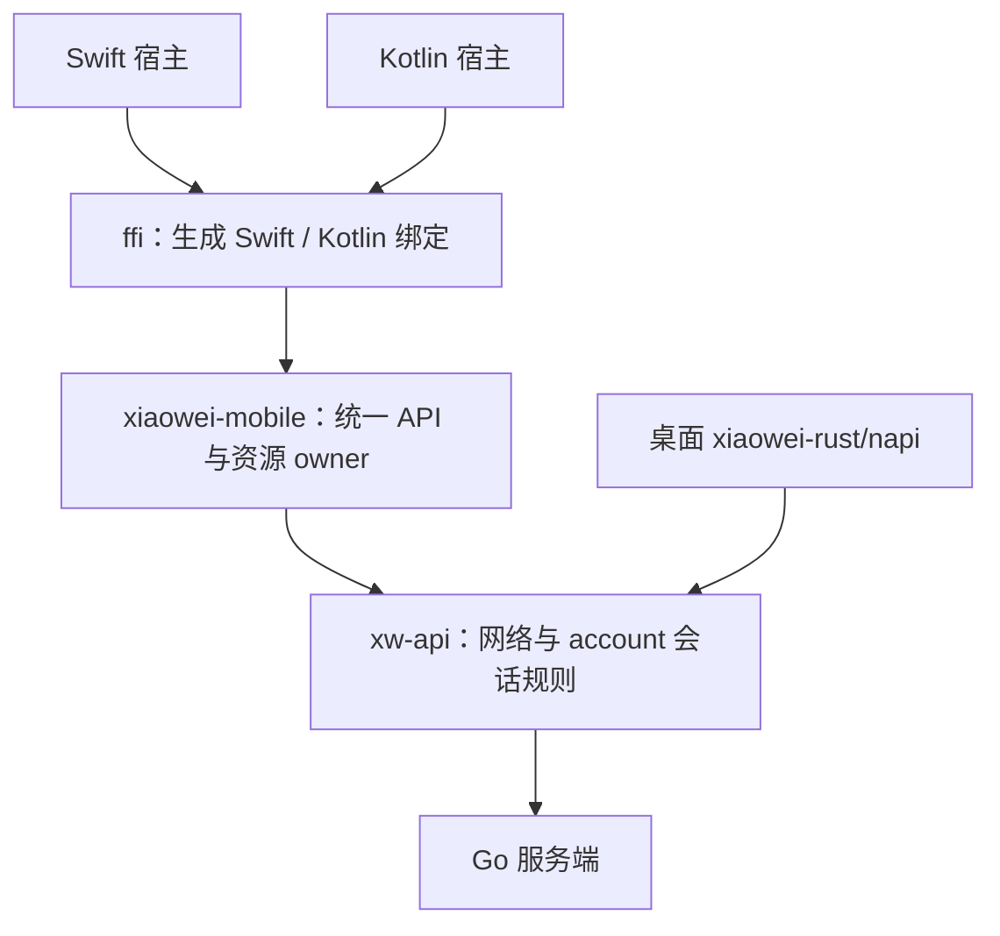
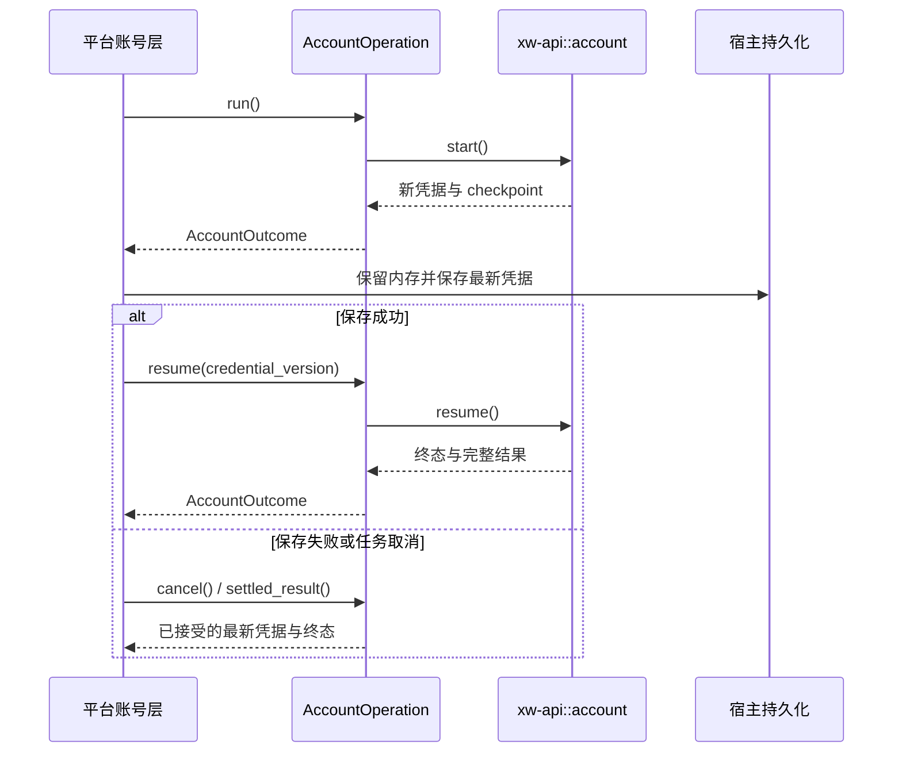

# 移动模块接口与生命周期

`xiaowei-mobile` 是移动端功能入口，组合共享业务模块、管理运行资源并提供普通 Rust API。`ffi/` 依赖该入口，仅转换类型和导出语言绑定。模块结构与验证入口见[README](../README.md)。

共享业务实现属于 `xw-*`，移动入口承担功能组合、运行时、操作范围、结果保留及资源关闭。后续能力按实际需求接入；当前没有同步、配对、存储接口或插件框架。

## 客户端与上下文

`MobileClient::new()` 返回引用计数 owner，在 Rust 内创建具体 `xw_api::Client` 和已提交会话的 `SessionCore`。模块延迟初始化进程共用的两个工作线程 Tokio runtime；宿主无需先创建 Tokio，Swift／JVM 的事件循环不执行网络驱动，也不在 UI 线程 `block_on`。各客户端关闭自己的任务，进程运行时持续存在。

`SessionContext` 包含规范化前的服务器地址、可选 `Authenticated` PB 字节与 `connect`。模块验证地址并解码认证消息；凭据来自受信任的平台账号层，不从业务 payload 或请求选项读取。会话、设备与登录结果的业务校验仍由共享核心与服务器完成。

| 方法 | 用途 |
| --- | --- |
| `set_session(context)` | 异步交付宿主已提交的上下文，等待旧范围结算后配置连接，返回下次维护时间；不执行持久化或用户校验 |
| `login(context, request)` | 创建未提交登录的隔离操作；request 为服务器 LoginRequest PB，不激活该登录的连接 |
| `restore(context, force)` | 创建恢复与校验操作，复用刷新、鉴权等待及有限恢复 |
| `maintain(context, force)` | 创建凭据维护操作；调度时机由宿主根据结果决定 |
| `logout(context)`／`revoke(context)` | 正常退出或撤销未提交会话；Revoke 使用隔离上下文，不替换当前连接 |
| `invoke(context, method, payload, options)` | 创建普通 API 调用，固定请求目标和参数；不自动刷新凭据、保存会话或提交产品登录态 |
| `subscribe_connection()` | 返回同一个网络客户端的独立状态订阅 |
| `suspend()` | 取消并等待当前工作，停止连接，保留操作结果，拒绝新工作；恢复时由宿主重新交付会话 |
| `close()` | 禁止新工作，取消并等待操作、关闭订阅与网络；可重复等待 |

当前上下文与在途账号操作使用不同 SessionCore，提交已轮换的同一会话不会重置其检查点。服务器、用户或 session ID 改变时，先取消并等待旧范围工作，再应用新目标，避免旧恢复阶段迟到的连接设置覆盖新选择。旧操作仍可收取原上下文的保留结果，不能读到新目标凭据。普通调用也持有不可变目标，在首次执行时取当前时间检查有效期。

设置当前连接的操作必须与宿主已提交的目标一致。Login／Revoke 强制不活动化连接；其他操作只有在 `connect = true` 时使用当前连接的鉴权与恢复。会话切换、暂停及整体关闭使用同一生命周期锁；已经启动的清理由模块运行时完成，不依赖外部等待是否仍被轮询。切换期间拒绝新业务工作，关闭请求立即拒绝新工作，等待先前生命周期操作后再清理资源。宿主仍应等待暂停完成后恢复会话，串行提交自己的登录态与服务器选择。

## 账号操作与凭据

同一客户端只允许一个账号操作占用执行位置，等待检查点保存也算占用，关闭句柄后释放。冲突返回本地 Busy，不排队，也不创建两个并行消费同一 refresh token 的隔离核心。普通 API 调用可以并行。

`AccountOperation` 在执行前已登记取消信号、固定上下文并持有独立核心。其 ID 由模块生成，不提供按外部字符串 ID 查找任意操作的接口。

| 方法 | 语义 |
| --- | --- |
| `run()` | 执行一次命令；重复等待复用已创建任务，不重放网络动作 |
| `resume(credential_version)` | 核对最近返回的检查点和凭据版本，再继续同一核心；只能在宿主接受新凭据后调用 |
| `cancel()` | 同步且幂等；首次执行前取消也有效 |
| `settled_result()` | 等待在途执行并收取核心保留结果；不启动命令、继续检查点或重放请求 |
| `close()` | 取消、等待结算并关闭隔离核心；关闭后仍可从原句柄收取保留结果 |

`AccountOutcome` 包含 code、msg、可选完整认证 PB、credential_version、checkpoint 和 next_maintenance_at_ms。成功、失败和取消都交付完整结果；账号业务失败不使用会丢失凭据的异常路径。

宿主每次接收结果时，先保留已变化的完整认证数据，再处理错误或取消。用户信息更新不一定增加凭据版本，不能只比较 version。保存失败时取消并收取保留结果，重试保存最新凭据，不能重新消费旧 refresh token。

未提交登录在取消或保存失败后，可由宿主取得其结果、关闭原操作，再创建 Revoke 尝试撤销。服务器已产生副作用而响应尚未被核心接受时，无法保证取得或撤销该会话。关闭操作和取消等待都不表示回滚远端副作用。

## 普通调用、状态与错误

`ApiCall` 提供 `run()`、同步 `cancel()` 和异步 `close()`。重复读取复用结果；客户端保留清理所需的内部 work，即使外部等待被丢弃，整体关闭仍能取消并等待工作。公开句柄 Drop 只做取消兜底。

选项复用 `RequestOptions`：默认 15 秒超时，0 仅关闭网络等待计时；Auto 优先可用 WS，否则发送前选择 HTTP，显式 WS 不回退。WS 已发出后不经 HTTP 重放。完整规则见[xwapi](../../../docs/xwapi.md)。

普通请求的业务非零结果统一保留为标准 PB 失败响应。HTTP 核心以 category=business 返回错误时，移动入口与桌面适配一样，以生成的 BaseResponse 还原 code／msg；网络、超时、取消和参数错误则转换为保留 code／category／安全 msg 的 `MobileError::Core`。句柄误用、Busy、关闭或运行时故障使用本地结构化错误，不伪装成服务端业务码。

`ConnectionSubscription.next()` 首次返回当前快照，再等待 `watch` 更新；中间状态可以合并，不是事件日志。单个订阅仅允许一个等待者。`close()` 结束当前等待，后续返回 None；客户端关闭结束全部订阅。快照只有 generation、状态和可选鉴权结果，没有凭据。

业务消息唯一来源为[服务器 proto](../../../contracts/proto/xiaowei/server/)，边界使用 PB 字节；本地选项、错误与状态才转换为 UniFFI record／enum。正式 App 的 Swift／Kotlin 类型化业务消息尚待接入既有契约生成流程，不手写 codec 或业务消息副本。

## 平台清理与可观测性

跨语言方法名与清理顺序见[绑定说明](../ffi/README.md)。平台任务取消必须显式调用句柄 cancel；账号取消后在独立 Swift 清理任务或 Kotlin NonCancellable 区域中收取结果、保存凭据并关闭操作。正常退出先处理账号层的保存事务，再关闭客户端；ARC／GC 不承担异步结算。

模块沿用 Rust `log` 门面，记录初始化、账号操作 ID、code／checkpoint、暂停和关闭结果，不记录认证 payload。HTTP／WS 请求证据仍由 xw-api 输出；日志 sink 由平台宿主接入，模块不安装全局 logger。
