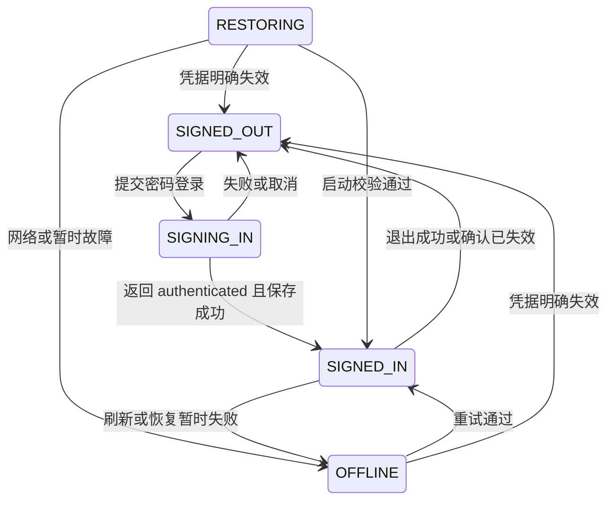
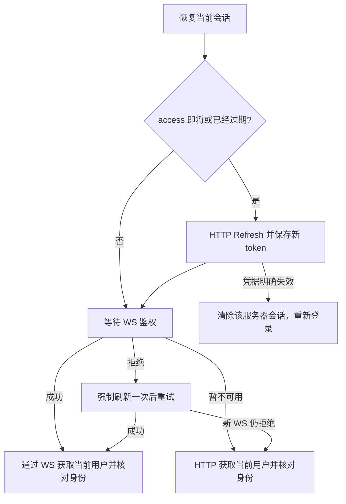

# 桌面账号与会话

桌面端已实现服务器选择、邮箱密码登录、设备身份、登录态保存、启动恢复、刷新和退出。账号 owner 位于 [services/account](../src/main/services/account/service.ts)，经本地 Gateway 向 renderer 提供 [Account 契约](../../contracts/proto/xiaowei/account.proto)；网络请求通过 [xwapi](../../docs/xwapi.md) 的 typed Auth client 执行。已接入独立的云连接状态；注册、找回密码及微信授权尚未接入。

已按确认的 Storybook 交互接入账号管理弹窗，支持逐服务器登录、切换、单独退出和退出全部。添加服务器与登录相互独立，成功登录另一服务器后才切换当前账号。

## 模块与凭据边界

AccountService 持有服务器选择和会话生命周期；AccountStore 负责 Storage meta 与登录态文件；app/gateway.ts 负责装配。renderer 使用 Account typed client 和快照，不通过 preload 新增业务接口，不直接读取登录态文件。账号快照包含 revision、服务器列表、选择、公开用户和状态消息，不包含 token。

xwapi 负责网络协议、响应解码和本地鉴权前置检查，不管理 Account 会话。直接调用原始 Login／Refresh／Logout 不会自动保存凭据或发出 Account 状态变更；AccountService 校验业务 code 及 authenticated 结果后才提交产品登录态。取消补偿和关闭顺序见 [xwapi 会话边界](../../docs/xwapi.md#模块职责与会话边界)，不在这里维护另一份传输实现说明。

xwapi 的网络路由和 API 方法日志统一使用 `serverApiMethod()` 生成的短标识，例如 `auth.Auth/GetCurrentUser`。本地 Gateway 注册与权限检查仍使用完整方法身份；HTTP 日志中的 `method=POST` 表示请求动词，API 标识体现在 `path` 中。

## 服务器与设备

首次使用时服务器列表默认包含并选中 `https://xiaowei.tctony.com`，开发态也使用此默认值。加载已有配置时，若列表缺少该地址则自动补入，保留已有选择；原列表为空时选中默认服务器，不重复添加。用户可以保存多个地址及各自的登录态，同时只激活一个服务器。切换保留原服务器会话，不请求退出；目标没有保存会话时显示登录入口，已有会话时恢复并验证。未激活的服务器不连接 WS，也不后台刷新，切回后再按需刷新。账号以服务器地址与公开 user_id 区分，不自动跨服务器合并同邮箱账号。

地址允许 HTTPS，HTTP 仅限 localhost、127.0.0.1 和 ::1；拒绝地址中的用户名、密码、query 和 fragment，支持基础子路径，统一移除末尾斜杠。填写基础地址，不附加具体 API 路径。HTTPS 不跳过证书校验，网络层拒绝重定向，避免把旧服务器凭据发给另一地址。

添加前先校验格式与去重，再由 Account 通过 typed Health client 对目标地址调用 HTTP `Health.Check`；请求不携带当前登录凭据，沿用 xwapi 的 15 秒默认超时，并保留原 caller 权限。只有合法响应且业务 code 为 0 才保存地址，添加不会自动选中或登录。检查失败或在检查中取消，不新增地址，也不改变当前服务器和会话。Check 只验证服务进程能够按 API 协议响应，不代表数据库或登录一定可用。

设备 ID 是首次使用生成的规范小写 UUID v4，不采集硬件指纹、不依赖 Keychain，也不是认证凭据。多个安装和 dev／release 共享 Storage 数据时共用该 ID；退出、升级和重装不改变保留下来的 ID，清除数据库后重新生成。

## 持久化

| 位置 | 内容 | 生命周期 |
| --- | --- | --- |
| Storage `meta` 的 `account.config` | 版本、设备 UUID、服务器列表及选择 | 保留设备和地址；退出不删除，不保存 token |
| `$APP_DATA/xiaowei/auth.json` | v2 格式的逐服务器会话集合，各自保存用户、设备和 token | 普通 JSON，临时文件加 rename 原子写入，权限 0600；最后一份会话清除后删除文件 |

旧 v1 单会话文件读取后保留到对应服务器，下次保存时写入 v2；不会因升级要求重新登录。凭据先写入文件，再提交 meta 中的新选择，写入失败时不切换当前账号。

登录态不重复保存服务器列表或设备配置，不跟随 `XIAOWEI_AGENT_HOME`。按用户确认的方案不做本地加密，不依赖系统安全存储授权；登录密码不持久化，token 不进入 renderer 快照或日志。文件和 meta 不匹配、无法读取或写入时应按实际错误处理，不覆盖为一份伪造的已登录状态。

单条会话缺少必要凭据或设备不匹配时，不作为已登录条目展示；用户可以重新登录覆盖该条记录，或通过退出清理。退出全部逐项处理，结构无效的本地条目直接清理，不阻断其他服务器的撤销；文件整体无法解析仍按读取错误处理。

## 恢复、刷新与退出

启动时只恢复已选服务器的会话，不阻塞桌面启动。切服时取消当前账号请求，先持久化轮换后尚未保存的凭据；成功切换后验证目标会话，连接层据当前快照关闭旧 WS 并连接目标服务器。切换不撤销旧服务器会话，旧请求的取消或迟到结果不能覆盖新选择。恢复请求合并并经账号操作队列串行执行，避免并发消费同一个 refresh token。

恢复先保证 access 可用，再复用或等待当前 WS 鉴权结果。建连后调用一次 `Auth.GetCurrentUser` 更新资料并核对 user、device 和 session ID，默认通过已就绪且导出兼容方法的 WS 调用，不再与握手并行发送 HTTP 校验。每次重连成功触发或合并同一恢复流程；调用方原有的 GetCurrentUser 权限检查仍保留。WS 暂不可用时显式通过 HTTP 校验；已发出的 WS 调用失败不通过 HTTP 重放，保留会话等待下一轮恢复。

token 处理规则：

- access 到期前 5 分钟刷新；access 已到期时也先通过 HTTP Refresh 获取新凭据，过期 access 不用于 WS 建连。刷新并保存成功后，使用新 token 替换连接。
- WS 明确拒绝鉴权，或 GetCurrentUser 返回未认证时，最多强制刷新一次再校验。被拒绝的 token 停止重连，等待 Account 提交新凭据；旧 token 的迟到拒绝不能再次刷新新会话。
- 刷新后 WS 仍拒绝时，通过 HTTP GetCurrentUser 确认，避免仅因 WS 接入故障丢弃可用会话。refresh 已过期、Refresh 明确失效，或刷新后 HTTP 仍明确未认证，才清除对应服务器登录态并要求重新登录。
- 网络、超时、服务或保存故障保留凭据并进入离线，30 秒后重试；正常 WS 网络断线仍按连接退避重试，连接恢复后重新核对当前用户。切服或取消时忽略旧结果；取消恢复不能把页面永久留在 RESTORING。

没有独立 HTTP 心跳，正常状态不额外轮询在线状态；启动校验、刷新后的校验及离线恢复复用上述流程。当前离线状态反映会话验证可用性，与独立的 WebSocket 云连接状态分开展示，其他服务器的记录不受影响。

刷新轮换后若保存失败，内存保留新凭据并按服务器标记待持久化，先重试保存，不再使用已消费的旧 refresh token；用户主动退出未激活服务器时发生的刷新也遵循此规则。刷新响应丢失，或新凭据尚未持久化进程就退出时，可能需要重新登录，不能承诺自动恢复所有网络歧义。

关闭登录浮层会取消对应 attempt；切服取消在途请求，迟到结果不写入新状态。已经取得但未提交的登录凭据会尝试在原服务器撤销；取消先于 Gateway 接受响应时可能拿不到凭据，不能保证撤销服务器已发生的登录副作用。

`Account.Logout` 支持指定服务器或本客户端保存的全部服务器会话；未指定目标时处理当前服务器。退出先确保该服务器 access 可用，再请求撤销，成功或明确失效后删除对应本地会话。未激活服务器通过隔离上下文刷新和撤销，不临时激活、不替换当前连接。退出全部逐项提交成功结果；失败条目保留并返回错误，允许重试。退出不修改设备 UUID、地址列表或当前选择，退出全部后不自动选择其他服务器。其他设备的会话不受本客户端操作影响，普通离线业务不依赖账号服务可用。

## 云连接

`services/xwapi/connection.ts` 持有当前已提交会话的唯一认证连接。Account 提供服务器和会话只读快照，连接层只回填 `cloud_connection`，不保存／刷新 token。登录或恢复出有效凭据后建立连接；服务器、session 或 access token 变化时先取消旧握手和连接，再创建新连接。过期凭据不用于新建连接，凭据刷新仍由 Account 调度。

临时断线保留账号，连接层从 500 毫秒开始指数退避，基础等待最多 30 秒并附加最多 1 秒抖动；在线时每 15 秒发送心跳，5 秒无响应则关闭重连。服务端明确拒绝认证或撤销会话时，连接层停止重试该 token，交给上述 Account 刷新与恢复流程处理；数据库故障或断网继续保留凭据。旧连接响应不能覆盖新会话，不自动重放请求、事件或流。

账号快照分别表达登录态与 `DISCONNECTED`／`CONNECTING`／`CONNECTED`／`RECONNECTING` 云连接状态。设置页在已登录卡片第二行的服务器地址前显示状态点：已连接为绿点，未连接为红点，连接中或重连中为每秒轻微缩放、明暗变化的灰点；系统开启减少动态效果时使用静态灰点。悬停提示和辅助功能标签说明具体状态，卡片下方不再单列云连接文字。连接中断不隐藏已登录用户。实际服务端支持的路由和认证边界见 [WebSocket 接入](../../server/docs/websocket.md)。

## 设置交互

通用设置通过 `AccountSettingsSection` 使用 Account typed client，先订阅再读取快照，用递增 revision 忽略迟到状态。账号卡片登录前后高度为 58px：未登录显示服务器选择与登录入口，空列表显示“添加服务器”；已登录显示头像占位、公开 UID、只读服务器地址和“管理”，不显示昵称。第一行只显示 ID，不添加 `UID：` 前缀，保留复制按钮；第二行显示云连接状态点和服务器地址。`server_accounts` 只提供各服务器保存的公开用户，不提供 token。

未登录时，密码登录使用设置窗口内的浮层，服务器地址只读。loading 至少持续 500 毫秒，期间卡片保持未登录，成功结束时浮层关闭与卡片切换同步；错误显示在标题与服务器信息之间的既有空隙，不撑高浮层。关闭时清空密码草稿。

已登录时可以在管理弹窗选择另一未登录服务器进入密码登录；进行中保留原账号卡片和连接。登录成功并保存凭据与选择后，切换到目标账号、建立其连接并返回管理列表；原服务器会话保留。失败或取消回到原状态，迟到结果不能切换账号。持久化失败会尝试回滚未提交选择，并在原目标服务器撤销已取得但未提交的登录凭据。

`Settings/General` Storybook 覆盖登录前后、连接中／断开、长地址、添加服务器及其校验中、登录浮层，以及单／多登录态、长地址、行内添加及校验中的账号管理，共 15 个场景，深色主题通过工具栏切换。旧微信账号原型、重复主题场景和已放弃的地址行切服预览已移除。

账号管理弹窗按服务器列出地址与 UID，当前服务器通过浅绿色行背景、左侧 3px 品牌色标记线、加重地址和“当前”标签突出显示，切换后标记随当前行移动。其单独退出按钮置灰并禁用；用户先主动切换，再退出原服务器，系统不自动代选。其他已登录服务器可切换或单独退出，也可退出全部。退出全部成功后关闭管理弹窗，回到未登录卡片；失败时保留弹窗显示错误，供用户重试。左下角“添加新服务器”在列表底部展开地址输入行，添加成功后显示为普通未登录行，由用户另行点击登录；不跳转到添加弹窗或自动进入登录。切换或退出失败在管理弹窗内显示错误，保留当前列表供重试。

行内添加和未登录时的添加浮层均在检查期间显示转圈及“校验中…”，禁用地址输入和重复提交；失败保留输入并显示错误，允许修改或重试。关闭实际添加浮层会取消对应 Gateway 请求。Storybook 通过模拟结果展示校验，不请求真实服务器。

管理弹窗执行切换、退出等操作时，已展开的添加行也禁用输入和提交，Enter 不能绕过 busy 状态发起另一项操作；退出全部的关闭和错误收尾不会被行内添加覆盖。

测试入口见 [桌面测试](../tests/README.md)。账号测试覆盖真实 Gateway／HTTP／Storage／文件边界、取消与迟到结果、刷新轮换和保存失败；现场验证关注用户登录、退出与重启恢复，不用自动测试代替实际 UI 验收。
