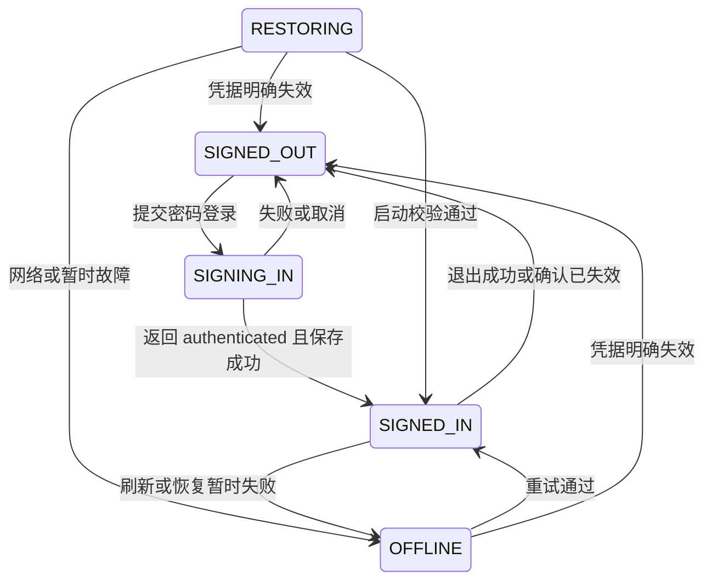

# 桌面账号与会话

桌面端已实现服务器选择、邮箱密码登录、设备身份、登录态保存、启动恢复、刷新和退出。账号 owner 位于 [services/account](../src/main/services/account/service.ts)，经本地 Gateway 向 renderer 提供 [Account 契约](../../contracts/proto/xiaowei/account.proto)；网络请求通过 [xwapi](../../docs/xwapi.md) 的 typed Auth client 执行。注册、找回密码、微信授权和 WebSocket 尚未接入。

## 模块与凭据边界

AccountService 持有服务器选择和会话生命周期；AccountStore 负责 Storage meta 与登录态文件；app/gateway.ts 负责装配。renderer 使用 Account typed client 和快照，不通过 preload 新增业务接口，不直接读取登录态文件。账号快照包含 revision、服务器列表、选择、公开用户和状态消息，不包含 token。

xwapi 负责网络协议、响应解码和本地鉴权前置检查，不管理 Account 会话。直接调用原始 Login／Refresh／Logout 不会自动保存凭据或发出 Account 状态变更；AccountService 校验业务 code 及 authenticated 结果后才提交产品登录态。取消补偿和关闭顺序见 [xwapi 会话边界](../../docs/xwapi.md#模块职责与会话边界)，不在这里维护另一份传输实现说明。

## 服务器与设备

首次服务器列表为空，开发态也不自动添加本地地址。用户可以保存多个地址，但同时只登录一个服务器；有会话时必须先退出才能切服，离线状态也遵循此规则。账号以服务器地址与公开 user_id 区分，不自动跨服务器合并同邮箱账号。

地址允许 HTTPS，HTTP 仅限 localhost、127.0.0.1 和 ::1；拒绝地址中的用户名、密码、query 和 fragment，支持基础子路径，统一移除末尾斜杠。填写基础地址，不附加具体 API 路径。HTTPS 不跳过证书校验，网络层拒绝重定向，避免把旧服务器凭据发给另一地址。

设备 ID 是首次使用生成的规范小写 UUID v4，不采集硬件指纹、不依赖 Keychain，也不是认证凭据。多个安装和 dev／release 共享 Storage 数据时共用该 ID；退出、升级和重装不改变保留下来的 ID，清除数据库后重新生成。

## 持久化

| 位置 | 内容 | 生命周期 |
| --- | --- | --- |
| Storage `meta` 的 `account.config` | 版本、设备 UUID、服务器列表及选择 | 保留设备和地址；退出不删除，不保存 token |
| `$APP_DATA/xiaowei/auth.json` | 版本、当前服务器及认证结果中的用户、设备和 token | 普通 JSON，临时文件加 rename 原子写入，权限 0600；退出删除 |

登录态不重复保存服务器列表或设备配置，不跟随 `XIAOWEI_AGENT_HOME`。按用户确认的方案不做本地加密，不依赖系统安全存储授权；登录密码不持久化，token 不进入 renderer 快照或日志。文件和 meta 不匹配、无法读取或写入时应按实际错误处理，不覆盖为一份伪造的已登录状态。

## 恢复、刷新与退出

读取已保存会话后异步恢复，不阻塞桌面启动。恢复先保证 access 可用，再调用 `/me` 核对用户、设备和 session ID；access 到期前 5 分钟刷新。恢复请求合并并经账号操作队列串行执行，避免并发消费同一个 refresh token。

临时网络失败保留用户和凭据并显示离线，30 秒后重试；明确失效才清除本地会话。没有独立 HTTP 心跳，正常状态不额外轮询在线状态；启动校验、刷新后的校验及离线恢复复用 `/me`。当前离线状态只反映会话验证可用性，不等于尚未实现的 WebSocket 连接状态。

刷新轮换后若保存失败，内存保留新凭据并标记待持久化，先重试保存，不再使用已消费的旧 refresh token。刷新响应丢失，或新凭据尚未持久化进程就退出时，可能需要重新登录，不能承诺自动恢复所有网络歧义。

关闭登录浮层会取消对应 attempt；切服取消在途请求，迟到结果不写入新状态。已经取得但未提交的登录凭据会尝试在原服务器撤销；取消先于 Gateway 接受响应时可能拿不到凭据，不能保证撤销服务器已发生的登录副作用。

退出先请求服务器撤销当前会话，成功或明确失效后删除本地登录态；网络失败保留会话供重试。退出不修改设备 UUID 或保存的地址，其他服务器和设备的会话由服务端规则隔离。普通离线业务不依赖账号服务可用。

## 设置交互

通用设置通过 `AccountSettingsSection` 使用 Account typed client，先订阅再读取快照，用递增 revision 忽略迟到状态。账号卡片登录前后高度为 58px：未登录显示服务器选择与登录入口，空列表显示“添加服务器”；已登录显示头像占位、公开 UID、只读服务器地址和退出入口，不显示昵称。

密码登录使用设置窗口内的浮层，服务器地址只读。loading 至少持续 500 毫秒，期间卡片保持未登录，成功结束时浮层关闭与卡片切换同步；错误显示在标题与服务器信息之间的既有空隙，不撑高浮层。关闭时清空密码草稿。

`Settings/GeneralLogin` Storybook 覆盖空列表、地址选择与添加、登录前后、进行中、失败、长地址和深色主题。旧微信预览仅用于对照，不表示微信能力已经实现。

测试入口见 [桌面测试](../tests/README.md)。账号测试覆盖真实 Gateway／HTTP／Storage／文件边界、取消与迟到结果、刷新轮换和保存失败；现场验证关注用户登录、退出与重启恢复，不用自动测试代替实际 UI 验收。
