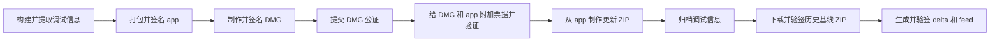
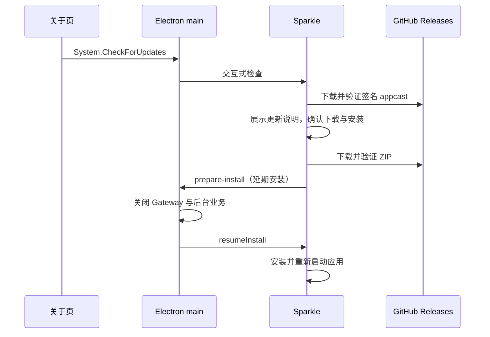

# macOS 桌面打包与更新设计

本文说明当前打包、分发和自动更新的设计与实现。版本准备、更新说明维护和推送 tag 触发 CI 的步骤统一见 [release-desktop-app 技能](../../.agent/skills/release-desktop-app/SKILL.md)；本地打包、更新联调和排障操作见其 [本地验证参考](../../.agent/skills/release-desktop-app/references/local-validation.md)。

## 平台、版本与产物

桌面使用 electron-builder 打包，Sparkle 2.10.0 提供原生检查、下载、安装与重启界面。目前仅支持 macOS Apple Silicon（arm64）和稳定 `x.y.z` 版本，通过公开仓库 `tctony-labs/xiaowei` 的 GitHub Releases 分发。

应用版本唯一来源是 `desktop/package.json`，对应 tag 为 `v<version>`。关于页的 `app.getVersion()`、`CFBundleShortVersionString`、`CFBundleVersion`、产物文件名和 Sparkle 版本均由它派生；内部 workspace npm 包和 Rust crate 不跟随应用版本递增。后续版本必须单调递增，tag 与应用版本不一致时 CI 拒绝发布。

| 产物 | 用途 |
| --- | --- |
| `desktop/dist/mac-arm64/XiaoWei.app` | 打包、签名和公证阶段使用的应用目录 |
| `XiaoWei-<version>-arm64.dmg` | 用户下载安装 |
| `XiaoWei-<version>-arm64.zip` | Sparkle 完整更新包 |
| `*.delta` | 官方 Sparkle 工具生成的旧版到新版增量更新包 |
| `XiaoWei-<version>-arm64-debug-symbols.zip` | 与实际发布代码匹配的独立调试信息 |
| `appcast.xml` | 带签名的稳定更新源 |

分发附件位于 `desktop/dist/`。发布时为最近 3 个较旧稳定版本生成直达最新版的 delta；appcast 只保留本次版本的条目，在该条目的 `sparkle:deltas` 中列出补丁。没有匹配补丁或补丁无法应用时，Sparkle 使用完整 ZIP；历史版本通过 GitHub Releases 列表查询。

## 构建与包内容

### JavaScript 与原生依赖

main、LLM worker、preload 和 renderer 的 JS／TS 由 electron-vite 构建到 `out/`，包括工作区包与第三方 SDK。main／preload 关闭依赖自动外置，工作区通过 `source` 条件消费源码。Electron 和 Node 内置模块由宿主提供，不复制进应用。

生产运行依赖只保留 `xiaowei-agent` 和 `xiaowei-rust` 两个 native 包；pi-ai、electron-log、Gateway、contracts、protobuf 和前端依赖均为构建输入，放在 `devDependencies`。`xiaowei-rust` 聚合 Storage／Clipboard／Search／Platform 绑定，Rust 核心仍按 `xw-*` 划分；Agent 独立链接。

发布 FileSet 显式收集 `out/`、应用元数据，以及两个 native 包的 `index.js`、`package.json` 和 `darwin-arm64.node`。electron-builder 不遵循依赖包的 npm `files` 清单，因此先重置默认全选，再声明实际输入；不维护逐 SDK、源码或其他平台文件的打包后删除规则。

动态 import 通过相邻 chunk 保留，目标须可被 bundler 静态分析。Bedrock 使用 pi-ai 的公开 `lazyApi` 和字面量 `import("@earendil-works/pi-ai/api/bedrock-converse-stream")`，在首次使用时加载 AWS 实现，不通过外置整个 SDK 绕过打包。

### 资源、压缩与校验

应用图标通过 `extraResources` 收集，Sparkle framework 和 LICENSE 使用 `extraFiles`／`extraResources`。新增运行时资源须显式声明文件和用途。`mac.electronLanguages` 仅保留简体中文（`zh_CN`）和英文（`en`）；`CFBundleLocalizations` 声明语言支持，不负责裁剪资源。

正式构建对 main／preload 启用 `minify: "esbuild"`，renderer 使用 Vite 默认生产压缩；开发构建不压缩 main／preload。不引入混淆或字节码，日志源码位置注入仍保留。正式 JS 生成 hidden source map，既不写 `sourceMappingURL`，也不将 `.map` 放进应用；映射进入独立调试归档。

`scripts/release/verify-package-content.mjs` 检查实际 ASAR、应用依赖声明、必需入口和 `app.asar.unpacked`。多余运行包、原始源码、类型声明、source map、其他架构二进制或必需文件缺失均阻止发布。原生 arm64、签名、元数据和 addon 加载由打包入口继续校验。

构建边界由 `scripts/dev/desktop-source-resolution.test.mjs` 验证，允许的外部入口仅为宿主和两个 native 包；`desktop/tests/llm/bundled-worker.test.mjs` 在工作区外、不复制 SDK node_modules 的条件下验证十种 provider chunk、HTTP/SSE、WebSocket、失败、取消和关闭。

### 体积维护与优化边界

正式 `v0.1.2` 的体积测量保存在 [体积优化归档](../../.agent/records/archived/2026-10-16-release-size.md#正式-v011-与-v012-对比)，作为比较 baseline；测量操作见技能参考。归档是历史快照，当前构建行为以源码及本文为准。

当前保留 SwiftShader 作为 GPU 不可用时的软件回退。业务与 Agent 使用两个独立 addon，尚未引入额外共享动态库，也未额外启用 Rust LTO。依赖或构建策略调整需同时评估体积、构建耗时和功能回归，不能只按文件大小裁剪运行组件。

## 签名、公证与调试信息

### 构建和签名顺序

`package:mac` 使用 SHA-256 固定的官方 Sparkle 归档（缓存于 `desktop/.sparkle/`），先构建两个 Rust napi release 产物和 desktop，再打包。默认使用 ad-hoc 签名，不公证或上传；`--signed` 要求显式 Developer ID 和 Apple 公证配置；`--dir` 只生成应用目录与调试归档。通用 `package` 入口不携带 Sparkle。

原生 release 构建启用 `debug=2`、`split-debuginfo=unpacked`、`strip=none`。每个 `.node` 构建成功后，先通过 `dsymutil` 生成 dSYM 并核对架构和 UUID，再用 `strip -x` 裁剪并复核 UUID。该过程发生在原生测试、ASAR 完整性元数据及签名前；失败阻止发布。`build:debug` 不受影响，`packageMac({ build: false })` 复用已完成处理和测试的产物。

正式完整打包仅向 Apple 提交最终 DMG 公证一次：

Apple 为 DMG 内的代码生成票据，工作目录 app 因签名身份相同可取得自身票据。electron-builder 自动公证关闭；公证后不再重新打包或签名，更新 ZIP 由 ditto 从已附加票据的 app 生成。DMG 携带外层票据，ZIP 内 app 携带自身票据；两种安装路径需要分别验收。依据见 [Apple 公证工作流](https://developer.apple.com/documentation/security/customizing-the-notarization-workflow)。

脚本验证主 app、Electron／Sparkle framework、Squirrel 的 ShipIt、Sparkle helper／XPC 和两个 napi 的 Team ID、Developer ID、安全时间戳及 hardened runtime；DMG 验证 Developer ID 和安全时间戳。随后验证 app／DMG 票据和 Gatekeeper。stapler 的 CloudKit 错误 68 按 5、10、20 秒重试，其他错误或重试耗尽直接失败，不重复提交公证。独立 ZIP 阶段也必须通过 app 票据与 Gatekeeper 校验。`--signed --dir` 没有 DMG，改用临时 ZIP 对 app 公证一次，附加票据后删除临时 ZIP。

`mac.signIgnore` 让 `Resources/` 下的普通资源由父 bundle 签名封存，其中的 `.node` 原生模块和 Squirrel 的 `Resources/ShipIt` 可执行文件仍单独签名。新增位于资源目录中的可执行代码时，须同步核对忽略规则和签名校验，不能只依赖父 bundle 的封存。默认签名器会把二进制资源也单独签名，产生 Sparkle 不支持的 `com.apple.cs.*` 扩展属性；打包验证因此同时检查并拒绝这些属性，不在签名后剥除它们。

### 发布调试信息

`scripts/release/debug-symbols.mjs` 在最终 ZIP 生成后归档；`--dir` 在应用签名验证后归档。本地两版本联调不生成调试归档。它不进入 app、DMG 或 Sparkle feed，不增加用户安装包体积。

| 调试 ZIP 内容 | 约束 |
| --- | --- |
| `native/` | 从已打包 app 复制两个实际 `.node`（含代码签名）和对应 dSYM；架构与 UUID 必须一致 |
| `javascript/out/` | 包内 JS 与本次构建逐字节相同；对应 `.map` 包含文件名、映射和内嵌源码，不含公开映射引用；无源码来源的 Vite 辅助 chunk 允许空映射 |
| `electron/SHASUMS256.txt` | 对应 Electron 官方版本的校验清单 |
| `manifest.json` | 应用版本、源码 commit、工作区状态、工具链版本、原生和 Electron UUID、文件 SHA-256，以及匹配版本／架构的 Electron 官方符号 URL 与校验值 |
| `source.patch` | 工作区有已跟踪差异时保存 `git diff --binary HEAD`；未跟踪文件仅记于工作区状态，不代表可完整重建 |

Electron 符号按版本引用，不向每个 Release 重复上传；清单必须同时包含 `dsym.tar.xz` 和 `symbols.zip`，包内 Electron 版本必须与依赖声明一致。仅安装 Command Line Tools 时 manifest 的 Xcode 版本为 `null`。

归档入口先在临时目录生成 ZIP，成功后替换目标，失败时保留旧归档并清理临时目录。网络、映射、UUID 或符号校验失败会阻止发布。dSYM 和 source map 必须匹配实际发布的同一次构建；应用运行时不自动加载这些外部映射。

## 更新源与更新说明

### 签名与下载契约

Sparkle Ed25519 密钥和 Apple 代码签名证书相互独立。正式应用的 `Info.plist` 携带长期 `SUPublicEDKey`，同时要求签名 feed 和更新包。固定 feed 为 `https://github.com/tctony-labs/xiaowei/releases/latest/download/appcast.xml`，ZIP URL 指向对应 tag 的 Release 附件；正式 Release 设为 latest 后更新源生效，草稿和 prerelease 不进入这条稳定 feed。

`scripts/release/generate-appcast.mjs` 校验 tag 与当前应用版本，借助 `delta-baselines.mjs` 和 GitHub CLI 分页读取 Release 列表，按数值版本选择最近 3 个较旧稳定版本；排除草稿、prerelease、当前版和更高版本。每个基线只下载对应的 arm64 更新 ZIP 与 `appcast.xml`，用当前构建公钥验证历史 feed 和 ZIP 的签名、长度、版本与下载地址，再交给生成器。候选版本缺少 ZIP 或 feed 时记录并跳过，不以更旧版本补足；没有历史基线时生成完整更新。API、下载或验签失败会阻止发布。

官方 `generate_appcast` 接收新版 ZIP 和已验证的基线 ZIP，设置 `--maximum-versions 1 --maximum-deltas 3`，私钥通过 stdin 传入，不隐式读取个人 Keychain。生成器自动决定补丁格式及是否值得生成；实际补丁数可能少于 3。生成后执行官方 `sign_update --verify`，并通过构建公钥验证 feed、完整 ZIP 和每个 delta 的 Ed25519 签名、长度、版本、下载地址及来源版本。全部通过后将补丁和 feed 移出临时目录，日志记录基线、实际补丁数及补丁相对完整 ZIP 的体积。

已验证的正式 0.1.3、0.1.4、0.1.5 更新包仍带有二进制资源的代码签名扩展属性，不能作为 delta 基线。历史原始包保持不变，由官方工具报告不兼容并跳过，用户继续取得完整 ZIP。首个使用修正后签名方式的版本也需完整更新；其后发布才能开始为该版本生成 delta，并逐步让最近 3 个稳定版本都具备增量更新能力。

### 单一更新说明来源

`desktop/release-notes/<version>.md` 同时作为 GitHub Release 正文与 Sparkle 更新弹窗内容。`scripts/release/release-notes.mjs` 校验稳定版本、文件存在、首行 `# XiaoWei <version>` 和非空正文；只有标题、空章节或注释会被拒绝。

CI 在构建前校验说明，发布时使用 `gh release create --notes-file`，不再使用 `--generate-notes`。appcast 生成器将同一份 Markdown 放入与 ZIP 同名的临时 `.md`，通过 Sparkle 的 `--embed-release-notes` 生成带 Markdown 格式的 `description`，正文与 feed 一起签名，无须额外托管说明文件或增加 Markdown 转换依赖。

`fullReleaseNotesLink` 指向 `https://github.com/tctony-labs/xiaowei/releases`，供“已是最新版本”提示的版本历史入口使用。它与更新弹窗的 `description` 职责不同，不用单版本详情页代替历史列表。

## CI 发布实现

[macOS release workflow](../../.github/workflows/macos-release.yml) 支持推送 `v*` tag 或手动传入已有 tag，在 macOS runner 检出该 tag。发布任务串行执行，不取消先前发布；源码、应用版本和 tag 必须一致。

流水线依次校验说明和发布配置、安装 locked 依赖、构建一次两个生产 release addon，再由 `test-prebuilt.mjs` 执行工作区检查、tooling、Gateway、原生包和 desktop 测试。desktop 测试生成的 JS 构建输出与生产 addon 供后续打包复用。

发布和 develop 测试流水线使用相同 key 恢复 pnpm、Go 和 Cargo 缓存；Rust 编译前恢复未变输入的时间戳，测试通过后记录新快照。tag 运行可以读取默认分支 develop 的缓存，仍需编译其中缺少的 release profile 产物；跨 tag 缓存范围、输入及收益验证见 [CI 构建缓存](../../scripts/ci/README.md)。分发应用、签名和公证产物继续由本次构建生成。

测试 fixture 在独立的 `target/rust-napi-tests/rust` 和 `target/rust-napi-tests/agent` 构建，成功后才给消费测试设置 `XIAOWEI_TEST_NAPI_PREPARED=1`。fixture 使用 debug profile，不进入发布包。测试前后生产 `.node` 的 SHA-256 必须不变；测试失败、生产文件缺失或变化均阻止打包。普通 test workflow 保持原有 debug 构建和 fixture 流程。

打包阶段以 `packageMac({ signed: true, build: false, stage })` 拆成独立的 `app`、`dmg`、`notarize`、`zip` step，复用同一产物，不重复编译。随后使用 `GH_TOKEN` 读取历史基线，生成并验证 delta 与 appcast，将实际生成的补丁一并上传 Actions artifact 和 GitHub Release，直接创建稳定 Release 并设为 latest。没有 delta 时仍可发布完整更新。任一前置阶段失败都不继续发布；没有人工草稿转正式阶段。

### CI 配置

Apple 配置来自 tctony-labs org，Sparkle 私钥单独保存在 xiaowei 仓库。证书由 electron-builder 导入构建临时 Keychain，密码和私钥仅注入需要它们的步骤，不自动创建或替换长期密钥。

| 配置类型 | 配置名称 | 脚本环境变量与用途 |
| --- | --- | --- |
| Variable | `APPLE_ID` | `APPLE_ID`：公证 Apple ID |
| Variable | `APPLE_TEAM_ID` | `APPLE_TEAM_ID`：Developer Team ID |
| Variable | `MACOS_APPLICATION_CERT_NAME` | `CSC_NAME`：完整 Developer ID Application 证书名 |
| Secret | `MACOS_APPLICATION_CERT_P12` | `CSC_LINK`：含证书及私钥的 Base64 `.p12` |
| Secret | `MACOS_APPLICATION_CERT_P12_PASS` | `CSC_KEY_PASSWORD`：证书密码 |
| Secret | `APPLE_ID_PASS` | `APPLE_APP_SPECIFIC_PASSWORD`：app-specific password |
| Repository Secret | `SPARKLE_PRIVATE_KEY` | `SPARKLE_ED_PRIVATE_KEY`：32 字节 seed 或兼容的 96 字节导出，支持省略 Base64 padding |

CI 推导 `SPARKLE_ED_PUBLIC_KEY` 并验证公私钥配对，只把公钥传入后续打包环境，无须单独配置 org 公钥变量。签名证书名必须是完整的 Developer ID Application 身份且与十位 Team ID 一致；builder 不回退到开发证书。

## 客户端更新行为

main 持有更新 service。正式 macOS 包启动后执行后台检查，Sparkle 按一周间隔检查；自动下载关闭，用户在原生窗口决定下载和安装。关于页通过 `System.CheckForUpdates` 发起交互式检查。开发态隐藏按钮且不初始化 Sparkle；不支持的平台或缺少正确配置的包没有有效更新能力。

Sparkle 标准 user driver delegate 将原生 UI 生命周期接入 Dock 可见状态。即使设置窗口关闭，更新提示、检查或下载安装 UI 仍在会话中时 Dock 保持可见；会话结束后按其余普通窗口决定显隐。更新重启沿用普通后台启动行为。

原生安装 delegate 暂缓安装，main 收到 `prepare-install` 后等待 Gateway、Agent／LLM、剪贴板和 Storage 等业务关闭，再恢复安装 continuation。正常退出复用同一次关闭 Promise，controller 在 `will-quit` 释放。更新初始化、检查、发现版本、错误及安装准备进入既有桌面日志。

## 本地两版本更新联调

本地测试使用 `XiaoWei Local Update` 名称、`com.tctony.xiaowei.local-update` appId 和 `http://127.0.0.1:18765/appcast.xml` feed，数据与日志隔离在 `~/Library/Application Support/com.tctony.xiaowei.local-update/`。它忽略正式 Agent／模型路径环境覆盖；HTTP 的 ATS 本地网络配置只进入测试包。

`package:mac:test` 在内存中生成临时 Ed25519 密钥，通过 stdin 交给签名工具，不保存私钥或写入个人 Keychain。当前 package 版本作为旧版、patch 加一作为新版，不改仓库版本；两个包复用一次 native 和 desktop 构建，仅打包版本不同。

`desktop/dist/local-update/` 保存两版 app／DMG／ZIP、`installed/` 旧版副本、`source/` 新版 ZIP、delta 和签名 feed，以及不含私钥的 `test.json`。正常 feed 为 `appcast.xml`，另存不含 delta 的签名 `appcast-full.xml`。已有成功测试对时拒绝覆盖。

本地 HTTP 服务仅监听 127.0.0.1，启动时验证 feed 和全部待提供的更新包，只公开 feed 中的更新附件并记录请求。`valid` 提供正常 delta 与完整 ZIP，`full-only` 提供不含 delta 的签名 feed；`invalid-feed` 篡改 feed，`invalid-delta` 仅篡改补丁响应，`invalid-archive` 使用完整更新 feed 并篡改 ZIP。HTTP 源始终通过 `/appcast.xml` 提供所选 feed，不公开测试 manifest 或内部 feed 文件。

本地测试 feed 尚未填更新说明，Sparkle 显示紧凑提示；正式 feed 的非空 `description` 启用说明区域和窗口缩放。服务本身不启动 Electron，本地 ad-hoc 验证不证明正式签名、公证或公开下载链路已通过。

## 验证边界

自动回归覆盖 Gateway 调用、开发态禁用、原生桥接失败、并发检查、安装前等待关闭、关闭后的迟到事件、关于页交互，以及更新说明校验和签名 feed 嵌入。增量更新测试覆盖历史基线选择与验签、下载错误、真实 Sparkle 工具生成和应用补丁、还原应用的逐文件一致性与代码签名、基线不匹配及 HTTP 签名错误场景；这些测试同时进入正式发布检查。实际 Electron 更新 UI、安装、重启及自动回退仍需通过本地两版本入口验收。常规发布依赖 CI 自动检查，触发流程见 [发布技能](../../.agent/skills/release-desktop-app/SKILL.md#2-推送并触发-ci)。
