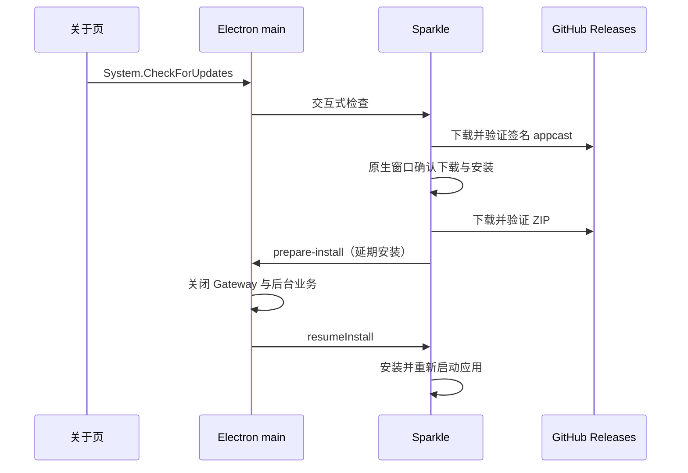

# macOS arm64 打包与更新

桌面使用 electron-builder 打包，Sparkle 2.10.0 提供原生检查、下载、安装与重启界面。首期仅支持 Apple Silicon 和稳定的 `x.y.z` 版本，通过公开仓库 `tctony-labs/xiaowei` 的 GitHub Releases 分发。版本来源是 `desktop/package.json`，Release tag 必须为 `v<version>`；发布下一版本前递增该版本，保持 Sparkle 的升级比较单调递增。

发布包通过 `mac.electronLanguages` 仅保留简体中文（`zh_CN`）和英文（`en`）的 Electron 语言资源；本地更新测试包继承相同设置。`CFBundleLocalizations` 声明应用支持的语言，不承担资源裁剪。

main、LLM worker、preload 和 renderer 的纯 JS／TS（含工作区包与第三方 SDK）由 electron-vite 构建到 `out/`。main／preload 关闭依赖自动外置，工作区仍通过 `source` 条件消费源码；Electron 和 Node 内置模块由宿主提供，不复制到应用。

生产依赖只保留 `xiaowei-agent` 和 `xiaowei-rust` 两个 native 包；pi-ai、electron-log、Gateway、contracts、protobuf 和前端依赖均为构建输入，放在 `devDependencies`。`xiaowei-rust` 聚合 Storage／Clipboard／Search／Platform 的绑定，内部 Rust 核心保持 `xw-*`，Agent 独立链接。macOS 打包明确收集 `out/`、应用元数据，以及每个 native 包的 `index.js`、`package.json` 和 `darwin-arm64.node`。electron-builder 不遵循依赖包的 npm `files` 清单，因此发布 FileSet 先重置其默认全选，再声明这些输入；不再维护逐 SDK／其他环境／声明或源码删除规则。

懒加载通过构建生成的相邻 chunk 保留。动态 import 的目标须可被 bundler 静态分析；Bedrock 使用 pi-ai 的公开 `lazyApi` 和字面量 `import("@earendil-works/pi-ai/api/bedrock-converse-stream")`，保持首次调用再加载 AWS 实现。不要将整个 SDK 外置以绕过动态路径，也不要直接修改第三方源码。

非 JS 资源须明确声明文件和用途。应用图标沿用 `extraResources`，Sparkle framework 和 LICENSE 沿用 `extraFiles`／`extraResources`；后续依赖若需运行时读取资源，应单独接入具体文件，不能恢复整个依赖目录复制。

`build` 命令对 main（含 LLM worker）和 preload 显式启用 `minify: "esbuild"`，renderer 沿用 Vite 的生产压缩默认值；`serve` 开发构建不压缩 main／preload。使用常规空白、标识符和表达式压缩，不接入混淆或字节码工具。既有日志源码位置注入保留，运行时异常栈按压缩产物显示，事后通过独立归档的 source map 还原源码位置。

main／preload／renderer 正式构建设置 `build.sourcemap: "hidden"`，同时生成 JS 与独立 `.map`，不向 JS 写入 `sourceMappingURL`；开发构建保持 `false`。打包输入显式排除 `out/**/*.map`，构建回归检查映射可用且无引用，最终分发检查继续拒绝 `.map` 和 inline map 引用，不依赖打包后删除。native 类型声明及 Rust／Cargo 源码不在输入清单中；生成的 JS 加载器保留。

每次 macOS 打包及独立发布阶段都会执行 `scripts/release/verify-package-content.mjs`，检查实际 ASAR、应用依赖声明、必需入口及 `app.asar.unpacked`。多余运行包、原始源码、声明、source map、其他架构二进制或缺失必需文件会阻止后续发布；签名、元数据、arm64 与两个 addon 的加载检查继续由既有打包入口执行。

依赖升级或新增后须通过 `scripts/dev/desktop-source-resolution.test.mjs` 的构建图检查，以及 `desktop/tests/llm/bundled-worker.test.mjs` 的工作区外隔离运行检查。前者只允许宿主和两个 native 外部入口；后者不复制 SDK node_modules，覆盖十种 provider chunk 加载、HTTP/SSE、WebSocket、失败、取消和关闭。实际包验收时，将 ASAR 解包到工作区之外，验证 native 生成加载器，并通过 `XIAOWEI_TEST_BUNDLED_MAIN_DIR=<解包目录>/out/main` 对包内 worker 重跑隔离测试。该环境变量只用于测试，不改变应用运行入口。

## 体积维护与优化边界

正式 `v0.1.2` 作为后续迭代的体积 baseline。DMG、包内 app、Electron Framework、ASAR、原生模块和语言资源的实测明细及新旧对照统一保存在 [体积优化归档记录](../../.agent/records/archived/2026-10-16-release-size.md#正式-v011-与-v012-对比)，不在本文重复维护版本测量表。归档记录保留历史快照，不作为当前构建行为的说明；当前构建和分发约定以本文、配置及验证脚本为准。

后续版本体积明显变化时，先与 baseline 按相同口径比较，再决定是否需要优化：

1. 下载对应版本的正式 DMG，核对实际长度与 GitHub asset 的 SHA-256；不能混用正式包、ad-hoc 包和已安装后被修改的 app。
2. 只读挂载 DMG，统计包内 app 的普通文件逻辑字节数，跳过符号链接。DMG 压缩字节数与 app 展开字节数分别记录；不以卷容量或磁盘块占用代替。
3. 分别核对 Electron Framework、app.asar、app.asar.unpacked 和其余资源，再检查 native 数量、语言资源、source map、声明及生产依赖清单；从增长的组成定位原因。
4. 记录比较的版本、源码提交、架构、工具链与签名方式。跨版本总差额不能直接归因于某一项优化；验证单项收益时使用相同源码和构建条件对照。
5. 若需要新的重大优化，按 record 生命周期新建事项并引用此 baseline；新版本的测量与结论写入新事项，不修改已归档快照。

当前保留 SwiftShader，提供 GPU 不可用时的软件图形回退；不按文件大小直接删除 Chromium 运行组件。常规业务与 Agent 保持两个独立 addon，共用依赖仍分别链接，当前未引入额外共享动态库。Rust LTO 尚未额外启用；如另行评估，应同时比较体积、构建耗时与功能回归。

正式安装与 Sparkle 更新的人工验收继续遵循下文 [正式包最终验收](#正式包最终验收)，单次体积优化的归档不表示这些交互已通过。

## 本地打包

准备工作区依赖、固定的 Node／pnpm／Rust 工具链和 Xcode Command Line Tools，在 Apple Silicon Mac 上执行：

```sh
pnpm --dir desktop package:mac
```

环境中必须提供 `SPARKLE_ED_PUBLIC_KEY`，值为正式更新密钥的 32 字节 Ed25519 公钥的 Base64。公钥进入主应用 `Info.plist`；它不是私钥。不要用临时测试公钥分发正式应用，否则后续正式密钥签名的更新无法安装。

此入口先下载 SHA-256 固定的官方 Sparkle 归档至忽略的 `desktop/.sparkle/`，再顺序构建两个正式 Rust napi 的 release 产物、desktop main／preload／renderer，最后生成：

- `desktop/dist/mac-arm64/XiaoWei.app`
- `desktop/dist/XiaoWei-<version>-arm64.dmg`
- `desktop/dist/XiaoWei-<version>-arm64.zip`
- `desktop/dist/XiaoWei-<version>-arm64-debug-symbols.zip`

macOS 的原生 `build --release` 为此次 Cargo 构建设置 `debug=2`、`split-debuginfo=unpacked` 和 `strip=none`，保留 release 优化与调试信息。napi 构建成功后，先对每个 `.node` 执行 `xcrun dsymutil`，在旁边生成 `.node.dSYM` 并核对架构和 UUID，再执行 `xcrun strip -x`，复核 UUID 并记录裁剪前后字节数。生成、匹配或裁剪失败均阻止后续发布。裁剪发生在原生测试、ASAR 完整性元数据生成和代码签名前，CI 与本地打包共用此入口；`build:debug` 保持原有行为。`packageMac({ build: false })` 复用已经完成这些步骤并经过测试的 release 产物，不重复处理。

默认采用 ad-hoc 签名，不自动选用本机 Developer ID；不公证、不上传，也不启动应用。Sparkle 支持 ad-hoc 应用通过 Ed25519 验证更新，但这不等于应用已获得 Gatekeeper 的对外分发认可。`--dir` 生成应用目录和独立调试归档，不生成分发 DMG／更新 ZIP，仍执行相同的原生 release 构建和签名流程：

```sh
pnpm --dir desktop package:mac --dir
```

带 `--signed` 时要求显式提供 Developer ID Application 的 `CSC_LINK`（Base64 `.p12`）、`CSC_KEY_PASSWORD`、完整证书名 `CSC_NAME`，以及 `APPLE_ID`、十位 `APPLE_TEAM_ID` 和 app-specific password `APPLE_APP_SPECIFIC_PASSWORD`。证书名必须为 `Developer ID Application: <姓名> (<Team ID>)`，并与 Team ID 一致。builder 使用证书持有人与 Team ID 选择 distribution 身份，禁止回退到开发证书；打包后再次验证身份和 hardened runtime。缺少配置直接失败。

```sh
pnpm --dir desktop package:mac --signed
```

正式完整打包只向 Apple 提交最终 DMG 公证一次。顺序为：打包并签名 app → 从同一份 app 制作并签名 DMG → 提交 DMG 公证 → 分别给 DMG 和工作目录中的 app 附加票据并验证 → 用已附加票据的 app 制作 ZIP。Apple 会处理 DMG 内的签名代码并生成对应票据；工作目录中的 app 与 DMG 内的 app 签名身份相同，因此可以取得其票据。electron-builder 自动公证已关闭，DMG 公证后不再重新打包或签名，ZIP 使用 ditto 在票据附加之后生成。依据见 [Apple 公证工作流](https://developer.apple.com/documentation/security/customizing-the-notarization-workflow)。

核对主 app、Electron／Sparkle framework、Sparkle helper／XPC 和两个 napi 的 Team ID、Developer ID 与 hardened runtime，同时检查 app／DMG 的票据和 Gatekeeper。stapler 返回 CloudKit 错误 68 时，按 5、10、20 秒间隔最多重试三次；其他错误或重试耗尽仍阻止发布，不重复提交公证。单独执行 ZIP 阶段也必须通过 app 票据与 Gatekeeper 校验。`--signed --dir` 不生成 DMG，因此只通过临时 ZIP 提交 app 公证一次并附加票据，临时 ZIP 随后删除。

DMG 内的 app 在制包时尚未单独附加票据，DMG 分发携带外层票据；更新 ZIP 中的 app 携带自身票据。正式验收需分别覆盖 DMG 离线安装运行与 ZIP／Sparkle 更新，不能只凭本地 ad-hoc 打包或在线 stapler 校验认定离线体验已通过。

原有 `pnpm --dir desktop package` 保留为通用开发目录包入口，不携带 Sparkle；验收更新必须使用 `package:mac` 的产物。

## 发布调试信息

每次正式完整打包在最终更新 ZIP 生成后执行 `scripts/release/debug-symbols.mjs`；`--dir` 在应用签名及验证后执行。独立 CI 的 `app`／`dmg`／`notarize` 阶段不提前归档，`zip` 阶段完成归档后才能上传或发布。本地两版本更新测试不生成此归档。调试 ZIP 不进入应用、DMG 或 Sparkle feed，不改变用户安装包体积。

`XiaoWei-<version>-arm64-debug-symbols.zip` 的顶层目录与文件名同名，包含：

- `native/`：从已打包应用复制的两个实际发布 `.node`（含最终代码签名），以及对应的 `.node.dSYM`。归档前再次核对架构及 UUID，避免使用 debug 重建或其他版本留下的 dSYM。
- `javascript/out/`：包内全部 main、LLM worker、preload、renderer JS 及相邻 chunk，以及它们对应的 `.map`。每个 JS 必须与本次 `desktop/out/` 构建产物逐字节相同，map 必须包含对应文件名、映射及内嵌源码；Vite 生成且没有源码来源的辅助 chunk 允许空映射。缺失 map、存在公开 map 引用或 JS 不一致会阻止归档。
- `electron/SHASUMS256.txt`：从对应 Electron 官方 Release 获取的校验清单。
- `manifest.json`：应用版本、源码 commit、工作区状态、架构、Rust／Xcode／macOS SDK／Node 版本、两个 native UUID、Electron Framework UUID、每个归档文件的 SHA-256，以及匹配 Electron 版本和 arm64 架构的官方 `dsym.tar.xz`／`symbols.zip` 下载地址与 SHA-256。仅安装 Command Line Tools 时 Xcode 版本记为 `null`，仍记录 SDK 版本。打包的 Electron Framework 版本必须与依赖声明一致，官方校验清单必须同时包含两种符号包。
- `source.patch`：工作区有已跟踪文件差异时保存 `git diff --binary HEAD`；正式 CI 按已提交 tag 构建，通常没有该文件。未跟踪文件仅记录于工作区状态，不由 patch 保存；本地脏工作区归档不等同于可完整重建的正式源码快照。

Electron 官方符号按版本引用，不向每个 XiaoWei Release 重复上传大文件。macOS `.ips` 原生报告和 LLDB／`atos` 使用对应 dSYM；Electron `crashReporter` 产生的 minidump 使用官方 `symbols.zip`。下载后校验 manifest 中的 SHA-256，符号化时再核对报告模块 UUID。dSYM 和 source map 都必须来自实际发布的同一次构建，之后重新编译不能替代原始符号。

定位 Rust 崩溃时，先检查归档中的 UUID 与 `.ips` 报告的模块 UUID 一致，例如：

```sh
xcrun dwarfdump --uuid native/xiaowei-agent.darwin-arm64.node.dSYM
```

然后用 `atos -arch arm64 -o <dSYM 内 Contents/Resources/DWARF 下的文件> -l <报告中的模块加载地址> <崩溃地址>` 还原函数和源码位置。JS 错误使用 `javascript/out/` 中与堆栈文件匹配的 `.map`，由 source map 工具解析行列号；Node `SourceMap.findEntry` 接受从 0 开始的行列号。应用运行时不会自动加载这些独立归档的 map。

必要时可对仍保留同一构建 `.map` 与 dSYM 的应用重新运行归档入口：

```sh
node scripts/release/debug-symbols.mjs desktop/dist/mac-arm64/XiaoWei.app
```

该入口读取官方校验清单但不下载完整 Electron 符号包；网络或符号校验失败会退出非零码。它先在临时目录生成 ZIP，成功后替换目标调试 ZIP，失败时保留已有归档并清理临时目录。

## 本地两版本更新联调

先执行以下入口，一次生成同一套临时 Ed25519 密钥签名的两个测试版本：

```sh
pnpm --dir desktop package:mac:test
pnpm --dir desktop update:mac:serve
```

不需要 Developer ID、公证或手工配置更新密钥。密钥仅驻留构建进程，经 stdin 交给官方签名工具，不写入文件或个人 Keychain；构建结束后不保留私钥。当前 package 版本作为旧版，patch 加一作为新版，不修改仓库 package.json。两个 addon 与 desktop 源码只构建一次，两个包复用同一份 release 产物，只有打包版本不同。

测试包名为 `XiaoWei Local Update`，appId 为 `com.tctony.xiaowei.local-update`，feed 固定为 `http://127.0.0.1:18765/appcast.xml`。数据、日志、Agent 和模型配置位于 `~/Library/Application Support/com.tctony.xiaowei.local-update/`；忽略正式 Agent／模型路径环境覆盖，不读取现有正式数据。HTTP 的 ATS 本地网络配置只进入测试包。测试包的全局快捷键仍可能与开发实例冲突，测试前由用户正常退出开发实例。

产物保存在忽略的 `desktop/dist/local-update/` 中：每个版本包含 `mac-arm64/XiaoWei Local Update.app`、DMG 和 ZIP；`installed/` 保存可直接启动、允许 Sparkle 替换的旧版副本；`source/` 保存新版 ZIP 和签名 feed；`test.json` 记录版本、公钥、产物路径，不含私钥。已有成功测试对时再次准备会拒绝覆盖；需要重做时先将此目录移到别处，重新生成的包和 feed 必须成对使用。

本地服务仅监听 127.0.0.1，只提供当前 feed／ZIP，记录请求和状态码；它不会启动 Electron。可以 Ctrl-C 停止，默认 `valid` 为正常更新；以下两种模式分别提供篡改后的 feed 或 ZIP，用来检查 Sparkle 拒绝无效签名：

```sh
pnpm --dir desktop update:mac:serve invalid-feed
pnpm --dir desktop update:mac:serve invalid-archive
```

测试 feed 当前未填更新说明，Sparkle 标准窗口会隐藏说明区域，显示紧凑且不可缩放的提示。提供非空 appcast description 或 release notes 地址后，原生窗口会启用说明区域并允许调整大小；无须修改框架。

### 人工联调步骤

1. 保持正常更新源运行。由用户启动 `desktop/dist/local-update/installed/XiaoWei Local Update.app` 旧版副本；也可以打开旧版 DMG，把应用拖至可写的 Applications 目录后再启动。不要直接在 DMG 只读卷中更新，也不要先安装新版。
2. 在关于页确认旧版本，创建可识别的测试设置、剪贴板条目或 Agent 会话；可选记录数据目录内文件内容以便比较。
3. 点击检查更新，核对原生 Sparkle 窗口识别新版。先取消下载／安装，确认仍可使用旧版；再关闭服务检查网络失败，恢复服务后继续。
4. 使用两个篡改模式确认错误能被显示和记录、没有安装新版。每次切换先停止前一个服务；检查前先关闭上一轮 Sparkle 窗口。测试结束恢复正常服务。
5. 正常下载并选择安装，确认日志先记录 `prepare-install` 与业务关闭，再由 Sparkle 替换、重启；关于页变成新版，原测试数据仍在，同一版本检查不再提示升级。
6. Agent 核对打包应用进程、独立日志和服务下载请求，记录实际结果。普通 Node 加载 addon 不替代此 Electron 运行验证。

第 1 步必须由用户执行，Agent 不冷启动应用。当前本地联调只验证 ad-hoc 包的更新机制；正式签名／公证包和 GitHub 下载链路需要在后续阶段再做最终升级验收。

## 更新密钥与 appcast

Sparkle 的 Ed25519 更新签名密钥与 Apple 代码签名证书是两套独立凭据。小微使用独立的长期更新密钥，在 xiaowei 仓库配置 Actions secret `SPARKLE_PRIVATE_KEY`。CI 从私钥推导公钥，并通过真实签名／验签确认配对；发布流水线不会自动生成或替换密钥。私钥不得进入仓库、日志或长期开发记录。

首次生成或重新导出现有密钥时，显式执行：

```sh
scripts/release/sparkle_generate_keys.sh
```

脚本参考 cmux，使用已固定的官方 Sparkle 2.10.0 `generate_keys`，在登录 Keychain 的 `xiaowei` account 中生成或读取密钥，再导出到 `/tmp/xiaowei-sparkle-private-key.txt`（权限 `0600`）。导出前验证公私钥配对，只输出公钥和文件路径；目标文件已存在时拒绝覆盖。由发布者备份该文件，并把文件中的 Base64 私钥作为 xiaowei 仓库 secret `SPARKLE_PRIVATE_KEY` 的值；无需添加公钥变量。完成备份和配置后由发布者移除临时导出文件。

完成 DMG／ZIP 打包后，在环境中提供 `SPARKLE_ED_PRIVATE_KEY`（官方导出的 Base64 私钥种子或兼容格式），生成 appcast：

```sh
node scripts/release/generate-appcast.mjs v0.1.0
```

参数必须匹配当前 `desktop/package.json`。工具只处理本版本的 ZIP，以 stdin 将私钥交给官方 `generate_appcast`，不从个人 Keychain 隐式读取凭据；生成后使用官方 `sign_update --verify` 验证 feed 签名，并使用构建公钥验证 ZIP 的 Ed25519 签名、长度、版本和对应 tag 的下载地址。本期只发布完整更新 ZIP，不生成 delta，也不保留多个版本的 appcast 条目。

应用要求签名 feed 和更新包。固定 feed 为 `https://github.com/tctony-labs/xiaowei/releases/latest/download/appcast.xml`，条目中的下载地址指向对应 `v<version>` Release 的更新 ZIP。GitHub 的 latest 下载地址只在 Release 正式发布后更新；草稿和 prerelease 不进入这条稳定 feed。发布时同时携带 DMG、更新 ZIP、独立调试 ZIP 和 `appcast.xml`。

## GitHub Release 准备

[macOS release workflow](../../.github/workflows/macos-release.yml) 支持推送稳定 `v*` tag 或手动输入已有 tag。它核对版本、tag 指向、公私钥配对和显式签名配置，安装 locked 依赖，顺序构建一次两个生产 napi release addon，再通过 `scripts/release/test-prebuilt.mjs` 执行工作区检查、tooling、Gateway、原生包和 desktop 测试。desktop 测试生成的 main／preload／renderer 与这些生产 addon 一起供打包复用；发布脚本以 `packageMac({signed:true, build:false, stage})` 按以下四个独立 Actions step 执行，不重复编译：

1. `app`：生成目录包、签名并验证 app。
2. `dmg`：通过 electron-builder 的 `--prepackaged` 复用 app，仅制作并签名 DMG。
3. `notarize`：只提交 DMG，等待 Accepted，然后分别附加并校验 DMG 与 app 票据和 Gatekeeper。
4. `zip`：重新校验 app 票据后，用 ditto 制作最终更新 ZIP，再校验并生成独立调试 ZIP，不重建 DMG。

每个 step 独立显示耗时，前一步失败会阻止后续发布。随后生成验证 appcast，上传 Actions artifact，并直接发布稳定 GitHub Release、设为 latest；公开更新源随之生效。本地一键入口不指定 stage 时按相同顺序执行；ad-hoc 模式跳过公证。

发布测试先在独立 `target/rust-napi-tests/rust` 和 `target/rust-napi-tests/agent` 目录构建启用 gateway-fixtures 的两个测试模块，成功后才向 Gateway／原生包／desktop 测试子进程设置已有的 `XIAOWEI_TEST_NAPI_PREPARED=1`。消费测试跳过生产 debug 重建，仍执行原有测试列表和生产接口检查。发布入口在测试前后核对两个生产 `.node` 的 SHA-256；构建 fixture 或测试失败、生产文件缺失或发生变化均阻止打包。测试 fixture 使用 debug profile，不进入应用。普通 `test.yml → just test` 保持原有 debug 构建及 fixture 准备流程，本地 `package:mac` 默认仍自行构建 release。

各版本发布构建串行执行。参考本机 `~/Develop/Projects/cmux/.github/workflows/build-tctony.yml`，复用 tctony-labs org 的个人 Developer ID 和 Apple ID 公证配置，Sparkle 更新私钥单独配置在 xiaowei 仓库，不需要新增 App Store Connect API key。证书由 electron-builder 导入构建用临时 Keychain；Apple ID 密码只注入签名／公证步骤，Sparkle 私钥只在预检查／appcast 步骤注入，经 stdin 交给官方工具。流水线不自动创建或替换长期更新密钥。

用户已确认使用个人身份。已安装 cmux 的公开签名元数据显示 `Developer ID Application: Chang Tang (NSWMLDGCEZ)`；CI 仍以 org 配置为输入并校验其一致性。配置名称与 cmux 一致；Apple 配置来自 org，Sparkle 私钥由小微单独生成并配置在仓库：

| 配置类型 | 配置名称 | 本地脚本环境变量与用途 |
| --- | --- | --- |
| Variable | `APPLE_ID` | `APPLE_ID`：公证 Apple ID |
| Variable | `APPLE_TEAM_ID` | `APPLE_TEAM_ID`：Developer Team ID |
| Variable | `MACOS_APPLICATION_CERT_NAME` | `CSC_NAME`：完整 Developer ID Application 证书名 |
| Secret | `MACOS_APPLICATION_CERT_P12` | `CSC_LINK`：包含证书及私钥的 Base64 `.p12` |
| Secret | `MACOS_APPLICATION_CERT_P12_PASS` | `CSC_KEY_PASSWORD`：`.p12` 密码 |
| Secret | `APPLE_ID_PASS` | `APPLE_APP_SPECIFIC_PASSWORD`：Apple ID app-specific password |
| Repository Secret | `SPARKLE_PRIVATE_KEY` | `SPARKLE_ED_PRIVATE_KEY`：官方更新私钥，支持 32 字节 seed 和旧版 96 字节导出，也兼容省略 Base64 padding |

CI 推导 `SPARKLE_ED_PUBLIC_KEY`，验证公私钥配对后只将公钥写入后续步骤的环境。无需单独配置 org 公钥变量。正式打包前也可本地执行 `node scripts/release/check-release.mjs v<version>`；本地需提供表中对应环境变量和 `SPARKLE_ED_PUBLIC_KEY`。此入口以无敏感内容的 challenge 做真实签名／验签，确认公私钥配对后才构建，不输出私钥、不操作个人 Keychain。

org 设置查询曾受到 GitHub token 权限限制（403）。小微使用独立 Sparkle 更新密钥，由用户备份并配置 `SPARKLE_PRIVATE_KEY`；v0.1.1 的真实 CI 已验证必需凭据可见性及正式签名、公证。流水线预检查会对缺失值直接报错，CI 必须使用已提交的版本源码。该次建设的验收结果见 [归档记录](../../.agent/records/archived/2026-10-12-macos-packaging-update.md)。私钥、证书与密码不要粘贴到聊天或提交到仓库。

### 发布新版本

应用版本只维护在 `desktop/package.json`。例如发布 `0.1.1`，将其 `version` 从 `0.1.0` 改为 `0.1.1`，对应 tag 为 `v0.1.1`。关于页通过 `app.getVersion()` 显示该版本；打包流程由它生成 `CFBundleShortVersionString`、`CFBundleVersion`、DMG／ZIP 文件名及 Sparkle 更新版本。内部 workspace npm 包与 Rust crate 不需要随应用发布同步递增版本。只打新 tag 而不改应用版本会被 CI 预检查拒绝。

每次发布按以下顺序执行：

1. 确定高于当前已分发版本的稳定 `x.y.z` 版本，修改 `desktop/package.json`，整理该版本的改动说明。继续使用原有 Developer ID 身份与长期 Sparkle 更新密钥。
2. 完成相关回归和 `just check`，确认待发布代码、版本和必要文档均已提交，工作区没有遗漏的发布改动。
3. 决定正式发布时，推送发布提交，再在同一提交上创建并推送 `v<version>` annotated tag。tag 推送会触发 macOS release workflow，校验成功后自动正式发布；CI 检出 tag 指向的提交，并核对 tag、应用版本与 HEAD 一致。已发布版本的 tag 和附件不覆盖；修正已分发版本时递增版本重新发布。
4. 等待 CI 完成构建／测试、app 签名、DMG 制作、单次公证及两份票据校验、最终 ZIP 与 appcast 签名验证。核对 run 的 head SHA 与发布 tag 一致，所有发布阶段成功。
5. CI 在所有前置阶段成功后直接发布稳定 Release、设为 latest，并生成 Release notes。推送 tag 是本次正式发布的触发点，后续没有草稿转正式的人工步骤。
6. 核对已发布 Release 包含本版本的 `XiaoWei-<version>-arm64.dmg`、`XiaoWei-<version>-arm64.zip`、`XiaoWei-<version>-arm64-debug-symbols.zip` 和 `appcast.xml`，检查版本、签名身份、公证、更新下载地址及 Release notes；调试归档的 commit、模块 UUID 和文件校验值必须对应本次发布。用户运行验收按下节执行，未完成的项目明确保留为待验收。
7. 发布后通过未登录下载地址验证 DMG、ZIP 和 `releases/latest/download/appcast.xml`；确认 latest feed 的版本、ZIP 下载地址、长度与签名匹配最终产物。由用户启动已安装旧版，通过检查更新完成安装、重启及数据保留验收。

以 `0.1.1` 为例，在版本改动已提交且相关检查通过后，触发构建的命令为：

```sh
git push origin HEAD
git tag -a v0.1.1 -m "XiaoWei v0.1.1"
git push origin refs/tags/v0.1.1
```

网络等临时故障可以重跑相同提交的 CI；需要修改源码时，新提交不会自动进入旧 tag 的构建。尚未分发的 tag 如需调整，先确认没有并发构建或已发布产物，再按用户授权更新；已公开分发的版本使用新版本号。

### 正式包最终验收

1. 核对现有 org 设置对 xiaowei 仓库的可见性；CI 使用已确认的个人 Developer ID、Apple ID 公证和长期更新密钥重新构建，不能上传本地测试包或复用其 feed。
2. 源码提交／推送与 tag 后运行真实 CI，检查签名主体、公证 Accepted、app／DMG 票据和 Gatekeeper；所有前置阶段成功后自动正式发布。
3. 使用同一长期公钥、同一已确认 Developer ID 的两个递增正式版本。由用户启动已安装旧版，复验原生窗口、取消／失败、安装前业务关闭、重启、版本、数据保留和无新 crash。正式发布前的受控 feed 联调不能代替公开更新链路验收。
4. 发布后通过 GitHub 正式下载地址核对 feed／ZIP 与重定向，再验证正式更新链路。历史草稿附件不属于公开更新源。

上述步骤用于各版本的正式验收。v0.1.1 已完成签名、公证、附件核验，用户已确认从正式 0.1.0 成功升级；DMG 离线安装、新 Dock 行为的正式包验证和其他未覆盖场景见归档记录中的后续验证边界。

## 运行与验收

main 持有更新 service，正式 macOS 包启动后执行后台检查，Sparkle 按一周间隔检查；自动下载关闭，用户在原生窗口决定下载和安装。关于页使用已确认的按钮，通过 `System.CheckForUpdates` 触发交互式检查。开发态隐藏按钮且不初始化 Sparkle；不支持的平台或未携带正确配置的包不会提供有效更新能力。

Sparkle 原生更新 UI 通过标准 user driver delegate 的生命周期事件接入 Dock 可见状态。即使设置窗口已关闭，只要更新提示、检查或下载／安装 UI 仍处于会话中，Dock 图标保持可见；原生 UI 结束后，按其余普通窗口决定显隐。更新重启沿用普通后台启动行为。

原生安装 delegate 延期安装，向 main 投递 `prepare-install`；main 等待 Gateway、Agent／LLM、剪贴板与 Storage 等业务关闭，再恢复 Sparkle 的安装 continuation。正常退出复用同一次关闭 Promise，controller 在 `will-quit` 释放。更新初始化、检查、发现版本、错误和安装准备写入既有桌面日志。



自动回归覆盖 Gateway 调用、开发态禁用、原生桥接失败、并发检查、安装前等待关闭、关闭后的迟到事件，以及关于页成功／失败交互。构建和 appcast 验签不能代替已安装应用升级验收：需要用同一长期公钥打包两个递增版本，在真实 Electron 中检查原生窗口、取消／网络失败、下载、安装前退出、版本升级与用户数据保留。Agent 不自行冷启动桌面；应用启动与实例操作仍遵循根 AGENTS.md。
