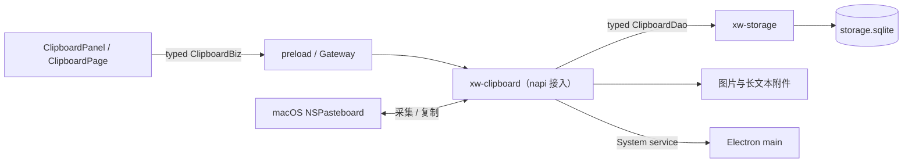

# 剪贴板

本文描述本地剪贴板的架构、持久化、采集、编辑、搜索和清理行为。迁移决策与验收证据见[本地剪贴板迁移 record](../.agent/records/archived/2026-09-17-migrate-local-clipboard.md)。

## 模块与调用边界



- [xw-clipboard](../crates/xw-clipboard/README.md) 负责监听、业务规则、系统剪贴板 I/O 和附件生命周期，核心不依赖 Electron；[xiaowei-rust](../crates/xiaowei-rust/README.md) 提供 napi 接入。
- Storage 统一持有 SQLite pool，通过 typed `ClipboardDao` 提供业务持久化；SQL、schema migration 和 FTS5 维护留在 Storage 内部。
- main 负责路径、服务装配和打开／定位文件等宿主动作。renderer 经通用 preload Gateway 使用生成的 `ClipboardBiz` client，不直接访问数据库。
- `ClipboardPage` 连接业务与变更事件，管理全文读取、缩略图和 Blob URL 回收；面板展示由 `ClipboardPanel` 负责。变更事件只表示需要重新查询，不保证逐条投递。

业务契约见 [clipboard.proto](../contracts/proto/xiaowei/clipboard.proto)，共享数据库装配和启动／关闭顺序见[共享存储接入](storage.md)。剪贴板服务与资源先关闭，再释放其依赖的 Storage pool。

## 数据与附件

目录由 main 的 [paths.ts](../desktop/src/main/app/paths.ts) 从系统 `appData` 生成；普通 macOS 实例的业务根目录为 `~/Library/Application Support/com.tctony.xiaowei/xiaowei/`：

```text
xiaowei/
├── storage.sqlite
└── clipboard/
    ├── images/<hash>.png
    └── large_text/<hash>
```

`storage.sqlite` 及其 WAL／SHM 属于共享数据库。剪贴板表为 `clipboard_items` 和 `clipboard_categories`，记录保存内容哈希、类型、正文或摘要、路径、尺寸、时间、次数、收藏、备注和分类。

| 内容 | 持久化与读取 |
| --- | --- |
| 普通文本 | 完整 UTF-8 文本存入数据库 |
| 长文本 | 超过 9999 UTF-8 字节时内部类型为 `largeText`；全文写入 `large_text/<hash>`，数据库保留前 500 个字符 |
| 图片 | PNG 原文件写入 `images/<hash>.png`，数据库保存哈希和尺寸等元数据 |
| 文件 | 仅保存原路径列表，不复制用户原文件 |

页面契约将普通文本和长文本统一为 `TEXT`，以 `preview_truncated` 区分摘要；`ReadText`／`ReadImage` 按记录 ID 返回完整内容。图片及长文本的读取、复制和外部打开使用持久原文件，路径跨应用重启有效，直至附件被删除。

[Store](../crates/xw-clipboard/src/store.rs) 维护采集、编辑、长短文本转换、合并及删除涉及的附件。同一哈希复用路径；数据库变更成功后，确认哈希已无记录引用才清理旧附件，文件删除尽力执行。该清理不删除文件记录指向的用户原文件。

普通文本外部打开时由 [Resources](../crates/xw-clipboard/src/resources.rs) 按需原子导出完整 UTF-8 内容，存入当前 owner 的私有临时目录。导出文件在记录编辑或删除后仍保留，直到 owner 关闭时统一清理；只停止监听不会清理这些文件。

## 监听与去重

当前系统采集支持 macOS，启用后每 500ms 轮询，首次轮询读取已有剪贴板内容。[Service](../crates/xw-clipboard/src/service.rs) 先检查系统 `changeCount`：

1. 版本相同则跳过内容读取与哈希计算。
2. 版本变化时读取内容；读取前后版本不同则留待下一轮重试。
3. 忽略空内容、纯空白文本及连续相同内容。非空内容计算完整哈希，监听结果直接传给保存层复用。
4. 内容首次出现时新建记录；再次出现时复用已有身份，更新使用时间和次数。

哈希为 SHA-256，首先写入内部类型名 `text`／`largeText`／`image`／`file`，随后按 [ClipboardData::hash](../crates/xw-clipboard/src/types.rs) 写入：

| 类型 | 参与哈希的内容 |
| --- | --- |
| 文本 | 完整 UTF-8 字节 |
| 图片 | 宽、高的 u32 小端字节，再加完整 PNG 字节 |
| 文件 | 按原顺序逐条写入路径 UTF-8 字节长度的 u64 小端字节，再写入路径字节 |

不截断长文本或采样图片。`changeCount` 降低稳定剪贴板的轮询成本；内容哈希用于判重和持久身份，保存不再重复计算同一采集快照的哈希。该规则沿用现有哈希及附件命名，无需迁移历史哈希。

历史复制成功后计一次使用，并抑制紧随其后的自身回写；下一次仍正常检查剪贴板，允许捕获其他应用在此期间写入的新内容。文件 URL 优先于文本读取，多文件回写时每个文件使用独立的 `NSPasteboardItem`。

读取系统剪贴板失败记 warning，附件或数据库保存失败记 error；同一阶段的连续错误去重，阶段变化或恢复后再次失败会重新记录。保存失败不推进已处理版本和哈希，可在后续轮询重试。

## 编辑、时间与次数

所有记录时间均为 Unix 毫秒。创建时间表示身份首次建立；最近使用时间决定列表顺序；修改时间表示正文或元数据实际变化。数据库字段为 `updated_at`，Gateway 契约为 `updated_at_ms`，原生 JS 对象与 renderer 视图为 `updatedAt`。

| 操作 | 修改时间 | 最近使用时间／使用次数 |
| --- | --- | --- |
| 新建记录 | 创建时间 | 创建时间／0 |
| 再次采集已有内容 | 保持 | 当前时间／+1 |
| 成功复制历史内容 | 保持 | 当前时间／+1，自身回写不重复计次 |
| 编辑为新文本 | 当前时间 | 保持 |
| 原样保存 | 保持 | 保持 |
| 编辑并合入已有记录 | 目标元数据实际变化时才刷新 | 保持目标值 |
| 收藏、备注、记录归类实际变化 | 当前时间 | 保持 |
| 删除分类 | 刷新受影响记录 | 保持 |

文本编辑只修改历史，不写系统剪贴板。编辑为新内容时保留来源 ID 和创建时间，更新全文、类型和哈希；原样保存不改变记录字段。编辑成已有内容时，在一个数据库事务中保留目标身份和正文、删除来源，并合并元数据：收藏取 OR；任一备注为空时保留非空备注，相同时不重复，均非空且不同时按 `来源;目标` 合并；分类优先采用来源的非空归属。合并保留目标创建时间和使用数据，不累加来源次数。

正文为空或纯空白时拒绝保存；备注去除首尾空白，清空后保存为 NULL。编辑失败时弹窗保留草稿并显示错误。实现见 [ClipboardDao](../crates/xw-storage/src/clipboard_dao.rs)。

列表始终按 `last_used_at DESC,id DESC` 排列，因此编辑不会置顶。详情显示使用时间、修改时间及次数。修改时间升级方式见下方「数据库升级与旧数据导入」。

## 分类

固定导航依次为收藏、剪贴板、图片、文件，初始选中剪贴板；之后追加自定义分类。分类支持新建、改名、改颜色、删除及记录归类。

导航按钮列表独立横向滚动，chip 左右各 8px 内边距、彼此间距 4px。选中分类变化时仅滚动该列表，使选中项进入可见区域；分类保存后重排也重新检查可见性。右侧“新建分类”按钮使用 32px 点击区域和 8px 右边距，固定区共 40px，不随列表滚动；按钮悬停时显示背景并加深图标颜色。

Storage 在新建或成功保存分类时写入当前 Unix 毫秒，按 `updated_at DESC,id DESC` 返回；原样保存分类也更新时间，时间相同按 ID 倒序。导航、归类弹窗和左右键切换共用此顺序，页面不提交分类时间，也不展示该日期。当前没有拖拽或手动排序。

删除分类通过外键 `ON DELETE SET NULL` 保留历史记录，并在同一事务中刷新受影响记录的修改时间，不增加次数或改变最近使用时间。

## 全文索引与召回

面板调用 `ClipboardDao.List`，空查询返回普通列表，非空查询使用 FTS5。默认每页 50 条，允许 1–100 条；页面分批读取，最多展示 200 条。收藏、图片／文件类型和分类过滤在分页前执行，搜索结果仍按最近使用时间、ID 倒序排列。

`clipboard_fts(content)` 的 rowid 对应记录 ID，使用 `xiaowei std` 分词器。content 拼接数据库正文／长文本摘要、备注和 JSON 文件路径；不扫描长文本附件全文，不包含 OCR 或图片描述。底层连接注册与分词规则见 [Storage 数据库实现](../crates/xw-storage/docs/database.md#fts5-与分词器注册)。

查询最多 4096 UTF-8 字节，FTS 实际使用 UTF-8 字符边界内的前 200 字节。空白分隔的多词按 AND 匹配，引号转义，末词允许前缀匹配；用户输入的 FTS 操作符按字面文本处理。数据库错误正常向调用方传播。

INSERT、UPDATE OF `text`／`remark`／`paths`、DELETE 触发器与业务变更处于同一事务；更新先删旧索引再插入新内容。仅使用次数、分类或收藏变化不重建索引。`20260924000000_clipboard_fts` migration 在同一事务中创建表、触发器、回填历史内容及记录迁移状态；回滚先移除触发器，再移除索引表。

`ClipboardDao.Search` 是内部有界召回接口，返回 `ClipboardEntityHit { entity, snippet }`，与页面 List 分开。查询语义相同，空白查询返回空 hits；limit 默认 100、允许 1–100，无 offset。结果按 FTS5 rank（BM25）升序，同分按最近使用时间、ID 降序；snippet 最多 32 个 FTS token，用省略号表示截断，不含高亮标记，单片段不保证展示分散的全部查询词。

全局 Search 当前仅提供打开剪贴板的命令，尚未调用此召回接口或接入 nucleo 重排；边界见[搜索实现](search.md#与剪贴板搜索的边界)。

## 保留期限与清理

设置默认启用记录、关闭自动粘贴、保留 30 天；保留期限可选 1／7／15／30 天或永久（-1）。Rust runtime 订阅设置，启停监听，并在保留期限变化时清理；维护任务首次等待 30 秒，此后每小时检查一次，永久保留跳过期限清理。

普通历史清理只删除同时满足以下条件的记录：

- 未收藏、无备注、无分类。
- 最近使用时间和修改时间均严格早于截止时间，等价于按两者较晚值判断过期。

期限清理按当前时间减保留天数计算截止时间，刚使用或刚修改的记录受到保护。设置中的“清理全部”调用 `PurgeOrdinary`，将请求开始时刻固定为截止时间，沿用相同保护条件；不按保留天数回推。每批最多删除 100 条，由业务层重复执行并清理失去引用的附件。

现有 `ClearHistory` API 只保护收藏，不检查备注、分类或过期时间，不能作为设置“清理全部”的入口。设置容量统计包含共享数据库本体、WAL／SHM 和剪贴板持久附件，不表示剪贴板独占的数据库空间。

## 面板与资源操作

面板使用 800 × 580 的 Launcher。上下键选择记录，空输入左右键切换分类；Esc 或空输入 Backspace 返回全局搜索。输入法组合期间不执行这些快捷操作，也不请求搜索；非空查询防抖 150ms，清空查询立即生效。键盘选中只滚动左侧列表，并保持上下 8px 留白。

回车／双击执行 `Select`：复制内容，隐藏 Launcher，确认来源焦点已恢复后按设置自动粘贴；恢复失败保留复制结果。右键 `Copy` 只复制并保留窗口。自动粘贴需要 macOS 辅助功能权限；快捷键与焦点交接规则分别见[桌面快捷键](shortcuts.md)和[焦点管理事项](../.agent/records/active/2026-09-28-tray-dock-focus.md#焦点会话与隐藏原因)。

变更通知通过无筛选的最新记录快照识别新采集或再次复制，切回“剪贴板”、清空搜索并选中该条记录；首次读取只建立基线。收藏、备注等元数据刷新保留当前筛选和仍存在的选中项。删除先确认，菜单或弹窗的 Esc 只关闭当前菜单或弹窗。

文本支持原始、JSON 和 Markdown 预览；长文本隐藏 Markdown 入口，保留 JSON 与“查看全部文本”外部打开。图片按预览区域适应显示，文件展示路径及逐个文件卡片。Markdown Web 链接只允许 HTTP(S)，远程图片允许 HTTP(S) 且不发送 Referer。

图片／文件菜单支持打开、在文件夹中查看和复制路径；多文件记录可复制全部文件，也可操作单个卡片，同目录时提供复制文件夹路径。资源操作只向 `ClipboardBiz` 提交记录 ID 与可选文件序号，由 Rust 解析实际路径，再调用 System 宿主能力。打开多文件记录需指定单个文件；定位可逐个处理全部文件；图片始终使用持久原文件。

## 数据库升级与旧数据导入

当前应用的 schema 升级由 Storage 自动执行，注册表见 [clipboard_migrations.rs](../crates/xw-storage/src/clipboard_migrations.rs)：

- `20261025000000_clipboard_category_updated_at` 为旧分类增加修改时间，初始化为 0 表示未知；保留 ID、名称、颜色和归属。
- `20261025000001_clipboard_updated_at` 为旧记录增加修改时间，使用升级前的 `last_used_at` 近似初始化；不改变原有身份、使用时间、次数或附件，无法恢复真实历史修改时间。

旧版项目的数据库及附件导入是尚未实现的离线一次性迁移，独立于上述 schema 升级。产品设置不提供导入入口、进度或结果界面，相关范围约定见[设置事项](../.agent/records/active/2026-09-18-settings-ui-inventory.md#how)。

## 范围与验证入口

普通历史保存在本机，收藏目前为本地标记，数据库未加密；收藏同步由独立事项推进。OCR、图片描述和图片语义检索由[图片理解 proposal](../.agent/records/proposed/2026-10-25-clipboard-image-understanding.md)承接，当前不展示图片理解入口。

全局搜索召回接入、容量上限、来源排除规则、文件失效检查、来源应用元数据、富文本／HTML 格式保真，以及 Windows／Linux 系统剪贴板接入尚未实现，后续独立处理。

业务验证入口见 [xw-clipboard README](../crates/xw-clipboard/README.md)，数据库与索引验证见 [Storage README](../crates/xw-storage/README.md#验证)，napi、面板和跨模块联调见[桌面测试](../desktop/tests/README.md)。运行实例的检查与重启遵循仓库 AGENTS.md 和实例管理流程。
