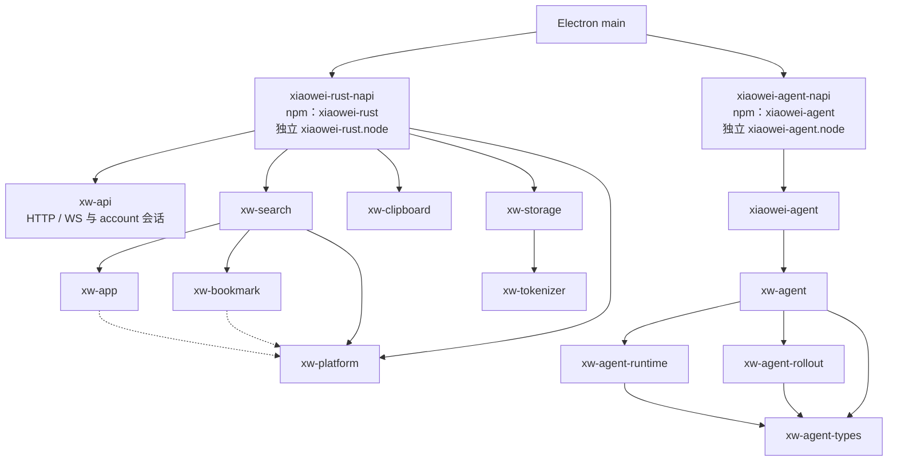

# 工作区详情

XiaoWei 包含 Electron 桌面应用、Rust 原生模块和独立 Go 服务端。桌面使用 TypeScript、React 和 Tailwind CSS，通过 napi 使用 Rust 能力，通过 Gateway 连接本地业务模块，通过 Rust xw-api 的 HTTP／WebSocket 访问 Go 服务端。

工作区组织、依赖同步与源码消费见 [包和依赖管理](package-management.md)。

## 模块与包

### 桌面应用

`desktop/` 是 Electron 应用包，主要分为 main 和 renderer。preload、worker、窗口、业务 service 等内部组织由对应模块文档说明。

| 模块 | 职责 | 详细说明 |
| --- | --- | --- |
| main | 应用装配、窗口与宿主能力，接入 Rust 模块和 TS 业务服务 | [main 模块组织](../desktop/src/main/README.md) |
| renderer | React 页面、组件、主题及业务调用适配 | [Renderer UI 开发](../desktop/src/renderer/README.md) |

### 共享契约与通信

`contracts/proto/` 定义跨语言消息与接口，`contracts/out/` 按业务输出固定契约包，`gateway/` 提供调用、事件、响应流及传输适配。业务 handler 和状态由所属业务模块持有。

| 包 | 职责 |
| --- | --- |
| `contracts/out/proto-desktop-ts/` | 桌面所需 TypeScript 消息与 service descriptor |
| `contracts/out/proto-{server,desktop,agent,llm,testing}-rs/` | 各自独立的 Rust 消息与 descriptor；业务模块按需组合 |
| `contracts/out/proto-server-go/` | Go 服务器及测试契约 |
| `contracts/tools/`：`xw-contracts-codegen` | 契约生成使用的 Rust 工具 |
| `gateway/ts/`：`xiaowei-gateway` | TS client、host 与 Node／Electron／worker 接入 |
| `gateway/rust/`：`xw-gateway` | Rust registry、typed binding 与 napi 通信适配 |

契约组织、生成与兼容规则见 [contracts](../contracts/README.md)，共同通信语义见 [Gateway 架构](gateway.md)，包与各语言接入见 [Gateway](../gateway/README.md)。

### Rust 模块

`crates/` 中的 `xiaowei-*` 是桌面直接消费的入口，`xw-*` 是内部 Rust 业务实现与支撑模块。当前仅分发两个 `.node`：常规业务聚合到 `xiaowei-rust`，Agent 通过 `xiaowei-agent` 独立接入；npm 包名不带 `-napi`，对应 Cargo 绑定 crate 带 `-napi`。

实线表示当前主要使用或依赖关系，虚线表示可按需使用的通用平台能力。图中的两个 napi 节点分别对应真实二进制。常规 addon 按功能持有 registry、owner 和业务状态；xw-api 的网络客户端与 account 会话核心由 xiaowei-rust 在 Rust 内创建，共用一个 endpoint 和 api 实例，桌面不另建 xwapi 模块。其余业务继续通过既有 Gateway 通信；聚合不自动合并数据库或服务生命周期。契约、Gateway、Tokio 与日志等公共依赖未逐一连线，跨两个 `.node` 仍分别链接。

应用、书签等具体业务由各自的纯 Rust 模块实现。`xw-platform` 提供通用平台能力，可由 `xiaowei-rust-napi` 及其他 Rust 模块按需使用；`xw-tokenizer` 是 Storage 的单独依赖。

| 包 | 职责 |
| --- | --- |
| `xw-api` | 客户端 HTTP／WebSocket、连接与无存储的单服务器会话维护 |
| `xw-search` | 全局搜索、排序与使用记录 |
| `xw-clipboard` | 剪贴板采集、历史、资源与粘贴 |
| `xw-storage` | SQLite 存储、迁移、设置与数据访问 |
| `xiaowei-agent` | Agent 核心与 Gateway／LLM 的集成入口 |
| `xiaowei-rust-napi` | 常规业务与平台能力的聚合 Node 适配 |
| `xiaowei-agent-napi` | Agent 的独立 Node 适配 |
| `xw-agent` | 会话、运行调度、持久化目录与业务恢复 |
| `xw-agent-runtime` | 单次生成执行、结果收集与取消 |
| `xw-agent-rollout` | 会话历史文件、提交与恢复 |
| `xw-agent-types` | Agent 内部领域类型、历史编解码与校验 |
| `xw-app` | 应用数据源 |
| `xw-bookmark` | 浏览器书签数据源 |
| `xw-platform` | 通用原生系统能力 |
| `xw-tokenizer` | Storage 使用的 SQLite FTS5 分词 |
| `xw-napi-log` | 原生模块日志接收 |

契约输出位于 `contracts/out/*-rs/`，生成工具为 `contracts/tools/` 的 `xw-contracts-codegen`，Gateway 核心为 `gateway/rust/` 的 `xw-gateway`；具体 workspace 成员以根 Cargo.toml 为准。输出包之间没有直接依赖，同语言同一项目类型只有一个生成来源。

各包的详细说明、依赖方向及原生构建约定见 [Rust 模块索引](../crates/README.md)。

### 共享 npm 包

| 包 | 职责 | 详细说明 |
| --- | --- | --- |
| `packages/source-log/`：`@xiaowei/source-log` | 源码位置注入、日志运行时与 worker 日志采集 | [source-log](../packages/source-log/README.md) |

`packages/` 用于独立 npm 包；Rust 功能模块的 Node 入口留在所属模块中。

### Go 服务端

| 包 | 职责 | 详细说明 |
| --- | --- | --- |
| `server/`：Go 服务端 | HTTP 接口、用户与设备会话，使用 PostgreSQL 持久化 | [服务端说明](../server/README.md) |

Go 服务端独立运行，其内部模块、配置、数据库与部署方式由服务端文档说明。

## 工具和其他

| 目录 | 用途 |
| --- | --- |
| `scripts/` | 工作区开发、构建、检查与测试工具 |
| [`patches/`](../patches/README.md) | 第三方 npm 依赖补丁与行为回归 |
| `.github/workflows/` | CI 检查与测试 |
