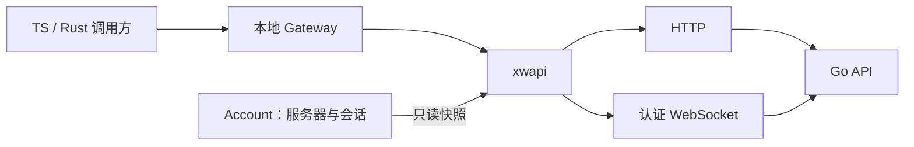

# xwapi 服务器调用

xwapi 在 Electron main 中将本地 Gateway 调用映射到 Go 服务端的 HTTP／WebSocket API。本文维护统一寻址、客户端接入和会话边界；方法、消息及登录态要求以 [服务端 proto](../contracts/proto/xiaowei/server/) 为准，响应与错误语义见 [契约约定](../contracts/proto/xiaowei/server/README.md)。

## 方法与登录要求

API 的唯一声明来源是 service、Request、Response 和方法级 [api.no_login](../contracts/proto/xiaowei/server/common.proto)。未声明或为 false 时需要登录；只有 true 才允许未登录调用，且仅提供 HTTP。传输支持范围由该元信息推导；不另维护方法清单、HTTP 路径表或 WS 白名单。

本地 Gateway 使用 `package.Service.Method`。xwapi 只接收自己显式注册的方法，在 descriptor 解析时校验 service 以 `xiaowei.server.` 开头，再生成网络标识 `<去掉此前缀的 service>/<Method>`。HTTP 固定使用 `POST /api/<网络标识>`，WS 的 `route.name` 使用该标识：

| 调用位置 | 示例 |
| --- | --- |
| 本地 Gateway | `xiaowei.server.auth.Auth.GetCurrentUser` |
| HTTP | `POST /api/auth.Auth/GetCurrentUser` |
| WS manifest／invoke 的 `route.name` | `auth.Auth/GetCurrentUser` |

仅方法地址缩短，PB 类型全名和本地 `methodRoute` 保持原样。HTTP 使用完整 Request 的 Proto JSON，WS 使用同一消息的二进制 PB；具体接入规则见 [HTTP](../server/docs/http.md) 和 [WebSocket](../server/docs/websocket.md)。

[纯 TS helper](../contracts/ts/src/server-api.ts) 从 descriptor 推导网络标识、HTTP 路径和登录要求，不依赖 Electron、AccountService 或 Gateway，可供网站复用。Go 的 [API 注册](../server/internal/httpapi/api.go) 将 descriptor 与业务 handler 绑定一次，再派生 HTTP 路由和 WS 导出；存在 proto 声明不等于已向网络发布。

## 模块职责与会话边界

[main 装配](../desktop/src/main/app/gateway.ts) 注册 xwapi owner，并提供 AccountService 的当前服务器／会话只读快照。客户端实现分工如下：

| 入口 | 职责 |
| --- | --- |
| [gateway.ts](../desktop/src/main/services/xwapi/gateway.ts) | 绑定本地 typed handler、注入上下文、将预期失败编码到业务响应 |
| [service.ts](../desktop/src/main/services/xwapi/service.ts) | 解析 API 元信息、检查本地登录态、编解码与结果校验、选择传输 |
| [http.ts](../desktop/src/main/services/xwapi/http.ts) | HTTP 执行、取消、响应边界与安全日志 |
| [connection.ts](../desktop/src/main/services/xwapi/connection.ts) | 持有当前会话的认证 WS、心跳与重连 |

xwapi 不保存或刷新凭据，也不因原始认证调用成功而提交 Account 状态。产品登录、刷新、恢复和退出由 [AccountService](../desktop/docs/account.md) 管理；服务器地址与 token 来自宿主上下文，不能由业务 payload 或 options 覆盖。

要求 session 的方法在发送前检查 sessionId、accessToken、服务器归属及 access 有效期；无需 session 的 HTTP 调用不附加当前 access token。本地拒绝返回 UNAUTHENTICATED，不清除会话；服务端仍执行最终鉴权，Account 负责刷新与失效处理。临时断线不等于退出登录，连接生命周期见 [桌面云连接](../desktop/docs/account.md#云连接)。

Account 的业务嵌套调用保留原 caller 权限，后台恢复使用宿主 client。已收到但未提交的登录凭据，通过宿主内部 `withContext` 建立隔离上下文并尝试撤销；结束后移除，不将其公开为当前登录态。取消先于本地 RPC 接受响应时，调用方可能拿不到迟到凭据，无法保证撤销服务器已发生的副作用。

应用关闭时，先结束 Account 的事务和补偿，再关闭认证连接与 xwapi，最后释放 Storage。关闭过程取消在途工作并等待清理；调用取消和超时不承诺撤销已发生的业务副作用。

## HTTP 与 WebSocket 选择

[XwApiOptions](../contracts/proto/xiaowei/xwapi.proto) 定义传输选择、等待期限和默认值，经 Gateway 的 [service options 通道](gateway.md#unary-service-options) 独立编码，不并入服务器 Request。未指定或为 UNSPECIFIED 时，优先使用当前会话已认证、ready 且导出兼容方法的 WS；接口不支持 WS、连接尚未就绪、已断开或方法未导出／不兼容时，直接使用 HTTP，不等待重连。显式 HTTP 始终使用 HTTP；显式 WS 不切换传输，不支持 WS 的方法返回 INVALID_ARGUMENT，连接不可用返回 UNAVAILABLE。已经选用 WS 发起的请求，无论断线、超时还是响应无效，都直接返回错误，不再通过 HTTP 重发，以免重复执行。

HTTP 的等待期限通过 fetch 取消信号执行，WS 通过 RPC 取消向对端传递。该期限与 Gateway／peer 的执行期限独立，任一先到即结束等待；关闭 xwapi 计时不绕过 Gateway 上限。HTTP／WS 的网络、取消、超时或无效响应映射为业务 UNAVAILABLE；本地 Gateway 自身的执行超时仍为 RPC TIMEOUT。业务非零 code 保留在对应响应中，不解释为 Gateway 权限错误。

## 接入与验证入口

TS 使用生成的 service descriptor 和 `bindClient`；传递选项时配置 `{ optionsSchema: XwApiOptionsSchema }`。Rust 使用模块生成的 typed Method 和 `with_options::<XwApiOptions>()`。生成、注册与验证流程见 [契约维护](../.agent/skills/maintain-gateway-contract/SKILL.md)，调用方按 [契约约定](../contracts/proto/xiaowei/server/README.md#客户端处理) 处理业务结果。

回归入口：[xwapi 调用](../desktop/tests/main/xwapi.test.ts)、[连接管理](../desktop/tests/main/server-connection.test.ts)、[Rust napi 调用](../desktop/tests/rust-napi/xwapi.test.ts)；运行方式见 [桌面测试](../desktop/tests/README.md)。HTTP 日志规则见 [请求日志](../server/docs/http.md#请求日志)，服务端连接认证、撤销与退出响应顺序见 [WebSocket 接入](../server/docs/websocket.md)。
