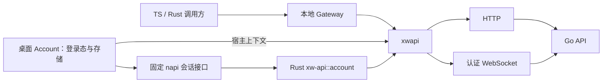

# xwapi 服务器调用

纯 Rust `xw-api` 执行客户端到 Go 服务端的 HTTP／WebSocket API。桌面由 `xiaowei-rust` 提供 Gateway 适配；共享核心不依赖 Gateway 或平台绑定。本文维护统一寻址、客户端接入和会话边界；方法、消息及登录态要求以 [服务端 proto](../contracts/proto/xiaowei/server/) 为准，响应与错误语义见 [契约约定](../contracts/proto/xiaowei/server/README.md)。

xwapi 是客户端访问层。服务端由 `server/internal/httpapi/` 实现相应接口及 HTTP／WebSocket 规范，每条认证连接独立绑定服务端验证的 user、device 和 session；网络边界不使用 App 内 Gateway 的 caller 或信任标记作为身份。

## 方法与登录要求

API 的唯一声明来源是 service、Request、Response 和方法级 [api.no_login](../contracts/proto/xiaowei/server/common.proto)。未声明或为 false 时需要登录；只有 true 才允许未登录调用，且仅提供 HTTP。传输支持范围由该元信息推导；不另维护方法清单、HTTP 路径表或 WS 白名单。

本地 Gateway 使用 `package.Service.Method`。xwapi 只接收自己显式注册的方法，在 descriptor 解析时校验 service 以 `xiaowei.server.` 开头，再生成网络标识 `<去掉此前缀的 service>/<Method>`。HTTP 固定使用 `POST /api/<网络标识>`，WS 的 `route.name` 使用该标识：

| 调用位置 | 示例 |
| --- | --- |
| 本地 Gateway | `xiaowei.server.Auth.GetCurrentUser` |
| HTTP | `POST /api/Auth/GetCurrentUser` |
| WS manifest／invoke 的 `route.name` | `Auth/GetCurrentUser` |

仅方法地址缩短，PB 类型全名和本地 `methodRoute` 保持原样。HTTP 使用完整 Request 的 Proto JSON，WS 使用同一消息的二进制 PB；具体接入规则见 [HTTP](../server/docs/http.md) 和 [WebSocket](../server/docs/websocket.md)。

[纯 TS helper](../contracts/out/proto-desktop-ts/src/server-api.ts) 从 descriptor 推导网络标识、HTTP 路径和登录要求，不依赖 Electron、AccountService 或 Gateway，可供网站复用。Go 的 [API 注册](../server/internal/httpapi/api.go) 将 descriptor 与业务 handler 绑定一次，再派生 HTTP 路由和 WS 导出；存在 proto 声明不等于已向网络发布。

## 模块职责与会话边界

[xiaowei-rust](../crates/xiaowei-rust/napi/src/account/mod.rs) 在 Rust 内部创建 xw-api 客户端与其 account 会话核心，将 Auth／Health 和连接观察注册到同一个原生 endpoint；账号内部操作通过固定 napi 方法接入。[main 装配](../desktop/src/main/app/gateway.ts) 沿用通用 Gateway 接入，不创建 xwapi 实例或提供专用 TS 代理。客户端实现分工如下：

| 入口 | 职责 |
| --- | --- |
| [xw-api](../crates/xw-api/README.md) | 契约解析、HTTP／WS 执行、结果校验、认证连接、心跳与重连 |
| [原生 Gateway 适配](../crates/xiaowei-rust/napi/src/xwapi/gateway.rs) | 注册既有 Auth／Health、保留权限、取消与业务错误响应 |
| [原生组合与上下文](../crates/xiaowei-rust/napi/src/account/mod.rs) | 创建共享 api 和会话核心；保存宿主交付的当前运行上下文，按调用隔离临时目标 |
| [桌面账号接入](../desktop/src/main/services/account/session.ts) | 交付桌面持有的会话、接收检查点和连接状态；通过固定 napi 方法调用 Rust 会话核心 |

xw-api 的网络请求层不保存或自动刷新凭据，也不因原始认证调用成功而提交 Account 状态。同一 crate 的 [account 模块](../crates/xw-api/README.md#账号会话) 直接调用网络能力处理单服务器登录、刷新、恢复和退出，不依赖 Gateway，不提供存储。桌面 [AccountService／AccountStore](../desktop/docs/account.md) 继续管理产品登录态、多服务器、保存与回滚；服务器地址与 token 来自宿主上下文，不能由业务 payload 或 options 覆盖。

连接鉴权等待由 xw-api::account 直接调用 Rust 连接能力。桌面通过 App 内的 `ConnectionChanged` 事件接收连接状态和鉴权结果，并按连接代次过滤旧事件；事件不携带凭据。

要求 session 的方法在发送前检查 sessionId、accessToken、服务器归属及 access 有效期；无需 session 的 HTTP 调用不附加当前 access token。本地拒绝返回 UNAUTHENTICATED，不清除会话；服务端仍执行最终鉴权，Account 负责刷新与失效处理。临时断线不等于退出登录，连接生命周期见 [桌面云连接](../desktop/docs/account.md#云连接)。

桌面 Account 的业务嵌套调用保留原 caller 权限，后台恢复使用宿主 client；单会话原生适配按实际动作检查原 Auth 权限。凭据输入与结果只绑定宿主创建的操作上下文，普通 Gateway 调用方不能注入或读取；桌面 Account 定义自己的展示与表单消息，AccountService 显式适配服务器认证类型；UI 字段与存储格式保持。普通 Auth／Health 请求由 Rust 读取当前运行上下文；添加地址时，现有账号宿主为该次 Health.Check 交付不含凭据的隔离目标，检查不改变当前连接。刷新检查点先交回桌面保存，再继续校验；取消或错误后仍可从原操作读取已接受的最新凭据。已收到但未提交的登录凭据由隔离会话操作尝试撤销，结束后移除，不将其公开为当前登录态。服务器响应尚未被核心接受时发生取消，调用方可能拿不到迟到凭据，无法保证撤销服务器已发生的副作用。

应用关闭时，先结束桌面 Account 的事务、补偿和待保存处理，再关闭组合的原生 owner；Rust 依次清理会话操作、当前会话及 api 连接，随后桌面释放 Storage。关闭过程取消在途工作并等待清理；调用取消和超时不承诺撤销已发生的业务副作用。

## HTTP 与 WebSocket 选择

`xw-api::RequestOptions` 与 `Transport` 是普通 Rust 类型，提供超时和显式传输选择，不另定义 xwapi 或 server_call proto。桌面服务器 Gateway 代理使用默认自动选择策略；调用方通过原有 RPC 句柄取消请求。

自动选择优先使用当前会话已认证、ready 且导出兼容方法的 WS；接口不支持 WS、连接尚未就绪、已断开或方法未导出／不兼容时直接使用 HTTP，不等待重连。Rust 调用方可以显式选择 HTTP；显式 WS 不切换传输，不支持 WS 的方法返回 INVALID_ARGUMENT，连接不可用返回 UNAVAILABLE。已经选用 WS 发起的请求，无论断线、超时还是响应无效，都直接返回错误，不再通过 HTTP 重发。
package、service 或消息全名变化会改变本地路由、HTTP 地址或 WS manifest 的类型身份，即使 PB 字段与 Proto JSON 仍兼容，也不能视为调用兼容。当前服务器契约统一使用 `xiaowei.server`；使用旧业务子 package 的客户端与新服务器，以及新客户端与旧服务器，均不兼容，需要配套更新。自动策略在 WS manifest 不匹配时只会尝试当前契约的 HTTP 地址，不会转换旧地址。

HTTP 的等待期限由 Rust 网络请求取消与超时执行，WS 通过 RPC 取消向对端传递。该期限与 Gateway／peer 的执行期限独立，任一先到即结束等待；关闭 xwapi 计时不绕过 Gateway 上限。HTTP／WS 的网络、取消、超时或无效响应映射为业务 UNAVAILABLE；本地 Gateway 自身的执行超时仍为 RPC TIMEOUT。业务非零 code 保留在对应响应中，不解释为 Gateway 权限错误。

## 接入与验证入口

桌面 TS 使用服务器生成的 service descriptor 和 `bindClient`，Rust Gateway 消费者使用模块生成的 typed Method。共享 Rust 调用方直接使用 `xw-api::Client` 与 `RequestContext`，认证消息来自唯一的 `proto-server-rs`。生成、注册与验证流程见 [契约维护](../.agent/skills/maintain-gateway-contract/SKILL.md)，调用方按 [契约约定](../contracts/proto/xiaowei/server/README.md#客户端处理) 处理业务结果。

回归入口：[xwapi 调用](../desktop/tests/main/xwapi.test.ts)、[连接管理](../desktop/tests/main/server-connection.test.ts)、[Rust napi 调用](../desktop/tests/rust-napi/xwapi.test.ts)；运行方式见 [桌面测试](../desktop/tests/README.md)。HTTP 日志规则见 [请求日志](../server/docs/http.md#请求日志)，服务端连接认证、撤销与退出响应顺序见 [WebSocket 接入](../server/docs/websocket.md)。
