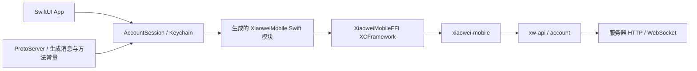

# iOS 开发与验证

## 工程与构建基线

App 的最低系统版本由 `Config/Base.xcconfig` 中的 iOS 17.0 定义；Swift 6 模式启用严格并发，编译与链接警告作为失败。当前仅包含 arm64 真机和 arm64 模拟器，不包含 Intel 模拟器。

已使用 Xcode 26.3（17C529）、Swift 6.2.4、iOS／Simulator SDK 26.2 构建。现有模拟器 runtime 显示名称为 iOS 26.3／18.3，实际 destination 版本为 26.3.1／18.3.1；选择目标时以 `xcodebuild -showdestinations` 为准。iOS 17 runtime 当前未安装，最低版本未完成运行验证。

工程维护四个原生 targets：

| Target | 职责 |
| --- | --- |
| XiaoWei | SwiftUI App、系统生命周期和展示状态 |
| XiaoweiMobile | 同次生成的 Swift 绑定，静态 framework；链接 Rust XCFramework |
| XiaoWeiTests | 在 App 宿主中实际调用生成绑定的网络与资源测试 |
| XiaoWeiUITests | 安装后启动 App，操作页面、系统权限和前后台切换 |



Swift 使用本地 [ProtoServer 包](../../contracts/out/proto-server-swift/README.md) 的生成消息与方法常量，不维护另一份路由或 codec。Health.Check 通过正式 Rust API 发出，解码 BaseResponse 后检查成功 code 与 data presence，显示“服务正常”。产品服务器为 `https://xiaowei.tctony.com`，首期没有多服务器入口；密码登录与恢复共用既有 Rust 账号实现。

## 准备原生产物

所有命令在仓库根执行：

```sh
rustup target add aarch64-apple-ios aarch64-apple-ios-sim
node ios/scripts/prepare.mjs --configuration Debug
```

prepare 读取最低版本并调用 [FFI 打包入口](../../crates/xiaowei-mobile/ffi/README.md#ios-app-打包)。Cargo 的 target_directory 决定二进制归属，支持 `CARGO_TARGET_DIR`；产物位于其中的 `mobile-ios/debug/` 或 `mobile-ios/release/`。同一目录中的 Swift 绑定、C 头和 `XiaoweiMobileFFI.xcframework` 必须一起使用，不手改生成文件。

prepare 同时写入忽略的 `target/ios/Native.xcconfig`，把原生目录交给 Xcode。打开工程前或切换原生构建配置后先执行对应准备命令；工程不依赖稍后的 Build Phase 来创建尚不存在的 XCFramework。不需要 Ruby、工程生成器或额外 npm 包。Xcode 使用本地 ProtoServer package，并精确解析 SwiftProtobuf 1.39.0；生成器／运行库版本一致，工程与独立 codec 的 SwiftPM 解析锁入库。首次解析需访问官方源码仓库。

```sh
open ios/XiaoWei.xcodeproj
xcodebuild -project ios/XiaoWei.xcodeproj -scheme XiaoWei -showdestinations
xcodebuild -project ios/XiaoWei.xcodeproj -scheme XiaoWei \
  -configuration Debug -destination 'generic/platform=iOS Simulator' \
  -derivedDataPath target/ios/DerivedData CODE_SIGN_IDENTITY=- build
```

Release 使用独立原生产物：

```sh
node ios/scripts/prepare.mjs --configuration Release
xcodebuild -project ios/XiaoWei.xcodeproj -scheme XiaoWei \
  -configuration Release -destination 'generic/platform=iOS Simulator' \
  -derivedDataPath target/ios/ReleaseDerivedData CODE_SIGN_IDENTITY=- build
```

Release 不编译 Debug 的 fixture 启动参数处理，也不使用测试用本地网络 Info.plist；正常 HTTPS 的证书校验始终由 Rust 客户端保留。

## 真机签名与网络

复制 `ios/Config/Local.xcconfig.example` 为 `ios/Config/Local.xcconfig`，只在本机填写自己的 `DEVELOPMENT_TEAM`；或向验证脚本传 `--team '<个人Team>'`。工程使用自动开发签名，真机构建允许 Xcode 更新 provisioning profile。不要把 Team、证书、profile 或设备 UDID 写入共享配置。

手机需连接、解锁、信任 Mac，并开启 Developer Mode。配对记录不等于当前可用：先用 `xcrun devicectl list devices` 和 Xcode destinations 核对实际设备，再进行签名、安装与运行。

隔离测试在 Mac 创建临时 Node HTTP／Go WS fixture。手机必须能访问显式指定的 Mac 地址；USB 调试连接本身不提供手机到 Mac 的 HTTP 转发。使用手机可达的局域网地址，保留 VPN／防火墙设置，由实际请求确认连通性，不把 `127.0.0.1` 发给真机。

Debug 的本地网络用途说明与 `NSAllowsLocalNetworking` 只服务开发验收，不全局允许任意 HTTP，也不关闭 TLS 校验。UI 测试通过系统弹窗处理本地网络及部分地区设备的无线数据授权。完整真机 fixture 测试会重置这份开发 App 的本地网络权限，先拒绝并检查失败状态，再重置、允许并恢复；不修改其他 App 或全局隐私设置。模拟器回环访问不经过真机本地网络隐私路径。

首轮真机验收按用户要求跳过局域网 fixture，使用 `--public-only`；真机本地网络权限允许／拒绝、隔离账号、WS 与取消仍需独立验收。该模式不访问 Mac fixture，也不重置本地网络权限，不用它宣称完整真机网络场景已通过。

## 运行验证

```sh
node ios/scripts/verify-runtime.mjs \
  --destination 'platform=iOS Simulator,name=iPhone 16 Plus,OS=26.3.1'
node ios/scripts/verify-runtime.mjs \
  --destination 'platform=iOS,id=<实际设备UDID>,arch=arm64' \
  --listen-host 0.0.0.0 --fixture-host '<手机可达的Mac地址>' --team '<个人Team>'
node ios/scripts/verify-runtime.mjs \
  --destination 'platform=iOS,id=<实际设备UDID>,arch=arm64' \
  --team '<个人Team>' --public-only
```

完整模式依次准备原生库、以 ad-hoc 签名构建模拟器宿主（真机用开发签名）、创建独立 fixture，然后串行执行 Keychain、账号宿主、账号表单 UI、生命周期 UI 和原有 Rust 宿主 XCTest。模拟器先等待 bootstatus；只关闭脚本启动的模拟器，保留原来已启动的实例。UI 和宿主场景串行运行，互不共用合成会话及请求计数。`--public-only` 使用相同构建入口，执行真实 Keychain 测试与无凭据公开 HTTPS 的 UI／宿主测试，不创建 fixture，也不要求 Go 或 Mac 局域网地址。

| 验证层 | 实际覆盖 |
| --- | --- |
| 账号 UI | 合成账号错误密码／成功登录、实际 Keychain 保存、终止进程后恢复、退出后再次启动仍未登录、挂起登录取消 |
| Keychain | 真实 Security API 的读写／更新／删除、重新创建 store 后恢复、设备 ID 保留、访问属性、关闭同步、禁止认证 UI 时仍可读取及 namespace 隔离 |
| 账号宿主 | 实际 Rust 操作配合可控存储失败，覆盖恢复、刷新检查点保存失败后的重试、保存途中取消、离线保留、失效清除、未提交登录撤销和退出删除失败的本地重试 |
| UI App | 原生加载、页面状态、健康请求、后台断开、前台重连、再次请求、显式停止和 owner 重建；完整真机模式另包含本地网络拒绝与恢复 |
| 宿主 XCTest | 合成 WS 鉴权／调用、公开 HTTP 无凭据、PB 业务失败、重复读取不重放、发送前／发送后取消、超时、账号检查点继续／取消后收取、登录退出、订阅 stop、pause／恢复与幂等 shutdown |
| 公开 HTTPS | 从目标 iOS 的 Rust 客户端请求默认服务器，执行实际 DNS／TLS；不使用真实账号 |
| fixture 断言 | 核对业务请求数量、取消请求已到达及 socket 实际关闭、前后台与 owner 重建分别建立 WS、最终无打开的 WS |
| public-only | 真实 Keychain 读写／访问属性、App 的公开 HTTPS、前后台、停止／重建，以及宿主 XCTest 通过正式绑定执行 Rust HTTPS；不覆盖真实账号登录或认证 WSS |

合成认证数据由既有 Rust fixture 生成；Swift 使用生成的 ProtoServer 消息构造登录请求、验证用户字段和解码响应。Debug fixture 依据每次控制地址 UUID 使用独立 Keychain namespace；公开测试也使用专用 namespace，不读取产品保存的会话。Release 不编译这些测试入口。Foundation 仅访问测试控制路径，不代替产品 Rust 网络调用。测试不退出用户账号，不启动桌面 App 或生产服务。

日志、每个场景的 `.xcresult` 和 `report.json` 位于 `target/ios/runs/<时间>/`；模拟器和真机的 DerivedData 分别位于 `target/ios/DerivedData/` 与 `target/ios/DeviceDerivedData/`。报告记录源码基线与未提交内容哈希、Xcode／SDK、destination、明确 scope、安全计数及结果；不保存认证 PB 或 token。各模式均核对实际通过的 XCTest 数量；完整模式还要求 fixture 完成断言，零测试或仅构建成功不能通过。

原有独立检查仍保留：

```sh
cargo test --locked -p xiaowei-mobile
node crates/xiaowei-mobile/ffi/scripts/verify-bindings.mjs
node crates/xiaowei-mobile/ffi/scripts/verify-ios.mjs
```

macOS 上的 Swift／Kotlin 命令行测试、iOS SDK 编译／链接、模拟器运行和真机运行属于四种独立证据。库检查的 iOS 15.0 仅用于库层兼容性，不改变 App 的最低版本。Kotlin/JVM 通过也不代表 Android App／ABI 已验收。

## 生命周期与日志

`AppModel` 在 MainActor 上持有一个 MobileClient、当前请求和连接订阅，串行交接 active、background 与 shutdown。inactive 的短暂系统交互不会暂停连接。进入后台取消当前请求、停止订阅并等待 Rust pause；回到前台重新提交会话，已 shutdown 的 owner 需要新建。修订号使旧任务结果不能覆盖新场景。

iOS 提供的有限后台时间只用于取消、凭据落盘与清理，不承诺后台常驻或杀进程前一定收到回调。App 使用系统 Logger，subsystem 为 `com.tctony.xiaowei.ios`，分别记录 lifecycle 和 account 的动作、错误分类、持久化及清理结果，不记录邮箱、密码、消息体或凭据。


## 账号与平台持久化

AppModel 只创建一个 MobileClient，AccountSession 使用该 owner 管理平台登录态，不复制 Rust 的刷新／认证状态机。前台激活后从 Keychain 加载并恢复；首次密码登录在隔离操作完成、校验返回身份且保存成功后，才提交当前会话并建立连接。密码仅在表单和本次请求内存中使用，提交／离开时清空表单，不写入 Keychain。

设备 ID 为持久小写 UUID，退出登录保留。完整 Authenticated PB 按明确服务器地址保存为 generic password，使用 `kSecAttrAccessibleAfterFirstUnlockThisDeviceOnly`：每次重启后首次系统解锁即可访问，随后锁屏期间仍可在系统允许 App 执行时读写。它不增加 App 锁或 Face ID，不设置用户在场 ACL，不使用 iCloud 同步，也不随备份迁移到其他设备。内容／设备密钥不属于会话存储。

恢复或维护返回新认证字节时先保留到内存，再保存到 Keychain；相同 credentialVersion 的检查点仅在保存成功后继续。用户资料变化也保存。保存失败保留内存中的新凭据、停止当前连接，下次先重试保存，避免再次消费旧 refresh token。取消先通知 Rust，在独立于被取消任务的清理任务里收取 settledResult 并关闭原操作；未提交的登录尝试本地删除并隔离撤销。撤销未确认会留下明确日志，不伪造远端成功。

退出成功或确认认证失效才删除本地会话；网络／服务失败保留登录信息。远端退出后本地删除失败保留待删除状态，“重试”只重试本地删除，不重复远端退出。Keychain 读取失败也显示可重试错误，不静默替换数据。账号动作串行，前台恢复、定时维护、重连和拒绝通知合并处理；后台／shutdown 先取消并结算账号操作，再暂停／关闭 Rust owner。

调试账号或存储场景可单独执行：

```sh
node ios/scripts/verify-runtime.mjs \
  --destination 'platform=iOS Simulator,name=iPhone 16 Plus,OS=26.3.1' --account-only
node ios/scripts/verify-runtime.mjs \
  --destination 'platform=iOS,id=<实际设备UDID>,arch=arm64' \
  --team '<个人Team>' --keychain-only
```

合成 fixture 的 HTTP／WS 证明宿主与共享核心的账号边界；真实服务器公开 HTTPS 证明目标设备的 DNS／TLS。生产密码登录、认证 WSS 及实际账号重启恢复需要专门的产品验收，不由合成结果替代。不要把真实凭据加入测试参数、报告或 fixture。
