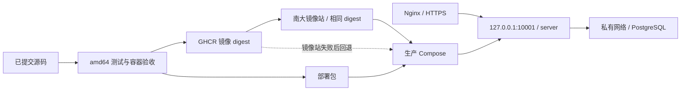

# 部署交付

生产使用 CI 发布的镜像和部署包，不在服务器构建源码。当前支持邮箱密码登录、会话刷新／恢复／退出、首次管理员初始化及认证 WebSocket；注册、SMTP及找回密码尚未实现，其完整交付验收由 [server-development](../../.agent/records/active/2026-10-11-server-development.md) 的后续切片跟进。

## 发布链路

用户明确要求部署服务器后，Agent 使用 [depoly-server skill](../../.agent/skills/depoly-server/SKILL.md)，通过 `workflow_dispatch` 手动触发 [Server image workflow](../../.github/workflows/server-image.yml)，构建成功后继续生产部署、初始化与登录验收及运维核对。服务端镜像构建不由 push、PR 或版本 tag 自动触发，不使用独立 server tag。

默认源码为远端 develop 的最新已提交版本，也可由用户指定分支或 commit。部署采用单实例原地升级，允许短暂停机。

workflow 仅由 workflow_dispatch 触发，source_ref 默认为 develop。部署技能先解析远端完整 SHA，再将其作为 source_ref 传入；workflow 解析一次后，测试与发布均 checkout 同一 SHA。GitHub run 的 headSha 属于 workflow 版本，实际应用版本以部署包 release.txt 的 sha 和镜像 revision 为准。代码与本地验收不代表已完成远端发布，真实 CI 发布和线上验收仍须在用户发起部署后执行。

仅构建、验收和发布 linux/amd64，不需要 arm64。测试使用 amd64 原生 runner，在专用 PostgreSQL 上执行 Go race／vet，再通过实际生产 Compose 验证配置预检查、空库初始化、登录、刷新、退出、容器重建、数据库故障与备份恢复。通过后发布镜像 `ghcr.io/tctony-labs/xiaowei-server`。

镜像标签为 `sha-<完整 Git SHA>`，不发布 latest。GHCR 是发布源；部署优先通过南京大学镜像站拉取，固定使用本次 workflow 输出的 digest，仅替换仓库域名。镜像附带源码仓库和版本的 OCI 元信息。首次创建 GHCR package 后需将可见性设为 Public，才能匿名拉取及使用公共镜像站；仓库公开不自动保证 package 公开。

每次发布通过 `server-deployment` workflow artifact 提供 `server-deployment.tar.gz`，不依赖 GitHub Release。部署包包括生产 Compose、配置模板、Nginx／日志轮转模板、备份入口 backup.sh、本文、`image.txt` 和 `release.txt`，不包含源码、真实配置或凭据。Agent 必须关联本次手动触发的 run ID、源码 SHA 与镜像 digest，不使用“最近一次成功”的其他构建产物。所需源码尚未提交或推送时，遵守用户明确授权提交的规则。



## 镜像拉取与版本核对

在目标服务器优先使用 `ghcr.nju.edu.cn`，只将 CI 部署包 image.txt 中的 `ghcr.io` 域名替换为该地址，仓库路径和完整 digest 保持不变。[南京大学 GHCR 说明](https://doc.nju.edu.cn/books/e1654/page/ghcr)支持这种域名替换，但没有承诺新版本实时可用；每次发布后都要验证本次准确的 digest，不能使用 latest、旧 tag 或其他版本代替。

先核对原始 release.txt 的源码 SHA、run ID 和 image.txt 一致，再在服务器执行完整镜像拉取。以下 `release_dir` 是本次部署包的绝对路径：

```sh
set -eu
upstream_image="$(cat "$release_dir/image.txt")"
case "$upstream_image" in
    ghcr.io/tctony-labs/xiaowei-server@sha256:*) ;;
    *) echo "Unexpected published image reference" >&2; exit 1 ;;
esac
deploy_image="ghcr.nju.edu.cn/${upstream_image#ghcr.io/}"
docker pull --platform linux/amd64 "$deploy_image"
docker image inspect "$deploy_image" \
  --format '{{.Os}}/{{.Architecture}} {{index .Config.Labels "org.opencontainers.image.revision"}} {{json .RepoDigests}}'
```

完整 pull 必须成功，检查输出的平台为 linux/amd64、revision 为本次完整源码 SHA、RepoDigests 包含所选仓库地址与 CI 发布的准确 digest。Docker 拉取时校验内容摘要；这里只允许替换域名，不接受镜像站重新打包产生的不同 digest。仅 manifest 可读或镜像站首页可访问不足以通过。所有拉取和核对均在停止旧应用及备份前完成。

镜像站失败时，保留旧服务并检查具体错误。确认暂时性故障后可重试；仍不可用时回退 image.txt 中的 GHCR 原站引用，重新完整拉取并执行相同核对。原站也失败或持续过慢时，先排查仓库入口和镜像层下载节点，再报告阻塞；不循环重试，不自行更改全局 Docker 代理、DNS 或 hosts，不切换未知镜像站，不使用本机 save／SCP／load 中转。南大镜像地址只用于本服务的完整镜像引用，不能用 Docker Hub 的 registry-mirrors 设置代替。

发布目录 `releases/<version>/` 中的 image.txt 和 release.txt 保留 CI 原文。候选配置的 `XIAOWEI_SERVER_IMAGE` 填入已验证的实际引用；候选 release.txt 保留原始 sha、run_id、run_url，将 `image=` 改为同一实际引用，并增加 `upstream_image=` 保存原始 GHCR 引用。使用镜像站时两者只允许域名不同，回退原站时两者相同。首次部署在服务根目录准备这份运行元信息；升级先在候选目录准备，升级前备份成功后才安装到服务根目录。

backup.sh 核对运行容器的镜像引用、Compose 配置和运行 release.txt 的 `image=` 完全一致，原有检查继续保留；不要只改 .env 或拿 CI 原始 release.txt 覆盖运行元信息。回滚恢复备份中的整套配置和 release.txt，保留其实际镜像引用；不要在恢复时自动改写镜像来源。

## 上海部署目录

本次目标为 `tctony.com`，业务地址 `https://xiaowei.tctony.com`，服务根目录 `/data/xiaowei/`。现有 Nginx 与 `*.tctony.com` 证书负责 HTTPS，数据库与应用在本机分容器运行。

```text
/data/xiaowei/
├── compose.yaml
├── release.txt              # 当前源码 SHA、CI run、实际 image 与 upstream_image
├── releases/<version>/       # 解压的部署包及对应 image.txt
├── config/
│   ├── server.yaml           # 不含密码，可供 nonroot 容器读取
│   └── .env                  # 0600，镜像引用、数据库及初始化凭据
├── data/postgres/            # 由 PostgreSQL 容器管理属主及 mode
├── backups/
│   ├── latest.tar           # 最近一次升级前的完整回滚备份，0600
│   └── upgrade-pending      # 备份完成至升级／回滚验收通过之间保留
└── logs/                    # Nginx 日志
```

生产使用 [compose.xiaowei.yaml](../deploy/compose.xiaowei.yaml)，复制为根目录的 compose.yaml；这是完整清单，不与开发 `compose.yaml` 叠加。Compose 项目名固定为 `xiaowei`，所有命令在服务根目录执行，并显式使用相同 `.env` 与清单：

```sh
cd /data/xiaowei
docker compose --project-name xiaowei --env-file config/.env --file compose.yaml ps
```

PostgreSQL 不发布宿主机端口。服务端只发布 `127.0.0.1:10001`，可通过 `XIAOWEI_SERVER_PORT` 改变宿主机端口；容器内部固定为 10001。服务端镜像使用 UID 65532，根文件系统只读，移除 Linux capabilities。数据库文件保存在上述 bind 目录，不随容器重建删除；不能删除 data/ 或把 PostgreSQL 主版本升级当作普通应用升级。

Docker JSON 日志每个服务保留 3 个、每个最大 10 MiB。Nginx 模板将日志放在 logs/，日志轮转模板每天轮转并保留 14 份；访问日志不记录 URL、query、请求体或认证头。反代错误日志仍是 Nginx 的标准诊断格式。

## 首次部署

服务器需要 Docker、Docker Compose v2、Nginx 和有效 TLS 证书。先将部署包下载到 releases/<version>/ 并解压，再准备以下文件；复制模板只在首次部署执行，升级不覆盖 config/。

```sh
mkdir -p /data/xiaowei/releases /data/xiaowei/config /data/xiaowei/data
mkdir -p /data/xiaowei/backups /data/xiaowei/logs
cd /data/xiaowei
cp releases/<version>/compose.yaml compose.yaml
cp releases/<version>/release.txt release.txt
cp releases/<version>/config/server.example.yaml config/server.yaml
cp releases/<version>/config/.env.example config/.env
chmod 644 config/server.yaml
chmod 600 config/.env
```

按[镜像拉取与版本核对](#镜像拉取与版本核对)选择并验证本次 digest 的实际引用，填入 config/.env 的镜像变量，并将根目录 release.txt 整理为对应的运行元信息。数据库密码设为独立随机值，首个管理员的邮箱及初始密码由用户直接在服务器填写，Agent 默认不读取密码或在本机留存凭据。数据库名、用户与密码只在空 PostgreSQL 目录初始化时创建；修改已有环境变量不会修改数据库账号密码。配置文件的生产模板不包含默认密码。

```sh
docker compose --project-name xiaowei --env-file config/.env --file compose.yaml pull
docker compose --project-name xiaowei --env-file config/.env --file compose.yaml run \
  --rm --no-deps -T server --check-config --config /etc/xiaowei/server.yaml
docker compose --project-name xiaowei --env-file config/.env --file compose.yaml up --detach --wait --wait-timeout 120
docker compose --project-name xiaowei --env-file config/.env --file compose.yaml ps
```

`--wait` 依赖容器内 `/xiaowei-healthcheck`：探针 POST 请求容器内部的 `/api/Health/Ready`，要求同时返回 HTTP 200 与整数 code 0；数据库不可用时，即使 HTTP 200 也会返回非零退出码。探针不读取配置或凭据，不启动应用。未配置服务器 YAML、迁移失败或初始化失败时不会开放 HTTP。

管理员登录由用户验证。初始化后保留 config/.env 中两项 `XIAOWEI_BOOTSTRAP_ADMIN_*` 及“仅首次初始化使用”的注释，不自动删除或改写。数据库已有初始化标记时会跳过初始化，后续修改这些变量不会重置已有密码，变量值也不代表当前登录密码。具体事务和密码规则见 [首次管理员初始化](authentication.md#首次管理员初始化)。

修改容器环境变量后，通过下列命令重建应用容器；`docker restart` 不会重新加载 .env。普通重建保留数据库及会话，不重新初始化账号。

```sh
docker compose --project-name xiaowei --env-file config/.env --file compose.yaml up --detach --no-deps --wait --wait-timeout 120 server
```

## 可信反向代理

默认不信任任何代理头。YAML 使用 `server.trusted_proxy_cidrs` 字符串列表；env 使用 `XIAOWEI_TRUSTED_PROXY_CIDRS` 的逗号分隔 CIDR，优先级沿用 YAML < 同目录 .env < 进程 env。显式空 env 关闭代理信任，非法 CIDR 拒绝启动。

宿主机 Nginx 访问 Docker 发布端口时，服务端通常看到 Compose 网络 gateway 作为 TCP 来源。先查看实际网络配置，确认该来源后只把该单个地址的 `/32`（IPv6 使用 `/128`）写入配置；不要直接信任整个私网网段。

```sh
docker network inspect xiaowei_default --format '{{range .IPAM.Config}}{{.Gateway}}{{end}}'
```

Nginx 模板将 `/api/` 下的统一 POST 接口及 WS 升级原样转发给 Go，其余路径暂时返回空的 HTTP 200，作为前台页面接入前的占位。HTTP 入口仍重定向到 HTTPS。

Nginx 模板使用 `proxy_set_header X-Real-IP $remote_addr` 覆盖外部输入，服务端仅在 TCP 来源匹配配置时采用这个单 IP。X-Forwarded-For 不参与限流，不解析多级代理链。配置后重建 server，确认启动日志包含 `trusted reverse proxies configured`；没有代理时保持空列表。来源与限流规则见 [限流文档](rate-limiting.md#计数与来源)。

以下接入配置在首次部署执行：将 nginx.example.conf 的域名、证书、监听端口和日志目录按实际环境调整；本次模板已对应上海。安装站点和 nginx.logrotate 后，检查并重载：

```sh
cp releases/<version>/nginx.example.conf /etc/nginx/sites-enabled/xiaowei.tctony.com
cp releases/<version>/nginx.logrotate /etc/logrotate.d/xiaowei
nginx -t
systemctl reload nginx
curl --fail --silent --show-error -X POST -H 'Content-Type: application/json' \
  -d '{}' https://xiaowei.tctony.com/api/Health/Ready
```

常规应用升级复用现有 HTTPS 接入，只执行公网访问验证，不重复复制 Nginx 模板、签发证书或重载 Nginx。仅在域名、上游端口、代理规则或证书配置变化时，更新对应设置并检查、重载；证书续期沿用服务器既有机制。

最后一项必须读取 JSON 的 code，curl 成功本身不证明就绪。Agent 默认只检查容器健康、公网路由、健康检查业务 code、初始化记录，以及数据库和 10001 没有公网暴露，不读取用户密码或执行生产登录。登录及容器重建后的会话恢复由用户验证；用户另行授权认证验收时才执行对应操作，并使用独立验收会话。健康检查通过不等于登录验收通过，等待用户确认期间明确保留待验收状态。正误密码、当前用户、刷新、退出等自动测试继续在 CI 隔离环境执行。反代不自动重放请求；Nginx 模板通过独立的 `/api/ws` location 转发 Upgrade／Connection 和可信代理头，关闭缓冲并使用 60 秒读写超时；客户端每 15 秒发起应用心跳。部署后还需验证真实 WSS 建连和 typed 调用，健康检查不能替代这项验收。

## 备份与恢复

部署包中的 backup.sh 执行升级前备份；运行环境需要 Bash、tar 和 Docker Compose。仅在升级前备份，正式备份固定为 `/data/xiaowei/backups/latest.tar`，仅保留最近一份，不增加定时备份和历史保留。升级成功后仍保留它，直到下一次有效的升级前备份替换。

备份包含 PostgreSQL custom-format dump、当前 compose.yaml、完整 config/，以及备份时间、当前源码 SHA、CI run ID 和实际镜像 digest。配置中包含秘密，暂存目录权限为 0700，备份文件为 0600；归档和恢复保留 config/ 的原始权限，确保 nonroot 可读 server.yaml，同时 .env 保持 0600；不得打印或提交其内容。确保旧镜像仍可用，不在本次升级中清理回滚镜像。

在新镜像和候选配置预检查通过后，从服务根目录调用本次部署包中的脚本；此时 compose.yaml、config/ 和 release.txt 必须仍属于当前健康版本：

```sh
bash releases/<version>/backup.sh /data/xiaowei
```

脚本核对运行镜像、Compose 镜像和 release.txt 一致，默认项目名 xiaowei；第二个参数仅用于不同的 Compose 项目（包括隔离验收）。脚本会清除调用 shell 中的 XIAOWEI_*／COMPOSE_* 覆盖，以保存的配置为准。成功后旧 server 保持停止，接着安装新版本；失败时返回非零并尝试恢复旧服务，部署者仍需核对 readiness。其执行步骤如下：

1. 新镜像拉取和候选配置预检查通过后，停止旧 server 并确认没有应用写入；db 保持运行。停机后再备份，避免备份完成至升级期间的业务写入落在回滚点之外。
2. 在 backups/ 下建立临时目录，复制当前 Compose、配置和版本元信息，通过现有 db 容器执行 `pg_dump --format=custom`，数据库身份沿用容器环境。不切换候选配置，不把新版本信息写入旧版本备份。
3. 检查 pg_dump 退出码、通过 `pg_restore --list` 检查归档可读性，并核对配套文件和版本元信息齐全。归档可读性不等同于已验证实际恢复；恢复路径另在隔离数据库验收。
4. 将完整备份打包为同一文件系统中的临时文件，检查打包退出码、归档内容和权限，再通过重命名替换 latest.tar。替换前旧备份始终保留；成功后清理本次暂存文件，不积累历史副本。
5. 任一备份步骤失败均阻止升级，保留上一份有效备份、当前配置和版本，恢复旧 server 并检查 readiness。新版本尚未通过验收时，重试继续使用本次升级前备份，不能把失败或部分迁移的数据库状态备份后覆盖它。

脚本成功时还写入 backups/upgrade-pending，存在该标记就拒绝下一次备份，防止失败重试覆盖回滚点。只有升级或回滚验收通过后才删除标记，latest.tar 继续保留。脚本用 backups/.backup-lock 防止并发备份；若被强制终止而留下锁或临时目录，先核对进程已退出、旧服务状态和备份完整性，再清理，不能盲目删除锁和 pending 标记重跑。

恢复时先停 server，把 latest.tar 解压到权限为 0700 的临时目录，核对数据库身份和版本信息。需要回退数据库时先重建目标数据库再导入，避免 pg_restore --clean 遗留失败版本新增的对象。以下操作仅用于已确定需要数据库回滚、且用户未在新版本写入业务数据（否则先取得数据丢失确认）的场景；不更换 db 容器或删除 data/：

```sh
set -eu
cd /data/xiaowei
umask 077
rollback_dir="$(mktemp -d /data/xiaowei/backups/.restore-XXXXXX)"
tar -xpf backups/latest.tar -C "$rollback_dir"
docker compose --project-name xiaowei --env-file config/.env --file compose.yaml stop server
mv config "$rollback_dir/replaced-config"
cp -pR "$rollback_dir/config" config
cp "$rollback_dir/compose.yaml" compose.yaml
cp "$rollback_dir/release.txt" release.txt
docker compose --project-name xiaowei --env-file config/.env --file compose.yaml exec -T db sh -eu -c '
  dropdb --username "$POSTGRES_USER" --force "$POSTGRES_DB"
  createdb --username "$POSTGRES_USER" --owner "$POSTGRES_USER" "$POSTGRES_DB"
'
docker compose --project-name xiaowei --env-file config/.env --file compose.yaml exec -T db sh -c \
  'exec pg_restore --username "$POSTGRES_USER" --dbname "$POSTGRES_DB" --exit-on-error' \
  < "$rollback_dir/database.dump"
docker compose --project-name xiaowei --env-file config/.env --file compose.yaml up \
  --detach --no-deps --wait --wait-timeout 120 server
```

逐步检查退出码，任何失败都停止后续操作，保留回滚备份并排查；恢复成功后才启动旧 server，期间不开放业务接口。不能在恢复前把故障数据写入 latest.tar。普通升级不改变 PostgreSQL 主版本、数据库身份或凭据，恢复配置必须与仍运行的 db 对应。数据库恢复要求它独占该应用的数据库，不能对共享业务数据库执行上述命令。验收后删除 upgrade-pending 和本次临时恢复目录。

恢复后验证用户、设备和会话，确认 /api/Health/Ready 的 code 0；备份内未失效的会话也随数据库恢复。恢复演练使用隔离数据库，不在生产库做破坏性演练。若新版本已接受业务写入，恢复会丢失备份后的数据，必须先说明具体影响并取得确认。

## 升级与回滚

1. 确认当前运行版本健康，记录镜像 digest 和对应发布信息；若上次升级尚未验收通过，按失败重试处理，保留原回滚点。
2. 解压本次 run 的部署包到新的 releases/<version>/，阅读配置变更、迁移和兼容性说明。复制现有配置为候选副本，保留用户值，补齐新增文件与必填项、处理改名和删除；不直接用新模板覆盖线上 config/。
3. 按镜像拉取与版本核对流程优先使用南大镜像站，核对准确 digest、平台和源码 revision；在候选 .env 和 release.txt 中保存一致的实际引用及上游来源。使用候选 Compose、环境变量和挂载运行临时容器，仅执行 `--check-config`。不发布端口、不启动依赖、不连接数据库或迁移；检查期间旧服务继续运行。退出码非零则修正候选配置并重试，不能停止旧服务。只以检查退出码 0 判断通过，不能用普通启动命令替代。
4. 配置检查通过后，按上述备份流程停止旧应用并建立完整回滚点。备份成功才安装候选 Compose、完整配置目录和候选 release.txt，使用新镜像启动 server。只更新 server，不重建或升级 db。
5. Agent 检查 readiness 的 HTTP 状态与业务 code、容器状态和安全日志；用户验证登录及已有会话恢复，默认不由 Agent 读取凭据或调用认证接口。单实例切换和备份期间允许短暂停机；技术检查与用户验收均通过后删除 backups/upgrade-pending，保留 latest.tar。用户尚未确认时保留待验收状态和标记。

候选目录包含新 Compose 和合并后的 config/；使用绝对路径 candidate_dir，确保相对挂载基于该目录。下列检查在旧服务运行期间执行，run 不加 --service-ports：

```sh
docker compose --project-name xiaowei --project-directory "$candidate_dir" \
  --env-file "$candidate_dir/config/.env" --file "$candidate_dir/compose.yaml" pull server
docker compose --project-name xiaowei --project-directory "$candidate_dir" \
  --env-file "$candidate_dir/config/.env" --file "$candidate_dir/compose.yaml" run \
  --rm --no-deps -T server --check-config --config /etc/xiaowei/server.yaml
```

首次部署和候选检查均使用配置文件中的值；部署 shell 不应额外设置 XIAOWEI_*／COMPOSE_* 变量覆盖它们。正式切换后，通过服务根目录的 Compose 执行 `up --detach --no-deps --wait --wait-timeout 120 server`。每一步失败即停止推进，保留对应回滚点。

配置检查只覆盖已实现的静态校验，不保证数据库或外部服务连通。管理员初始化变量目前只检查是否成对填写；邮箱和密码格式在实际首次初始化时检查，`--check-config` 成功不保证初始化成功。新增配置文件必须同时纳入加载、校验和部署挂载；遗漏才会在替换旧服务之前被检查发现。数据库迁移在监听 HTTP 前执行，失败时不能通过删库重新部署来处理。

升级失败时，先停止新 server 并检查迁移状态。仅在旧镜像兼容当前数据库结构时，才直接恢复旧 digest、配置及 Compose 并重建 server；否则使用本次升级前备份恢复配套数据库和旧版本。迁移不会自动降级，不能把任意旧镜像当作安全回滚方案。回滚后重新检查健康和登录，确认恢复成功后再规划下一次升级。

## 明确要求清库后重新初始化

这不是普通部署、升级、改配置或失败重试步骤。仅在用户明确要求清理现有数据并重新初始化时执行；先明确清理范围，不把“重新部署”视为清库授权。

用户先在服务器 .env 中填写要使用的管理员邮箱与密码。停止应用并确认不再写入后，在数据库事务中清理已授权范围内的账号、邮箱身份、设备、会话、access token 和 admin_bootstrap 初始化记录；保留表结构及 schema_migrations，清理前按当前版本核对依赖，不用无范围限制的 CASCADE 删除未知业务数据。只删除初始化标记不能重置已有账号，同邮箱会产生冲突。

清理后重建应用容器，使新环境变量生效并重新初始化。Agent 仅核对健康、管理员及初始化记录数量，登录由用户验证，不查看密码或密码哈希。用户确认后保留初始化变量与注释，不再自动移除。

## 日常检查

```sh
docker compose --project-name xiaowei --env-file config/.env --file compose.yaml ps
docker compose --project-name xiaowei --env-file config/.env --file compose.yaml logs --tail 100 server
docker compose --project-name xiaowei --env-file config/.env --file compose.yaml exec -T server /xiaowei-healthcheck
```

`stop` 和普通容器重建保留 data/。不要删除 PostgreSQL 数据目录。TLS 证书仍由服务器既有续期流程维护，更新证书后重载 Nginx。

## 容器内管理命令约定（待实施）

邀请签发仍计划使用 `xiaowei-server invite`，不提供公开 HTTP 签发接口。实现后通过同一生产 Compose 的 `exec -T server /xiaowei-server invite --config /etc/xiaowei/server.yaml ...` 在运行容器内启动独立进程，使用容器网络、环境变量和配置，完成后退出；不会替换 HTTP 主进程。

Compose 的 `--env-file` 用于 Compose 配置解析，不等同于二进制 `--config`；exec 也不自动继承 server 的启动参数。普通邀请码不授予管理角色。本命令与真实 SMTP／邀请注册验收依赖未完成切片；认证 WSS 的当前行为见 [WebSocket 接入](websocket.md)。
